# 安心诊聊平台（AXZL）系统设计文档

## 1 引言

### 1.1 编写目的

本文档是安心诊聊平台（AXZL）的系统设计文档，详细描述系统的总体架构、模块设计、数据库设计、接口设计和关键技术实现方案。本文档是开发人员进行编码实现的主要依据，也是后期系统维护和扩展的参考资料。

### 1.2 设计原则

1. **模块化原则**：采用Maven多模块架构，各模块职责单一，依赖关系清晰。
2. **分层架构原则**：严格遵循Controller → Service → Mapper三层架构，禁止跨层调用。
3. **开闭原则**：AI模型配置存储在数据库中，新增模型无需修改代码。
4. **安全性原则**：无状态认证、密码加密、XSS防护、接口限流等多层安全机制。
5. **可扩展原则**：RAG流程各环节可独立替换（向量库、嵌入模型、大语言模型）。

---

## 2 总体架构设计

### 2.1 系统架构图

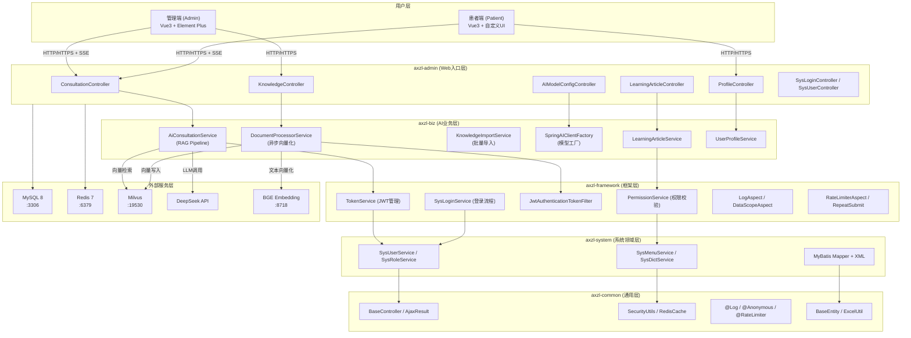

### 2.2 模块依赖关系

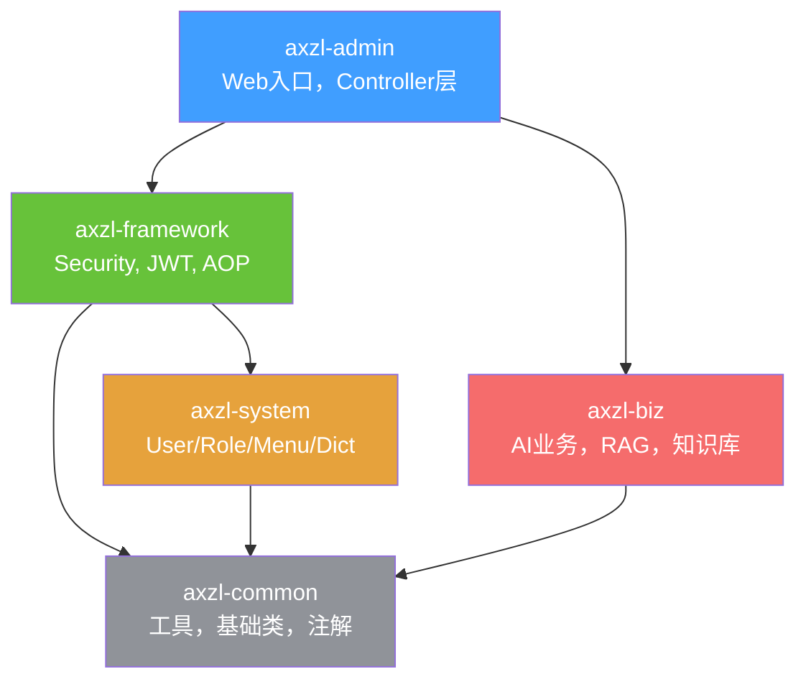

**各模块职责：**

| 模块 | 职责 | 关键包 |
|------|------|--------|
| axzl-admin | Web入口，Controller层，应用启动配置 | `com.axzl.web.controller` |
| axzl-biz | AI业务逻辑，RAG流程，知识库，健康档案 | `com.axzl.biz.service` |
| axzl-framework | Spring Security，JWT，AOP切面，核心服务 | `com.axzl.framework` |
| axzl-system | 系统管理领域（用户/角色/菜单/字典） | `com.axzl.system` |
| axzl-common | 通用工具，基础类，注解，枚举，Redis | `com.axzl.common` |

### 2.3 技术选型

| 层次 | 技术 | 版本 | 选型理由 |
|------|------|------|---------|
| 后端框架 | Spring Boot | 4.0.3 | Java生态最成熟的Web框架 |
| AI框架 | Spring AI | 2.0.0-M3 | Spring官方AI集成框架，统一API |
| ORM | MyBatis-Plus | 3.5.16 | 兼容MyBatis原生，提供便捷CRUD |
| 连接池 | Druid | 1.2.28 | 阿里巴巴开源，支持监控和SQL防火墙 |
| 缓存 | Redis (Lettuce) | 7.x | 高性能内存缓存，支持集群 |
| 向量库 | Milvus | 2.x | 开源向量数据库，支持多种索引 |
| 前端框架 | Vue 3 + Vite 6 | 3.x / 6.x | 响应式前端框架，快速构建工具 |
| UI组件库 | Element Plus | 2.x | Vue 3生态最成熟的UI库 |
| API文档 | Knife4j (Swagger) | 4.4.0 | 增强版Swagger UI |
| 容器化 | Docker Compose | - | 一键部署所有依赖服务 |

---

## 3 系统功能结构与建模

### 3.1 系统功能结构图

```mermaid
graph TB
    A["安心诊聊平台 AXZL"] --> B["智能问诊模块"]
    A --> C["知识库管理模块"]
    A --> D["健康知识学习模块"]
    A --> E["健康档案管理模块"]
    A --> F["AI模型配置模块"]
    A --> G["系统管理模块"]
    A --> H["系统监控模块"]
    A --> I["通用服务模块"]

    B --> B1["SSE流式对话"]
    B --> B2["同步AI问诊"]
    B --> B3["问诊历史管理"]
    B --> B4["会话管理"]
    B --> B5["满意度评价"]

    C --> C1["知识条目管理"]
    C --> C2["文档上传处理"]
    C --> C3["语义向量检索"]
    C --> C4["异步向量化"]
    C --> C5["文档重新处理"]

    D --> D1["文章分类管理"]
    D --> D2["文章发布管理"]
    D --> D3["AI摘要生成"]
    D --> D4["收藏与点赞"]
    D --> D5["阅读进度跟踪"]
    D --> D6["个性化推荐"]

    E --> E1["患者档案维护"]
    E --> E2["档案Excel导入导出"]
    E --> E3["我的健康档案"]

    F --> F1["模型CRUD"]
    F --> F2["默认模型切换"]
    F --> F3["多Provider支持"]

    G --> G1["用户管理"]
    G --> G2["角色管理"]
    G --> G3["菜单权限管理"]
    G --> G4["字典管理"]
    G --> G5["参数配置"]
    G --> G6["个人中心"]

    H --> H1["在线用户监控"]
    H --> H2["操作日志"]
    H --> H3["登录日志"]
    H --> H4["缓存监控"]
    H --> H5["服务器监控"]
    H --> H6["SQL监控"]

    I --> I1["验证码生成"]
    I --> I2["文件上传下载"]
```

### 3.2 系统用例图

#### 3.2.1 患者角色用例图

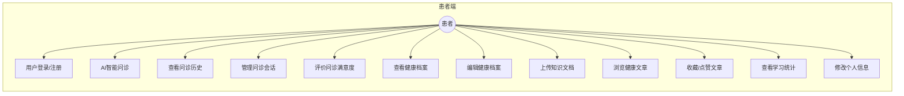

#### 3.2.2 管理员角色用例图

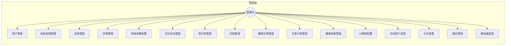

#### 3.2.3 系统交互用例总图

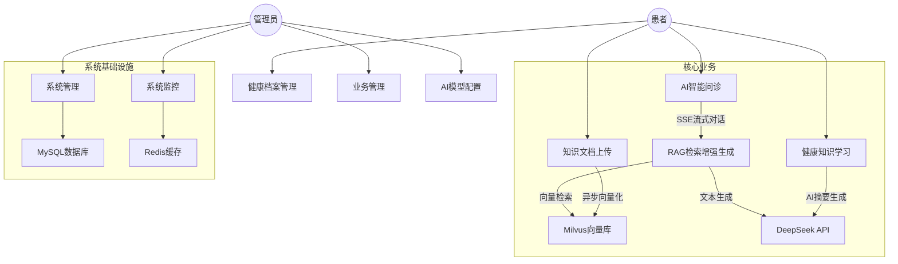

### 3.3 核心业务流程图

#### 3.3.1 用户登录认证流程

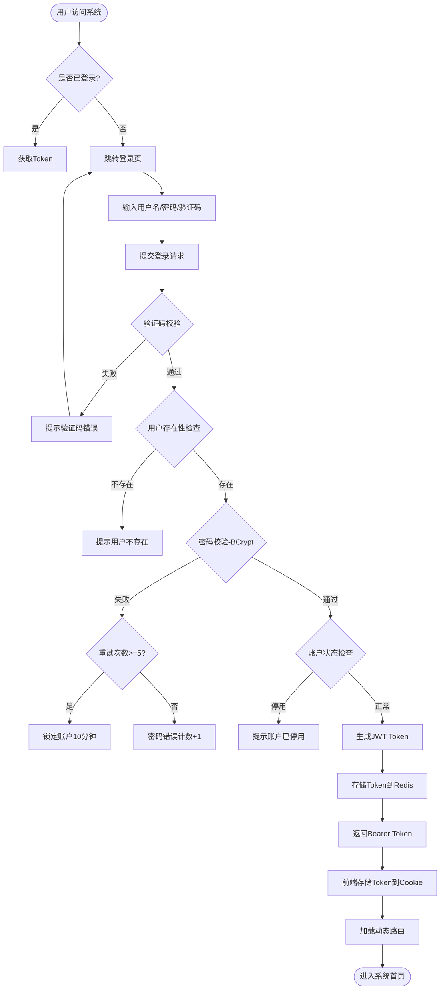

#### 3.3.2 AI智能问诊流程（RAG）

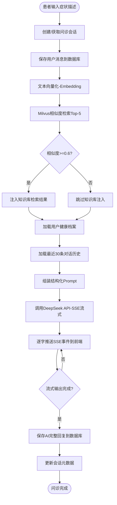

#### 3.3.3 文档上传与向量化流程

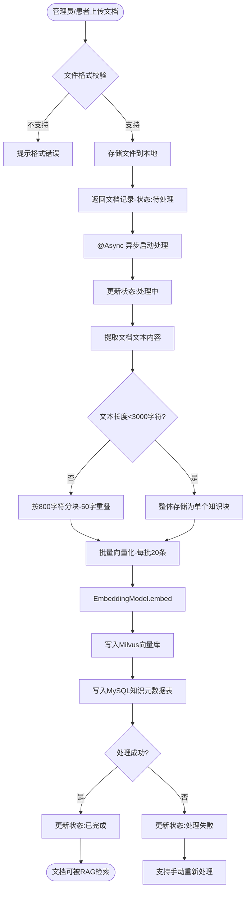

#### 3.3.4 健康知识学习流程

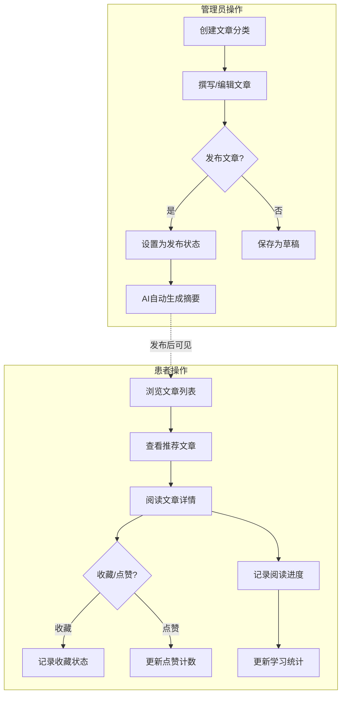

#### 3.3.5 权限控制流程

```mermaid
flowchart TD
    A([HTTP请求到达]) --> B[JwtAuthenticationTokenFilter]
    B --> C{是否匿名接口?}
    C -->|是| D[直接放行]
    C -->|否| E[提取Authorization Header]
    E --> F{Token是否存在?}
    F -->|否| G[返回401未认证]
    F -->|是| H[JWT验签+Redis查询]
    H --> I{Token有效?}
    I -->|否| J[返回401 Token过期/无效]
    I -->|是| K{剩余时间<20分钟?}
    K -->|是| L[自动刷新Token]
    K -->|否| M[设置SecurityContext]
    L --> M
    M --> N[进入Controller方法]
    N --> O{是否有@PreAuthorize?}
    O -->|是| P{权限校验通过?}
    P -->|否| Q[返回403无权限]
    P -->|是| R[执行业务逻辑]
    O -->|否| R
```

---

## 4 核心模块设计

### 4.1 RAG智能问诊流程设计

RAG（Retrieval-Augmented Generation）是本系统的核心技术架构，实现了基于知识库检索增强的AI问诊。

#### 4.1.1 流程时序图

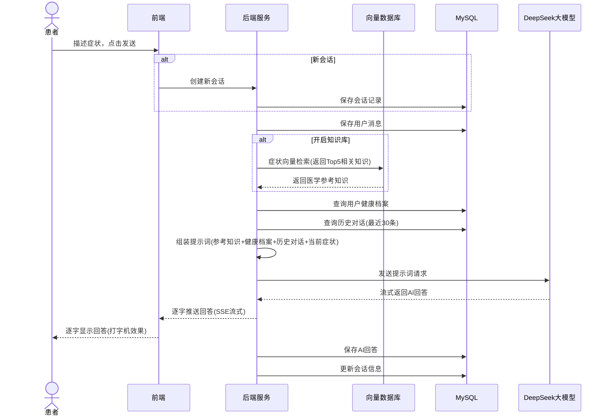

#### 4.1.2 Prompt组装策略

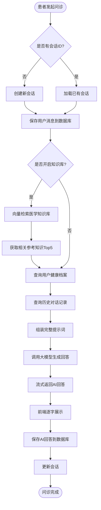


系统采用结构化Prompt模板，包含以下组成部分：

```
【系统角色设定】
你是一位专业的医疗健康顾问AI助手...

【知识库检索结果】（当useKnowledgeBase=true时注入）
以下是与患者问题相关的医学知识：
1. [知识标题]：[知识内容片段]（相似度：0.92）
2. ...

【用户健康档案】（当用户有健康档案时注入）
患者基本信息：性别[男/女]，年龄[X]岁，血型[X]
过敏史：[内容]
既往病史：[内容]
家族病史：[内容]
生活习惯：[内容]

【对话历史】（最近30条消息）
用户：...
AI：...
用户：...

【当前问题】
用户：[当前输入]

【回复要求】
请基于以上信息，给出专业、详细的健康建议...
```

#### 4.1.3 向量检索参数

| 参数 | 值 | 说明 |
|------|-----|------|
| Top-K | 5 | 返回最相似的5条知识 |
| 相似度阈值 | 0.6 | 余弦相似度低于0.6的结果不注入 |
| 向量维度 | 1024 | BGE-large-zh-v1.5输出维度 |
| 索引类型 | IVF_FLAT | Milvus索引类型 |
| 距离度量 | COSINE | 余弦相似度 |

### 4.2 文档处理流程设计

#### 4.2.1 处理流程

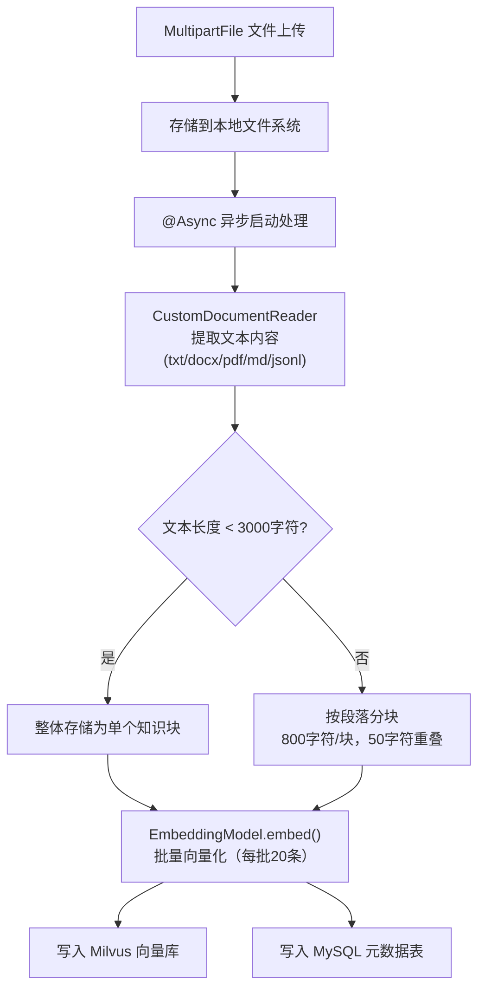

#### 4.2.2 分块策略

| 文档大小 | 策略 | 块大小 | 重叠 |
|---------|------|--------|------|
| < 3000字符 | 整体存储 | - | - |
| ≥ 3000字符 | 按段落分块 | 800字符 | 50字符 |

### 4.3 动态AI模型管理设计

#### 4.3.1 模型配置数据模型

```sql
biz_ai_model_config
├── provider (提供商标识: deepseek/openai/anthropic/localhost)
├── model_name (模型名称，唯一)
├── api_base_url (API基础URL)
├── api_key (VARBINARY加密存储)
├── model_type (text/embedding/image/audio)
├── temperature, max_tokens, top_p, top_k (模型参数)
├── frequency_penalty, presence_penalty (采样参数)
├── is_default (是否默认模型)
└── config_extra (JSON扩展配置)
```

#### 4.3.2 客户端工厂模式

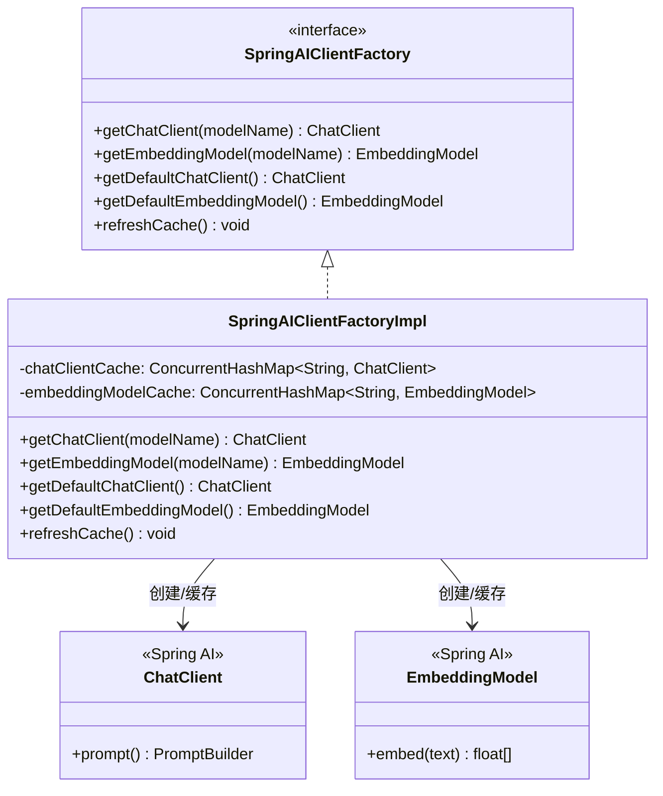

所有AI模型通过OpenAI兼容接口调用，统一使用`spring-ai-starter-model-openai`，不同Provider通过`api_base_url`区分：
- DeepSeek: `https://api.deepseek.com`
- OpenAI: `https://api.openai.com/v1`
- Anthropic: `https://api.anthropic.com/v1`（通过OpenAI兼容代理）
- 本地模型: `http://localhost:8718`

### 4.4 安全架构设计

#### 4.4.1 认证流程

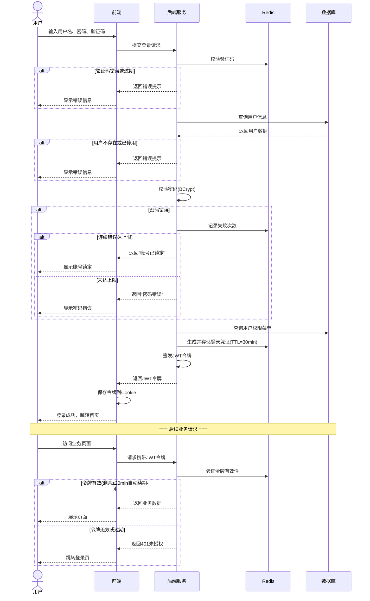


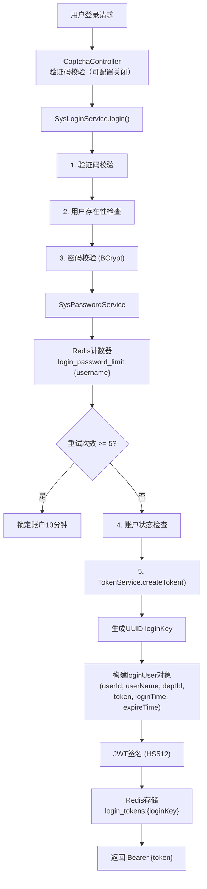

#### 4.4.2 请求过滤链

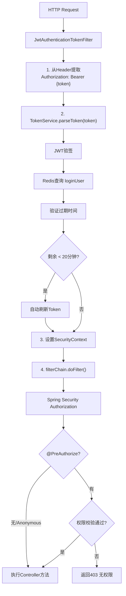

#### 4.4.3 权限模型

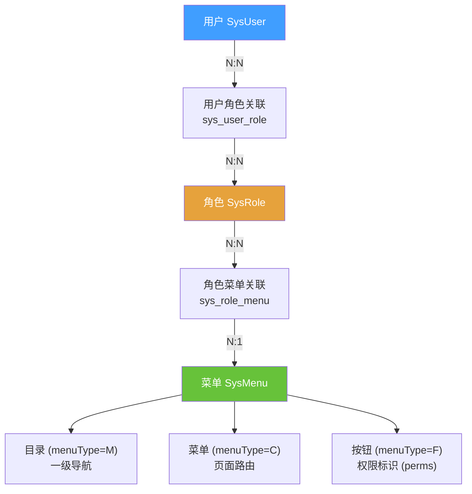

权限标识格式：`模块:子模块:操作`，例如：
- `system:user:list` — 用户查询
- `biz:consultation:chat` — 流式对话
- `biz:knowledge:add` — 知识新增

### 4.5 双布局架构设计

系统前端采用双布局架构，管理端和患者端使用不同的Layout组件：

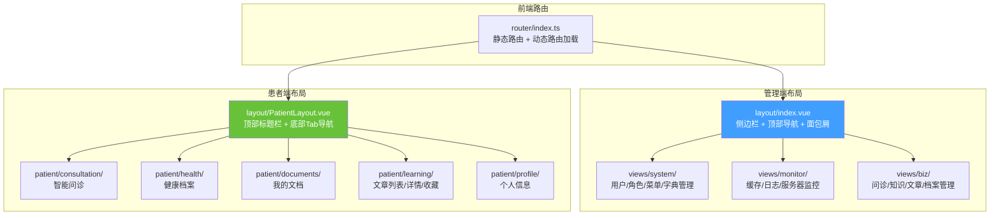

路由分为静态路由（constantRoutes）和动态路由（从后端`/getRouters`接口获取）：
- 静态路由：登录、注册、401、404、管理端首页、个人中心、患者端所有页面
- 动态路由：系统管理、系统监控、系统工具、业务管理（根据用户权限动态加载）

---

## 5 数据库设计

### 5.1 ER图（实体关系图）

```mermaid
erDiagram
    sys_user ||--o| biz_user_profile : "1:1 拥有"
    sys_user }|--|{ sys_user_role : "N:N"
    sys_user_role }|--|{ sys_role : "N:N"
    sys_role }|--|{ sys_role_menu : "N:N"
    sys_role_menu }|--|| sys_menu : "N:1"

    biz_chat_session ||--|{ biz_chat_message : "1:N"
    biz_chat_session }o--|| sys_user : "属于用户"

    biz_knowledge_meta }o--|| biz_document : "来源文档"
    biz_document }o--|| sys_user : "上传者"

    biz_learning_category ||--|{ biz_learning_article : "1:N"
    biz_learning_article }o--|{ biz_learning_user_article : "N:N 收藏/点赞"
    biz_learning_user_article }o--|| sys_user : "N:1"

    biz_ai_model_config {
        bigint id PK
        varchar provider
        varchar model_name UK
        varchar api_base_url
        varbinary api_key
        varchar model_type
        tinyint is_default
    }

    sys_user {
        bigint user_id PK
        varchar user_name UK
        varchar nick_name
        varchar password
        char status
    }

    sys_role {
        bigint role_id PK
        varchar role_name
        varchar role_key
        char status
    }

    sys_menu {
        bigint menu_id PK
        varchar menu_name
        bigint parent_id
        char menu_type
        varchar perms
    }

    biz_chat_session {
        varchar session_id PK
        bigint user_id FK
        varchar title
        int message_count
        char status
    }

    biz_chat_message {
        bigint message_id PK
        varchar session_id FK
        varchar role
        text content
    }

    biz_user_profile {
        bigint profile_id PK
        bigint user_id FK
        date birthday
        varchar blood_type
        text allergy_history
        text medical_history
    }

    biz_knowledge_meta {
        bigint id PK
        text question
        varchar label
        varchar vector_id
        char vector_status
    }

    biz_document {
        bigint id PK
        varchar file_name
        varchar file_type
        int chunk_count
        char vector_status
    }

    biz_learning_category {
        bigint category_id PK
        varchar category_name
    }

    biz_learning_article {
        bigint article_id PK
        bigint category_id FK
        varchar title
        char status
        int view_count
    }
```

### 5.2 数据库表设计

#### 5.2.1 系统基础表

**用户信息表 (sys_user)**

| 字段 | 类型 | 约束 | 说明 |
|------|------|------|------|
| user_id | BIGINT(20) | PK, AUTO_INCREMENT | 用户ID |
| user_name | VARCHAR(30) | NOT NULL, UNIQUE | 用户账号 |
| nick_name | VARCHAR(30) | NOT NULL | 用户昵称 |
| user_type | VARCHAR(2) | DEFAULT '00' | 用户类型 |
| email | VARCHAR(50) | DEFAULT '' | 邮箱 |
| phonenumber | VARCHAR(11) | DEFAULT '' | 手机号 |
| sex | CHAR(1) | DEFAULT '0' | 性别(0男1女2未知) |
| avatar | VARCHAR(100) | DEFAULT '' | 头像地址 |
| password | VARCHAR(100) | NOT NULL | BCrypt密码 |
| status | CHAR(1) | DEFAULT '0' | 状态(0正常1停用) |
| del_flag | CHAR(1) | DEFAULT '0' | 删除标志(0存在2删除) |
| login_ip | VARCHAR(128) | DEFAULT '' | 最后登录IP |
| login_date | DATETIME | | 最后登录时间 |
| pwd_update_date | DATETIME | | 密码更新时间 |
| create_by | VARCHAR(64) | DEFAULT '' | 创建者 |
| create_time | DATETIME | | 创建时间 |
| update_by | VARCHAR(64) | DEFAULT '' | 更新者 |
| update_time | DATETIME | | 更新时间 |
| remark | VARCHAR(500) | | 备注 |

**角色信息表 (sys_role)**

| 字段 | 类型 | 约束 | 说明 |
|------|------|------|------|
| role_id | BIGINT(20) | PK, AUTO_INCREMENT | 角色ID |
| role_name | VARCHAR(30) | NOT NULL | 角色名称 |
| role_key | VARCHAR(100) | NOT NULL | 角色标识 |
| role_sort | INT(4) | NOT NULL | 显示顺序 |
| data_scope | CHAR(1) | DEFAULT '2' | 数据范围 |
| menu_check_strictly | TINYINT(1) | DEFAULT 1 | 菜单树关联显示 |
| status | CHAR(1) | NOT NULL | 状态 |
| del_flag | CHAR(1) | DEFAULT '0' | 删除标志 |

**菜单权限表 (sys_menu)**

| 字段 | 类型 | 约束 | 说明 |
|------|------|------|------|
| menu_id | BIGINT(20) | PK, AUTO_INCREMENT | 菜单ID |
| menu_name | VARCHAR(50) | NOT NULL | 菜单名称 |
| parent_id | BIGINT(20) | DEFAULT 0 | 父菜单ID |
| order_num | INT(4) | DEFAULT 0 | 显示顺序 |
| path | VARCHAR(200) | DEFAULT '' | 路由地址 |
| component | VARCHAR(255) | | 组件路径 |
| menu_type | CHAR(1) | | 类型(M目录C菜单F按钮) |
| perms | VARCHAR(100) | | 权限标识 |
| icon | VARCHAR(100) | DEFAULT '#' | 菜单图标 |
| visible | CHAR(1) | DEFAULT 0 | 是否显示 |
| status | CHAR(1) | DEFAULT 0 | 状态 |

#### 5.2.2 业务数据表

**问诊会话表 (biz_chat_session)**

| 字段 | 类型 | 约束 | 说明 |
|------|------|------|------|
| session_id | VARCHAR(64) | PK | 会话UUID |
| user_id | BIGINT(20) | NOT NULL, INDEX | 用户ID |
| title | VARCHAR(200) | DEFAULT '' | 会话标题 |
| symptom_summary | TEXT | | 症状摘要 |
| ai_diagnosis | TEXT | | AI诊断摘要 |
| recommended_label | VARCHAR(50) | DEFAULT '' | 推荐科室 |
| message_count | INT(11) | DEFAULT 0 | 消息数量 |
| satisfaction | TINYINT(1) | | 满意度(1-5) |
| tokens_used | INT(11) | DEFAULT 0 | Token消耗 |
| last_message_time | DATETIME | | 最后消息时间 |
| status | CHAR(1) | DEFAULT '0' | 状态(0进行中1已结束) |
| is_pinned | TINYINT(1) | DEFAULT 0 | 是否置顶 |
| create_time | DATETIME | INDEX | 创建时间 |
| del_flag | CHAR(1) | DEFAULT '0' | 删除标志 |

**对话消息表 (biz_chat_message)**

| 字段 | 类型 | 约束 | 说明 |
|------|------|------|------|
| message_id | BIGINT(20) | PK, AUTO_INCREMENT | 消息ID |
| session_id | VARCHAR(64) | NOT NULL, INDEX | 会话ID |
| user_id | BIGINT(20) | NOT NULL | 用户ID |
| role | VARCHAR(20) | NOT NULL | 角色(user/assistant) |
| content | TEXT | NOT NULL | 消息内容 |
| retrieval_results | JSON | | 向量检索结果(Top5) |
| create_time | DATETIME | INDEX | 创建时间 |

**用户健康档案表 (biz_user_profile)**

| 字段 | 类型 | 约束 | 说明 |
|------|------|------|------|
| profile_id | BIGINT(20) | PK, AUTO_INCREMENT | 档案ID |
| user_id | BIGINT(20) | UNIQUE | 用户ID |
| birthday | DATE | | 出生日期 |
| gender | CHAR(1) | DEFAULT '0' | 性别 |
| blood_type | VARCHAR(10) | DEFAULT '' | 血型 |
| height | DECIMAL(5,1) | | 身高(cm) |
| weight | DECIMAL(5,1) | | 体重(kg) |
| allergy_history | TEXT | | 过敏史 |
| medical_history | TEXT | | 既往病史 |
| family_history | TEXT | | 家族病史 |
| lifestyle | TEXT | | 生活习惯 |

**知识库元数据表 (biz_knowledge_meta)**

| 字段 | 类型 | 约束 | 说明 |
|------|------|------|------|
| id | BIGINT(20) | PK, AUTO_INCREMENT | 知识ID |
| question | TEXT | NOT NULL | 问题/文本块内容 |
| answer | TEXT | | 答案/补充内容 |
| label | VARCHAR(50) | DEFAULT '', INDEX | 分类标签 |
| score | INT(11) | DEFAULT 0 | 评分 |
| related_diseases | VARCHAR(500) | DEFAULT '' | 关联疾病 |
| vector_id | VARCHAR(100) | DEFAULT '', INDEX | Milvus向量ID |
| vector_status | CHAR(1) | DEFAULT '0' | 向量状态 |
| source_type | VARCHAR(20) | DEFAULT 'qa', INDEX | 来源类型(qa/doc) |
| source_id | BIGINT(20) | | 来源文档ID |
| chunk_index | INT(11) | DEFAULT 0 | 分块序号 |

**上传文档表 (biz_document)**

| 字段 | 类型 | 约束 | 说明 |
|------|------|------|------|
| id | BIGINT(20) | PK, AUTO_INCREMENT | 文档ID |
| file_name | VARCHAR(200) | NOT NULL | 原始文件名 |
| file_type | VARCHAR(20) | NOT NULL | 文件类型 |
| file_size | BIGINT(20) | DEFAULT 0 | 文件大小(字节) |
| extracted_content | LONGTEXT | | 提取的文本内容 |
| chunk_count | INT(11) | DEFAULT 0 | 切分块数 |
| vector_status | CHAR(1) | DEFAULT '0', INDEX | 向量状态 |
| upload_by | BIGINT(20) | NOT NULL, INDEX | 上传用户ID |

**AI模型配置表 (biz_ai_model_config)**

| 字段 | 类型 | 约束 | 说明 |
|------|------|------|------|
| id | BIGINT | PK, AUTO_INCREMENT | 主键ID |
| provider | VARCHAR(50) | NOT NULL, INDEX | 提供商标识 |
| model_name | VARCHAR(150) | NOT NULL, UNIQUE | 模型名称 |
| api_base_url | VARCHAR(500) | NOT NULL | API基础URL |
| api_key | VARBINARY(2048) | NOT NULL | API密钥(加密) |
| model_type | VARCHAR(20) | NOT NULL, INDEX | 模型类型 |
| temperature | DECIMAL(3,2) | DEFAULT 0.1 | 温度参数 |
| max_tokens | INT | DEFAULT 4096 | 最大Token数 |
| top_p | DECIMAL(3,2) | DEFAULT 0.3 | Top-P参数 |
| is_default | TINYINT(1) | DEFAULT 0 | 是否默认 |
| config_extra | JSON | | 扩展配置 |

**健康知识文章表 (biz_learning_article)**

| 字段 | 类型 | 约束 | 说明 |
|------|------|------|------|
| article_id | BIGINT(20) | PK, AUTO_INCREMENT | 文章ID |
| category_id | BIGINT(20) | NOT NULL, INDEX | 分类ID |
| title | VARCHAR(200) | NOT NULL | 文章标题 |
| summary | VARCHAR(500) | DEFAULT '' | 文章摘要 |
| content | LONGTEXT | NOT NULL | 文章内容(富文本) |
| cover_image | VARCHAR(500) | DEFAULT '' | 封面图片 |
| author | VARCHAR(100) | DEFAULT '' | 作者 |
| tags | VARCHAR(500) | DEFAULT '' | 标签 |
| view_count | INT(11) | DEFAULT 0 | 阅读次数 |
| like_count | INT(11) | DEFAULT 0 | 点赞数 |
| ai_summary | TEXT | | AI生成摘要 |
| is_top | TINYINT(1) | DEFAULT 0 | 是否置顶 |
| is_featured | TINYINT(1) | DEFAULT 0 | 是否推荐 |
| status | CHAR(1) | DEFAULT '0', INDEX | 状态(0草稿1发布2下架) |
| publish_time | DATETIME | INDEX | 发布时间 |

### 5.3 索引设计

| 表名 | 索引名 | 字段 | 类型 | 用途 |
|------|--------|------|------|------|
| biz_chat_session | idx_user_id | user_id | 普通 | 按用户查询会话 |
| biz_chat_session | idx_create_time | create_time | 普通 | 按时间排序 |
| biz_chat_message | idx_session_id | session_id | 普通 | 按会话查询消息 |
| biz_chat_message | idx_create_time | create_time | 普通 | 按时间排序 |
| biz_knowledge_meta | idx_vector_id | vector_id | 普通 | 向量ID查询 |
| biz_knowledge_meta | idx_label | label | 普通 | 按分类筛选 |
| biz_knowledge_meta | idx_source_type | source_type | 普通 | 按来源筛选 |
| biz_document | idx_upload_by | upload_by | 普通 | 按用户查询文档 |
| biz_document | idx_vector_status | vector_status | 普通 | 按状态筛选 |
| biz_learning_article | idx_category_id | category_id | 普通 | 按分类筛选 |
| biz_learning_article | idx_publish_time | publish_time | 普通 | 按发布时间排序 |
| biz_learning_user_article | uk_user_article | user_id+article_id | 唯一 | 用户文章互动唯一 |
| biz_ai_model_config | uk_model_name | model_name | 唯一 | 模型名称唯一 |

---

## 6 接口设计

### 6.1 RESTful API规范

- **基础路径**：`/api`（开发环境通过Vite代理`/dev-api`）
- **认证方式**：`Authorization: Bearer {jwt_token}`
- **响应格式**：统一使用`AjaxResult`（HashMap子类）

```json
{
  "code": 200,
  "msg": "操作成功",
  "data": { ... }
}
```

- **分页响应**：使用`TableDataInfo`

```json
{
  "code": 200,
  "msg": "查询成功",
  "total": 100,
  "rows": [ ... ]
}
```

### 6.2 核心接口列表

#### 6.2.1 认证接口

| 方法 | 路径 | 说明 | 认证 |
|------|------|------|------|
| POST | /login | 用户登录 | 否 |
| POST | /register | 用户注册 | 否 |
| GET | /getInfo | 获取当前用户信息 | 是 |
| GET | /getRouters | 获取动态路由菜单 | 是 |
| GET | /captchaImage | 获取验证码 | 否 |

#### 6.2.2 智能问诊接口

| 方法 | 路径 | 说明 | 认证 |
|------|------|------|------|
| POST | /biz/consultation/stream | SSE流式问诊 | 是 |
| POST | /biz/consultation/chat | 同步问诊 | 是 |
| GET | /biz/consultation/history | 问诊历史 | 是 |
| GET | /biz/consultation/detail/{sessionId} | 会话详情 | 是 |
| PUT | /biz/consultation/satisfaction/{sessionId} | 满意度评价 | 是 |
| PUT | /biz/consultation/title/{sessionId} | 重命名会话 | 是 |
| PUT | /biz/consultation/pin/{sessionId} | 置顶会话 | 是 |
| DELETE | /biz/consultation/remove/{sessionId} | 删除会话 | 是 |

#### 6.2.3 知识库接口

| 方法 | 路径 | 说明 | 认证 |
|------|------|------|------|
| POST | /biz/knowledge/search | 语义搜索 | 是 |
| POST | /biz/knowledge/document/upload | 上传文档 | 是 |
| GET | /biz/knowledge/document/list | 文档列表 | 是 |
| POST | /biz/knowledge/document/reprocess/{id} | 重新处理 | 是 |

#### 6.2.4 健康知识学习接口

| 方法 | 路径 | 说明 | 认证 |
|------|------|------|------|
| GET | /biz/learning/article/list | 文章列表(患者) | 是 |
| GET | /biz/learning/article/{id} | 文章详情 | 是 |
| POST | /biz/learning/article/bookmark/{id} | 收藏/取消收藏 | 是 |
| POST | /biz/learning/article/like/{id} | 点赞/取消点赞 | 是 |
| PUT | /biz/learning/article/progress | 更新阅读进度 | 是 |
| GET | /biz/learning/article/bookmarks | 收藏列表 | 是 |
| GET | /biz/learning/article/recommended | 推荐文章 | 是 |

#### 6.2.5 健康档案接口

| 方法 | 路径 | 说明 | 认证 |
|------|------|------|------|
| GET | /biz/profile/my | 我的档案 | 是 |
| POST | /biz/profile/my | 更新我的档案 | 是 |
| POST | /biz/profile/export | 导出Excel | 是 |
| POST | /biz/profile/importData | 导入Excel | 是 |

---

## 7 关键技术实现

### 7.1 SSE流式对话实现

```java
// Controller层
@GetMapping("/stream")
public SseEmitter chatStream(ChatRequest request) {
    SseEmitter emitter = new SseEmitter(0L); // 无超时
    // 委托给Service层处理
    aiConsultationService.chatStream(request, emitter);
    return emitter;
}

// Service层核心逻辑
public void chatStream(ChatRequest request, SseEmitter emitter) {
    Flux<String> flux = chatClient.prompt()
        .user(promptContent)
        .stream()
        .content();

    // 后台订阅者：即使前端断开，也能保存数据
    StringBuilder fullResponse = new StringBuilder();
    flux.subscribe(
        chunk -> {
            try {
                emitter.send(chunk);  // 推送给前端
                fullResponse.append(chunk);
            } catch (IOException e) {
                // 前端断开，继续接收
            }
        },
        error -> emitter.completeWithError(error),
        () -> {
            // 完成后保存AI回复到数据库
            saveAssistantMessage(sessionId, userId, fullResponse.toString());
            emitter.complete();
        }
    );
}
```

### 7.2 异步文档处理实现

```java
@Async
public void processDocument(BizDocument document) {
    // 1. 更新状态为"处理中"
    document.setVectorStatus("1");
    documentMapper.updateById(document);

    try {
        // 2. 提取文本内容
        String content = customDocumentReader.read(filePath, fileType);

        // 3. 分块
        List<String> chunks = splitContent(content);

        // 4. 批量向量化
        for (int i = 0; i < chunks.size(); i += BATCH_SIZE) {
            List<String> batch = chunks.subList(i, Math.min(i + BATCH_SIZE, chunks.size()));
            List<float[]> embeddings = embeddingModel.embed(batch);

            // 5. 存入Milvus和MySQL
            for (int j = 0; j < batch.size(); j++) {
                saveToMilvus(embeddings.get(j), batch.get(j));
                saveKnowledgeMeta(batch.get(j), document.getId(), i + j);
            }
        }

        // 6. 更新状态为"已完成"
        document.setVectorStatus("2");
    } catch (Exception e) {
        document.setVectorStatus("3"); // 失败
    }
    documentMapper.updateById(document);
}
```

### 7.3 动态路由加载

```typescript
// 前端路由守卫
router.beforeEach(async (to, from, next) => {
    const userStore = useUserStore();
    const permissionStore = usePermissionStore();

    if (userStore.token) {
        if (!permissionStore.isRoutesLoaded) {
            // 从后端获取动态路由
            const res = await getRouters();
            const asyncRoutes = filterAsyncRoutes(res.data);
            // 动态添加路由
            asyncRoutes.forEach(route => router.addRoute(route));
            permissionStore.setRoutes(asyncRoutes);
            next({ ...to, replace: true });
        } else {
            next();
        }
    } else {
        // 白名单页面直接放行
        if (whiteList.includes(to.path)) next();
        else next('/login');
    }
});
```

---

## 8 部署架构

### 8.1 Docker Compose部署

```yaml
services:
  mysql:     # MySQL 8.0, port 3306
  redis:     # Redis 7, port 6379
  milvus:    # Milvus standalone, port 19530
  etcd:      # Milvus依赖
  minio:     # Milvus对象存储依赖
  attu:      # Milvus管理界面, port 8000
  bge-embedding: # BGE嵌入模型服务, port 8718
```

### 8.2 服务依赖关系

```mermaid
graph LR
    subgraph 外部API
        DeepSeek["DeepSeek API"]
    end

    subgraph Docker Compose
        MySQL["MySQL 8<br/>:3306"]
        Redis["Redis 7<br/>:6379"]
        Milvus["Milvus<br/>:19530"]
        Etcd["etcd"]
        MinIO["MinIO"]
        Attu["Attu<br/>:8000"]
        BGE["BGE Embedding<br/>:8718"]
    end

    subgraph 应用服务
        Admin["axzl-admin<br/>:8080"]
    end

    Admin -->|"JDBC"| MySQL
    Admin -->|"Lettuce"| Redis
    Admin -->|"gRPC"| Milvus
    Admin -->|"HTTP"| BGE
    Admin -->|"HTTPS"| DeepSeek
    Milvus --> Etcd
    Milvus --> MinIO
    Attu -->|"管理"| Milvus

    style Admin fill:#409EFF,color:#fff
    style DeepSeek fill:#F56C6C,color:#fff
    style Milvus fill:#67C23A,color:#fff
```

---

*文档版本：v1.0*
*编写日期：2026年5月*
*编写人：项目开发团队*