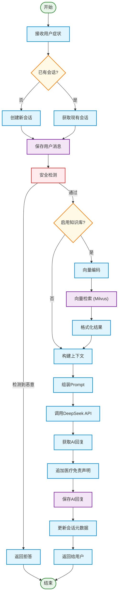

# RAG 核心流程总图

## 概述

安心诊聊平台（AXZL）基于 Spring AI 框架实现 RAG（Retrieval-Augmented Generation）检索增强生成流程。核心思路是：将用户输入的医学问题通过向量检索获取相关知识，结合用户健康档案和历史对话，组装成增强 Prompt 发送给大语言模型，最终返回带有医学知识支撑的回复。

## 总体流程图



**流程图说明：**
- **圆角矩形**：处理步骤（蓝色）
- **菱形**：判断决策（橙色）
- **圆形**：开始/结束（绿色）
- **圆柱形**：数据存储（紫色）
- **红色边框**：安全相关操作
- **虚线箭头**：离线数据依赖关系

## 各阶段详细说明

### 阶段1：用户输入

- 用户通过前端聊天界面输入症状描述或医学问题
- 可选择是否启用知识库增强（`useKnowledgeBase` 参数，默认 `true`）
- 入口：`AiConsultationServiceImpl.chat()` / `chatStream()`

### 阶段2：会话管理

- 首次对话自动创建 `ChatSession`（UUID 作为 `session_id`）
- 已有会话则复用，保证上下文连续性
- 用户消息以 `role=user` 保存到 `biz_chat_message` 表

### 阶段3：文档分块（离线预处理）
```mermaid

```
- **触发时机**：管理员/医疗专家上传医学文档时
- **分块策略**：
  - 文档长度 ≤ 3000 字符：整体编码，不分块
  - 文档长度 > 3000 字符：按段落边界拆分，块大小 800 字符，重叠 50 字符
- **向量化**：`VectorStore.add()` 内部自动调用 `EmbeddingModel.embed()` 生成 1024 维向量
- **存储**：写入 Milvus 集合 `vector_store`，同时在 `biz_knowledge_meta` 记录元数据

### 阶段4：向量检索（在线）

- **编码**：将用户消息通过 BGE-large-zh-v1.5 模型编码为 1024 维向量
- **检索**：Milvus IVF_FLAT 索引上执行 COSINE 相似度搜索
- **参数**：`TopK=5`（返回最相似的 5 个文档块），`similarityThreshold=0.6`
- **降级**：检索失败时返回空列表，不影响后续流程

### 阶段5：上下文构建

- 格式化检索结果为编号列表
- 加载用户健康档案（性别、血型、过敏史、既往病史等）
- 获取最近 30 条历史消息维持对话连贯性
- 保留原始用户消息作为当前症状描述

### 阶段6：Prompt 组装

系统提示词（`defaultSystem`）定义 AI 的角色、能力和工作原则，从 `prompts/axzl-question-system.st` 模板加载。用户消息部分按以下顺序组装：

```
[紧急预警前缀]        ← 仅当检测到紧急关键词时
[参考知识]            ← Top-5 向量检索结果（如启用知识库）
[用户健康档案]        ← 性别/血型/过敏史/病史
[历史对话]            ← 最近30条消息
[当前症状描述]        ← 用户原始输入
[回答要求]            ← 格式规范 + 安全约束
[最终指令]            ← 基于参考知识 / 医学知识回答
```

### 阶段7：AI 生成

- **调用方式**：Spring AI `ChatClient.prompt().user(prompt).call().content()`（非流式）或 `.stream().content()`（SSE 流式）
- **实际模型**：通过 `SpringAIClientFactoryImpl` 从数据库 `biz_ai_model_config` 动态加载配置
- **默认模型**：DeepSeek `deepseek-v4-flash`，Temperature=0.3，MaxTokens=4096
- **API 端点**：`https://api.deepseek.com/v1/chat/completions`（OpenAI 兼容接口）

### 阶段8：后处理 & 保存

- 所有 AI 回复末尾自动追加医疗免责声明
- AI 回复以 `role=assistant` 保存到 `biz_chat_message`，含 `retrieval_results` JSON
- 更新 `ChatSession` 的 `messageCount`、`tokensUsed`、`symptomSummary`、`recommendedLabel`

### 安全检测层（贯穿全流程）

| 检测类型 | 触发时机 | 处理方式 |
|---------|---------|---------|
| 越狱/恶意提问检测 | 用户消息提交后 | 返回拒答消息，不调用 AI |
| 紧急关键词检测 | Prompt 构建前 | 在用户 prompt 前注入紧急预警前缀 |
| 医疗免责声明 | AI 回复生成后 | 自动追加到所有回复末尾 |

## 关键配置

| 配置项 | 值 | 说明 |
|-------|-----|------|
| 分块大小 | 800 字符 | `DocumentProcessorServiceImpl.CHUNK_SIZE` |
| 块重叠 | 50 字符 | `DocumentProcessorServiceImpl.CHUNK_OVERLAP` |
| 检索 TopK | 5 | `performVectorSearch().topK` |
| 相似度阈值 | 0.6 | `performVectorSearch().similarityThreshold` |
| 历史消息数 | 30 条 | `selectRecentMessages(sessionId, 30)` |
| 嵌入模型 | bge-large-zh-v1.5 | 本地部署 localhost:8718 |
| 嵌入维度 | 1024 | `application.yml` |
| Milvus 索引 | IVF_FLAT | `application.yml` |
| 相似度度量 | COSINE | `application.yml` |
| 默认对话模型 | deepseek-v4-flash | 数据库 `biz_ai_model_config` |
| 默认温度 | 0.3 | 数据库 `biz_ai_model_config` |
| 默认最大 Token | 4096 | 数据库 `biz_ai_model_config` |

## 关键类与职责

| 类 | 职责 |
|---|------|
| `AiConsultationServiceImpl` | RAG 流程总编排：检索 → Prompt 构建 → AI 调用 → 保存 |
| `DocumentProcessorServiceImpl` | 文档分块、向量化、存储到 Milvus |
| `KnowledgeImportServiceImpl` | 医学知识条目导入到向量库 |
| `SpringAIClientFactoryImpl` | 动态创建 ChatClient / EmbeddingModel（从数据库配置） |
| `PromptTemplateLoader` | 加载系统提示词模板、紧急关键词检测、免责声明 |
| `AIChatConfig` | ChatClient Bean 配置（注入系统提示词） |
| `VectorStoreConfigListener` | 动态切换 EmbeddingModel 的 VectorStore 反射配置 |
| `CustomDocumentReader` | 多格式文档解析器（txt/word/pdf/md） |
