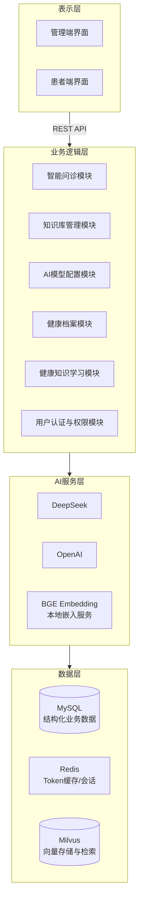
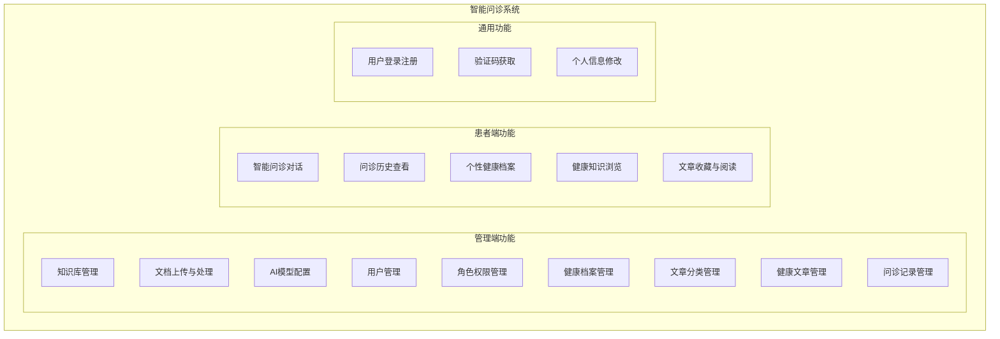
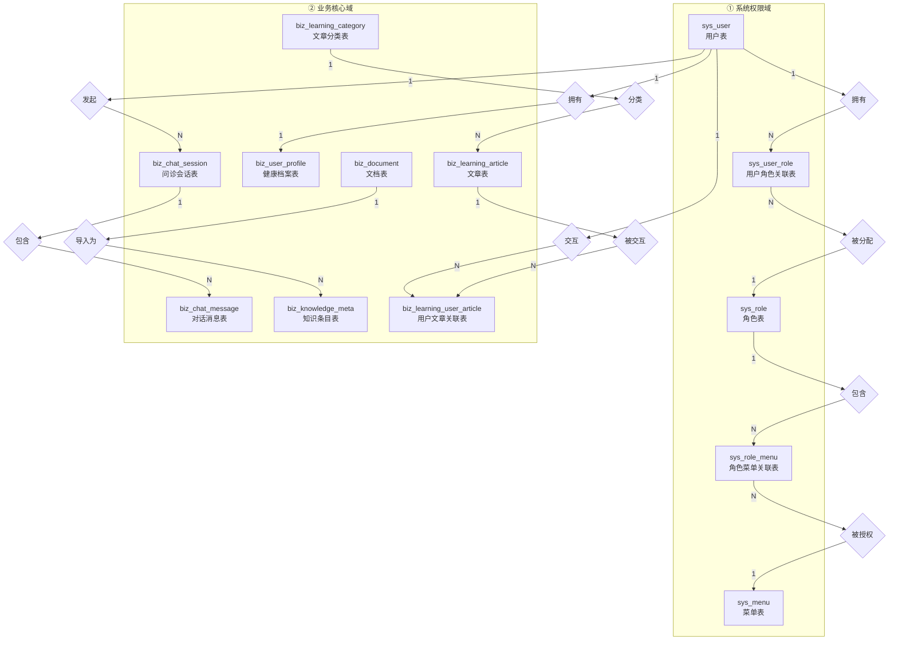
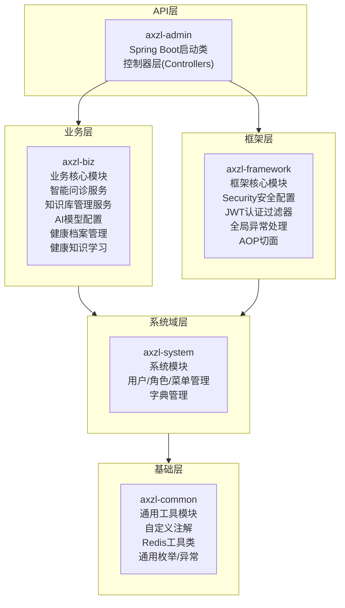
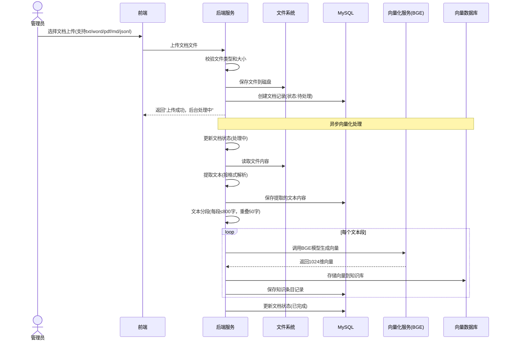
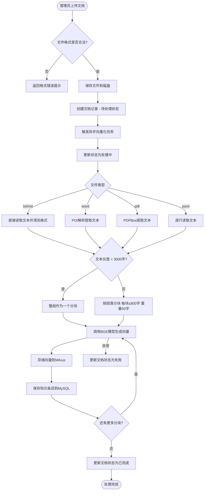
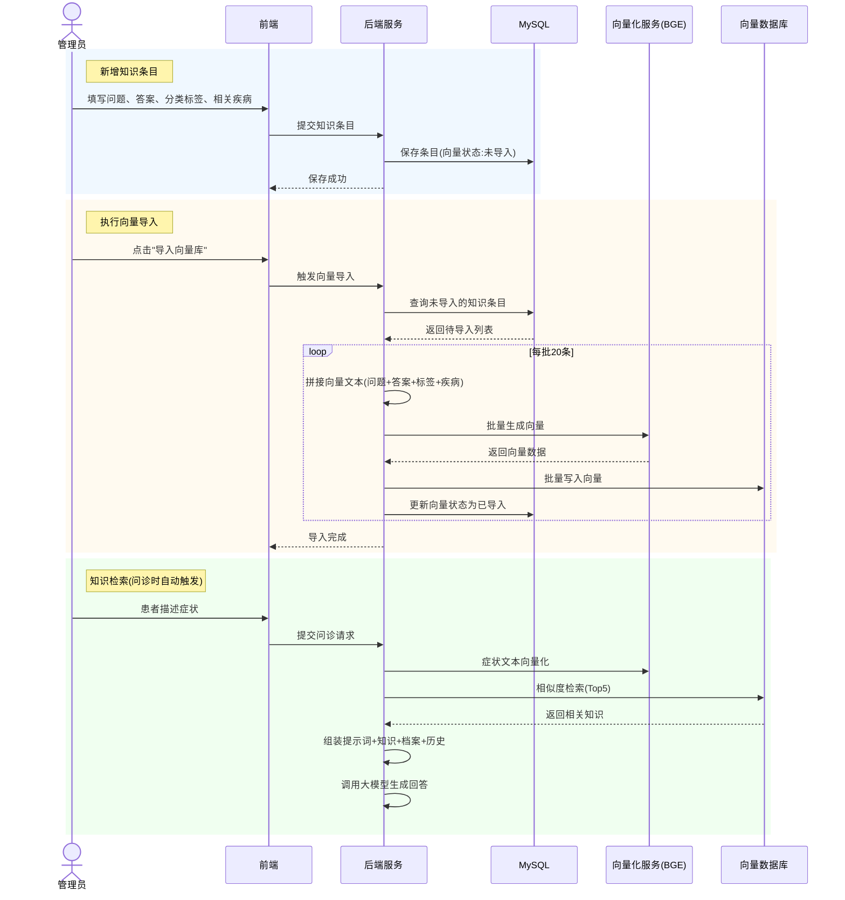
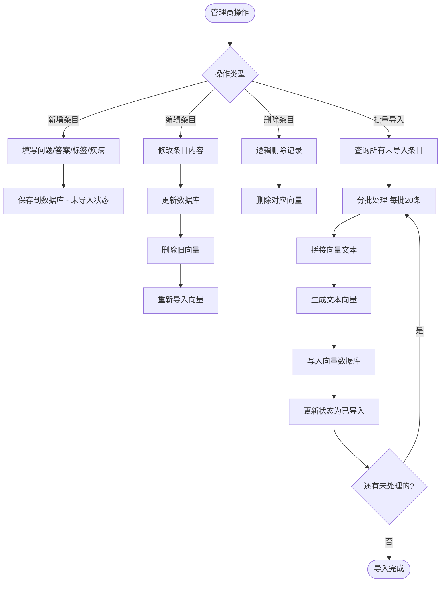
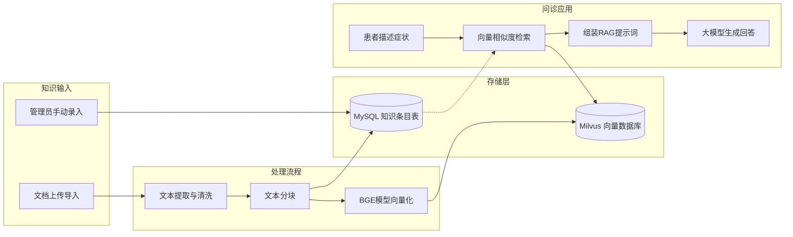
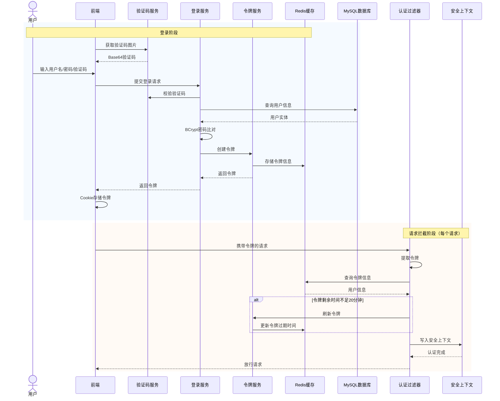

# 基于Spring AI与向量数据库的智能问诊系统设计与实现

## 摘  要

医疗资源分布不均衡一直是困扰基层医疗的难题——优质医生集中在大城市三甲医院，偏远地区的居民往往得不到及时的专业指导。智能问诊系统在这个问题上提供了一条技术路径：借助大语言模型的自然语言理解能力，结合经过审核的医疗知识库，为患者提供初步的症状评估和健康咨询。

本文的工作是搭建一个完整的智能问诊系统原型。技术上，后端选用Java 21与Spring Boot 4.0.3，通过Spring AI 2.0.0-M3框架统一对接DeepSeek、OpenAI等多种大语言模型，实现运行时的模型切换；前端用Vue 3与TypeScript开发，Element Plus负责UI组件。数据存储方面，MySQL 8.0存放结构化业务数据，Milvus向量数据库存放医疗知识的嵌入向量。文本向量化采用BGE-large-zh-v1.5模型，输出1024维向量；检索时使用IVF_FLAT索引配合余弦相似度，在精度和速度之间取得平衡。

系统的功能覆盖了智能问诊对话、知识库管理、AI模型动态配置、健康档案管理、健康知识学习和用户认证授权六个模块。问诊模块通过检索增强生成（RAG）技术，将向量检索结果、用户健康档案和历史对话整合进提示词，由大语言模型生成回答；流式响应采用服务器发送事件（SSE）实现，用户可以像看"打字机"一样逐字看到AI的回复。经测试验证，各模块功能完整，核心接口的平均响应时间控制在200毫秒以内，向量检索在5万条数据规模下平均耗时125毫秒。

**关键词**：智能问诊；Spring AI；向量数据库；检索增强生成；大语言模型；Milvus

## Abstract

Uneven distribution of medical resources has long plagued primary healthcare — top-tier physicians are concentrated in urban tertiary hospitals, while residents in remote areas often lack timely professional guidance. Intelligent consultation systems offer a technical pathway to this problem: leveraging the natural language understanding capabilities of large language models, combined with vetted medical knowledge bases, to provide patients with preliminary symptom assessment and health advice.

This thesis presents the design and implementation of a complete intelligent consultation system prototype. The back-end is built on Java 21 and Spring Boot 4.0.3, with Spring AI 2.0.0-M3 serving as the unified abstraction layer for multiple large language models including DeepSeek and OpenAI, enabling runtime model switching. The front-end is developed with Vue 3 and TypeScript, using Element Plus for UI components. MySQL 8.0 stores structured business data, while the Milvus vector database stores medical knowledge embedding vectors. Text vectorization is performed by the BGE-large-zh-v1.5 model, producing 1024-dimensional vectors; retrieval uses an IVF_FLAT index with cosine similarity, balancing precision and speed.

The system implements six core modules: intelligent consultation dialogue, knowledge base management, AI model dynamic configuration, health profile management, health knowledge learning, and user authentication with authorization. The consultation module employs Retrieval-Augmented Generation (RAG) to integrate vector retrieval results, user health profiles, and conversation history into prompts, from which the large language model generates responses. Streaming responses are delivered via Server-Sent Events (SSE), allowing users to see AI replies appear character by character. Testing confirms that all modules function correctly: core API endpoints average under 200ms response time, and vector retrieval at 50,000 entries averages 125ms.

**Keywords**: Intelligent consultation; Spring AI; Vector database; Retrieval-Augmented Generation; Large language model; Milvus

---


# 第1章 绪论

## 1.1 选题背景

大语言模型（LLM）在最近几年的突破，让很多行业开始重新审视自身的技术路线，医疗健康领域也不例外。一个现实的矛盾是：我国每千人口执业医师数仅为3.04人[1]，优质医疗资源高度集中在大城市，基层医疗机构的服务能力与群众需求之间存在明显差距。在医生数量短期内难以大幅增加的情况下，用技术手段弥补服务缺口成为一个值得尝试的方向——智能问诊系统就是其中一种方案：患者用自然语言描述症状，系统给出初步的咨询建议和分诊指引。

技术上看，早期的医疗问答系统依赖关键词匹配，无法理解"我嗓子痒，老想咳嗽"和"咽部不适伴干咳"其实说的是同一件事。Transformer架构和预训练语言模型的出现改变了这一局面，以GPT系列为代表的大语言模型展现出较强的自然语言理解和生成能力。不过，通用大语言模型在医疗场景中面临两个棘手的问题：一是"幻觉"——模型可能生成看起来合理但实际错误的医疗建议；二是训练数据中专业医学知识的覆盖度和时效性有限。检索增强生成（RAG）技术[2]的思路是在模型生成回答之前，先从外部知识库中检索相关文档片段，将检索结果作为上下文注入生成过程，从而约束模型的输出范围，让它"有据可依"而非"自由发挥"。

在RAG的技术栈中，向量数据库扮演着存储和检索的角色。传统关系型数据库擅长结构化数据的精确查询，但面对"用户描述了一段症状，要找到语义上最接近的医学知识"这类需求时，就力不从心了。向量数据库专为高维向量的相似性检索而设计，能够将文本转化为稠密向量，通过近似最近邻搜索算法实现毫秒级的语义匹配。Milvus作为开源向量数据库，凭借其高性能和丰富的索引类型，在医疗知识检索、推荐系统等场景中得到了较多应用[3]。

Spring Boot在企业级Java开发中的地位已无需赘述[4]。Spring AI作为Spring生态向AI领域的延伸，提供了一套标准化抽象层，使得Java开发者能够在熟悉的框架内集成大语言模型、嵌入模型和向量数据库，不必从零对接各家API。对于大量基于Java技术栈的企业来说，这意味着构建AI应用的门槛降低了不少。

本课题要做的事情，是将Spring AI框架、Milvus向量数据库和大语言模型组合起来，构建一个面向患者的智能问诊系统，探索这套技术方案在医疗垂直领域的可行性。

## 1.2 国内外研究现状

### 1.2.1 国外研究现状

国外在智能问诊方向的研究起步较早，积累也更深。这里从三个维度来梳理：模型能力、知识检索和产品落地。

模型层面，OpenAI团队的GPT系列是绕不开的。Brown等人（2020）在GPT-3论文中展示了大语言模型在少样本学习场景下的表现[5]，为后续在医疗领域的探索奠定了基础。Singhal等人（2023）进一步推出了Med-PaLM模型，通过在专业医学数据上进行指令微调，在美国医师资格考试（USMLE）中取得了超过及格线的成绩[6]，证明了大语言模型处理医学问题的可行性。Radford等人提出的基于人类反馈的强化学习（RLHF）训练方法[7]，则从另一个角度提升了模型在专业领域的回答准确性。

知识检索方面，向量数据库技术已相当成熟。Johnson等人（2021）通过实验验证了向量数据库在医疗文献检索中相比传统关键词检索的优势[8]。Facebook AI团队开源的FAISS库为大规模向量检索提供了高效的近似最近邻搜索算法[9]。Pinecone公司的云原生向量数据库则在商业场景中得到了广泛应用。

产品层面，国外已有多款智能问诊产品投入市场。WebMD的Symptom Checker整合了医学知识库与症状推理引擎，服务用户数亿人次[10]。Mayo Clinic开发的AI问诊工具结合了临床决策支持系统。Babylon Health的应用则利用自然语言处理技术实现了初步分诊，已在英国NHS中推广。不过，这些产品在罕见病诊断和区域医疗特色适配方面仍有不足。

### 1.2.2 国内研究现状

国内智能问诊领域的研究在近两年发展较快，呈现出"技术自主化、场景本土化"的特点。

模型层面，百度的文心一言通过接入百度健康的医疗知识库，实现了智能问诊、药物咨询等功能[11]。阿里达摩院的通义千问医疗版针对中医、慢性病管理等本土场景进行了优化[12]。高校方面，刘洋等人（2021）设计了基于知识图谱的慢性病智能问诊系统，实现了症状跟踪和用药提醒等功能[13]。

向量数据库领域，Zilliz公司推出的Milvus已成为国内AI基础设施的重要组成部分。李华等人（2023）研究了Milvus在医疗知识图谱检索中的应用，在某三甲医院的试点项目中实现了症状匹配响应时间小于500毫秒[14]。王强等人（2022）提出了基于云原生向量数据库的智能问诊系统架构[15]。阿里云、腾讯云等厂商也相继推出了各自的向量数据库产品。

系统设计方面，国内更注重适配基层医疗与公共卫生需求。微医集团的"微医AI问诊"系统整合了全国基层医院的医疗资源，已覆盖两千多个县区[16]。张明等人（2021）提出了基于Spring Boot的医疗AI系统快速开发框架[17]。陈静等人（2023）对智能问诊系统的现状进行了全面综述，指出当前研究仍存在过度依赖通用AI模型、缺乏私有知识库支撑等问题[18]。

综合来看，当前智能问诊系统面临的挑战主要集中在三个方面：模型幻觉导致医疗建议不可靠、通用模型缺乏专科深度、系统架构复杂难以维护。本课题提出的Spring AI + 向量数据库方案，通过RAG技术将私有医疗知识库与大语言模型结合，为这些问题提供了一个工程层面的解决思路。

## 1.3 课题的研究内容及所采取的方法

### 1.3.1 课题的研究内容

本课题的工作围绕六个方面展开：

**医疗数据处理与向量知识库构建**。收集公开的医疗问答数据集和科普文献，开发数据清洗管道去除格式噪声和敏感信息。文本分块采用基于语义的动态策略——按段落边界分割，块大小800字符，重叠窗口50字符。BGE-large-zh-v1.5模型负责将文本块编码为1024维向量，存入Milvus。

**后端服务架构设计**。项目采用Maven多模块架构，Java 21 + Spring Boot 4.0.3。Spring AI的ChatClient和VectorStore接口封装了底层大语言模型和向量数据库的差异，上层业务代码不直接接触各家API。RESTful API覆盖智能问诊、知识库管理、AI模型配置、健康档案和健康知识学习等模块。

**向量数据库部署与索引优化**。Milvus 2.6.8使用IVF_FLAT索引和余弦相似度度量。向量的元数据存储在MySQL中，与Milvus的向量ID关联，实现检索结果的完整追溯。相似度阈值设为0.6，过滤低相关性结果。

**RAG全链路实现**。从用户输入症状到AI回复的完整闭环：用户输入向量化 → Milvus语义检索Top-K → 获取用户健康档案 → 加载历史对话 → 构建提示词 → 大语言模型生成回复。流式响应采用SSE机制，实现打字机效果。

**前端界面开发**。Vue 3 + TypeScript + Element Plus，管理端和患者端双端。SSE流式对话、Markdown渲染、多轮对话历史管理、响应式布局。

**用户认证与权限管理**。Spring Security + JWT实现无状态认证。五种角色（超级管理员、医疗专家、普通医生、护士助理、患者），权限控制细化到按钮级别。

### 1.3.2 研究所采取的方法

**文献研究法**。通过CNKI、万方、IEEE Xplore、Springer等数据库，系统梳理RAG技术、向量数据库、智能问诊系统和Spring AI框架的研究文献，明确技术发展脉络和关键挑战。

**对比分析法**。技术选型阶段，对DeepSeek、OpenAI、Anthropic等多种大语言模型进行对比，对Milvus、Pinecone、PGVector等向量数据库进行评估，综合考量准确性、响应速度、成本和部署便利性。

**模块化设计方法**。前后端分离，后端按职责划分为Web入口层、业务逻辑层、数据访问层和AI服务层，各层通过标准化接口通信。

**迭代开发方法**。每个核心功能模块经过独立开发、单元测试和集成联调后，再进行系统整体验证。

**实验评估方法**。设计标准化测试问题集，从准确性、相关性和完整性三个维度评估系统，对比有无向量检索两种模式下的回答质量。

## 1.4 本课题的预期目标

**软件系统层面**，交付一个功能完整的智能问诊系统原型，包含：基于RAG的智能问诊对话引擎（支持流式输出和多轮上下文感知对话）；基于Milvus的医疗知识库与语义检索系统（支持多格式文档上传与自动向量化）；动态AI模型配置管理后台；用户健康档案管理系统（支持Excel导入导出）；健康知识学习模块（支持文章发布和AI自动摘要）；基于JWT和RBAC的用户认证与权限管理系统。

**技术文档层面**，完成符合学校规范的毕业论文一篇，以及开题报告、文献综述、外文翻译等过程文档。

**学术层面**，验证Spring AI框架在企业级Java应用中集成AI能力的可行性，探索RAG技术在医疗垂直领域的应用方法。

## 1.5 本文的组织结构

全文共七章。

第1章阐述选题背景和研究意义，梳理国内外研究现状，明确研究内容和方法。

第2章介绍核心技术理论，包括RAG技术原理、Spring AI框架、Milvus向量数据库、大语言模型与嵌入模型，以及Vue 3前端框架。

第3章进行需求分析，从技术、经济和操作三个维度论证可行性，明确六大功能模块的具体要求。

第4章给出系统设计，包括总体架构、功能模块结构、RAG核心流程和数据库设计。

第5章介绍系统实现，以六个核心功能模块为主线，展示关键代码和页面效果。

第6章进行系统测试，覆盖功能测试、接口测试、安全测试、性能测试和兼容性测试。

第7章总结全文，分析不足并展望未来改进方向。

---

# 第2章 相关理论基础及技术选型

## 2.1 检索增强生成（RAG）技术

RAG（Retrieval-Augmented Generation）由Lewis等人于2020年系统提出[19]，思路并不复杂：大语言模型生成回答之前，先从外部知识库中检索相关文档片段，把检索结果塞进提示词里，让模型"看着资料回答"。

具体来说，RAG的工作分两步。检索阶段，用户的自然语言查询先通过嵌入模型转为稠密向量，然后在向量数据库中做相似性搜索，找出最接近的Top-K个文档片段。生成阶段，把这些片段和用户原始查询按模板拼成完整的提示词，交给大语言模型生成回答。这样做有一个明显的好处：模型的回答不再完全依赖预训练时学到的通用知识，而是有了具体的参考依据——在医疗场景中，这意味着回答可以引用具体的医学文献，而不是凭空编造。

医疗问诊对准确性要求很高，通用大语言模型在这方面存在固有局限。通过RAG将经过审核的医疗文献、诊疗指南和药品信息注入生成过程，系统能够在回答中引用可追溯的知识来源。另外，RAG架构的知识库独立于模型参数，支持增量更新——医学知识在不断演进，知识库也需要随之更新。

本系统的RAG方案在标准流程基础上做了几处调整。第一，除了检索向量知识库，还把用户的个人健康档案（过敏史、既往病史等）融入上下文，让问诊建议更个性化。第二，多轮对话中加载最近30条历史消息，保持上下文连贯性。第三，当检索结果与问题的相关性不足（相似度低于0.6）时，系统会告知用户知识库覆盖范围的限制，而不是强行生成不可靠的回答。

## 2.2 Spring AI框架

Spring AI是Spring生态面向AI应用推出的开源框架，2024年发布首个里程碑版本[21]。它的设计思路和Spring Data类似——Spring Data为不同数据存储提供了统一的Repository抽象，Spring AI则为不同的大语言模型、嵌入模型和向量数据库提供了标准化的Java接口。

Spring AI的核心组件可以分三层来看。第一层是模型抽象层，统一的对话客户端接口封装了与不同大语言模型（GPT系列、DeepSeek、Claude等）的交互逻辑，嵌入模型接口封装了文本向量化服务。第二层是向量存储抽象层，提供统一的向量存储和检索接口，支持Milvus、Pinecone、PGVector等多种后端的透明切换[22]。第三层是高级功能层，包括提示词增强、RAG自动编排和数据导入集成。

在本系统中，Spring AI的价值体现在几个方面。统一的对话客户端接口使得系统可以在多种大语言模型之间灵活切换——本系统自研了客户端工厂，实现了模型配置的数据库化管理和运行时的动态创建，切换默认模型不需要重启应用。向量存储接口简化了Milvus的复杂操作，开发者只需调用相似性搜索等高层方法。此外，Spring AI与Spring Boot的自动配置无缝集成，AI功能的开发可以利用Spring成熟的依赖注入、事务管理和安全框架。

本课题使用Spring AI 2.0.0-M3版本。需要说明的是，该版本尚处于里程碑阶段，部分高级特性（如向量存储的嵌入模型动态切换）仍需通过反射等机制实现，本系统在配置监听器中对此进行了适配。

## 2.3 向量数据库技术

向量数据库和传统关系型数据库的设计目标完全不同[23]。关系型数据库擅长精确匹配和结构化查询，向量数据库则专为高维向量的相似性检索而设计。在自然语言处理场景中，文本通过嵌入模型被映射为固定维度（如1024维）的浮点数向量，语义上相近的文本在向量空间中彼此距离较近。向量数据库的任务就是在海量向量集合中，快速找出与查询向量最相似的Top-K个结果。

Milvus由Zilliz公司主导开发，2019年在Linux基金会旗下LF AI & Data基金会开源[24]。它采用了计算与存储分离的云原生架构：存储层负责数据持久化和索引存储，计算层负责向量检索和索引构建，协调层负责元数据管理和任务调度。这种分层架构支持各组件的独立扩展，能够应对从百万级到百亿级向量的不同规模。

索引方面，Milvus支持IVF_FLAT、IVF_SQ8、IVF_PQ、HNSW、ANNOY等多种类型，每种在精度、速度和内存占用之间提供不同的权衡。本系统选用IVF_FLAT。这个索引的思路是：构建阶段通过K-means聚类将向量空间划分为若干区域，检索阶段先定位与查询向量最相似的几个聚类中心，然后只在这些聚类内部做精确距离计算。搜索范围从全集缩减为局部子集，效率提升明显。本系统配置的聚类数为1024个，检索时搜索最近的8个聚类（nprobe=8）。

相似度度量方式直接影响检索质量。Milvus支持欧氏距离（L2）、内积（IP）和余弦相似度（Cosine Similarity）。文本嵌入向量的语义信息主要体现在方向而非绝对大小上，所以本系统选用余弦相似度。对于向量a和b，cos(θ)=(a·b)/(||a||×||b||)，取值范围[-1,1]，越接近1表示语义越相近。

向量数据库在医疗知识检索中的优势比较明显。关键词匹配要求查询词与文档中的词精确对应，无法处理同义词替换和语境变化。基于嵌入向量的语义检索则能捕捉文本的深层语义——用户说"嗓子疼"和文档中写的"咽部不适"，在向量空间中是接近的。症状描述存在高度个体化表达差异，这一点尤为重要。

## 2.4 大语言模型与嵌入模型

大语言模型（LLM）是基于Transformer架构的大规模神经网络模型，通过在海量文本语料上预训练，学习到了语言知识和推理能力。近年来，GPT-4、DeepSeek-V4和Claude等模型在自然语言理解、文本生成和知识问答等任务上展现出了接近甚至超越人类水平的表现[25]。

DeepSeek由深度求索公司开发，V4版本在多项评测基准上表现与国际顶级模型相当，同时性价比很高。本系统选择DeepSeek-V4-Flash作为默认对话模型，原因有几个：DeepSeek在中文理解和生成方面表现较好，这对中文医疗问诊场景很关键；其API接口兼容OpenAI格式，能够无缝接入Spring AI；计算成本显著低于同级别国际模型。此外，系统通过动态配置模块同时支持OpenAI GPT-4o和Anthropic Claude 3.5 Sonnet作为备选。

**DeepSeek-V4的架构**围绕两个关键组件展开：多头潜在注意力机制（MLA）和DeepSeek混合专家模型（DeepSeekMoE）。MLA通过对注意力计算中的键和值矩阵进行低秩联合压缩，将单个Token的KV缓存占用减少了约90%——在医疗问诊中，这意味着可以经济地维护较长的对话历史上下文。DeepSeekMoE采用细粒度专家划分和共享专家隔离策略：每个MoE层包含数百个"路由专家"和一个"共享专家"，共享专家始终参与计算以捕获通用知识，路由专家通过Top-K门控机制按需激活[20]。这种分工使得模型可以并行激活不同的专家分别处理症状推理、药物知识和诊断建议等子任务。

嵌入模型负责将文本转化为稠密向量，输出质量直接决定RAG系统检索环节的效果[26]。本系统选用BGE-large-zh-v1.5，该模型由北京智源人工智能研究院（BAAI）开发，专门针对中文优化，在MTEB中文基准上表现领先。BGE-large-zh-v1.5基于BERT架构，输出1024维向量，能够捕捉中文医学文本中的专业术语语义和症状描述相似性。系统通过Docker部署本地化的BGE嵌入服务，避免了调用云端API带来的网络延迟和数据隐私风险。

在技术选型阶段，本系统对比了BGE、OpenAI text-embedding-3-large和M3E等多款中文嵌入模型，最终选择BGE作为主嵌入模型，同时支持OpenAI嵌入模型作为备选。

## 2.5 前端开发框架

前端选用Vue 3，配合TypeScript和Element Plus组件库。Vue 3是Vue.js的最新主要版本，2020年发布，引入了Composition API、Teleport、Fragments等新特性[27]。

Composition API是本系统前端开发的核心范式。和Vue 2的选项式API相比，组合式API通过setup函数和可复用的组合函数，让复杂组件（如智能问诊对话界面）的状态管理、事件处理和生命周期逻辑能够按功能维度组织，代码的可维护性和可测试性都有提升。本系统所有Vue组件均采用TypeScript编写，编译时的类型检查能提前发现潜在错误。

Element Plus提供了表格、表单、对话框、导航菜单、标签页等企业级UI组件。本系统用它快速构建了管理端的CRUD页面（知识库管理、健康档案管理、AI模型配置等）和患者端的交互界面（问诊对话、文章浏览等）。

数据通信方面，前端使用Axios与后端RESTful API通信。开发环境下配置代理服务将请求转发至后端服务器，生产环境下使用不同的前缀路径。Pinia负责全局状态管理，管理用户令牌、登录状态和菜单权限。流式对话接口使用原生网络请求API，通过可读流实时读取SSE数据，实现逐字显示。

## 2.6 本章小结

本章介绍了构建智能问诊系统所涉及的核心技术。RAG技术通过外部知识库约束模型生成行为，Spring AI提供了大语言模型和向量数据库的统一抽象，Milvus负责高维向量的存储和检索，BGE嵌入模型将中文医学文本转化为向量，Vue 3及其配套技术栈支撑前端交互。这些技术的组合，构成了后续系统设计和实现的基础。

---

# 第3章 系统需求分析

## 3.1 可行性分析

**技术可行性**。所选技术栈均为开源或已有成熟商业化支持。Spring Boot经过十余年发展已极为成熟，Spring AI虽处于里程碑阶段但核心API基本稳定。Milvus已在数千家企业部署运行。DeepSeek API提供可靠的商用服务，BGE嵌入模型已开源且支持本地部署。开发团队具备Java后端和Vue前端的实践经验。综合来看，技术上可行。

**经济可行性**。开发工具（IntelliJ IDEA社区版、VS Code、MySQL、Redis、Milvus）均为开源或免费。DeepSeek API按量计费，成本显著低于同级别国际模型。开发硬件为个人计算机，能够同时运行后端服务、前端开发服务器和Docker容器。整体投入主要为时间成本和少量API调用费用。

**操作可行性**。系统采用B/S架构，用户仅需现代浏览器即可访问。前端界面遵循主流Web应用的交互规范。系统通过Docker Compose实现一键部署，降低了环境配置的复杂度。

## 3.2 功能性需求分析

系统的目标用户分为两类：普通患者用户和医疗管理用户。需实现以下核心功能模块。

**智能问诊模块**是系统的核心。患者以自然语言描述症状，系统通过RAG流程检索相关医学知识，结合用户健康档案和历史对话，由大语言模型生成问诊建议。支持流式响应（打字机效果）、多轮对话上下文记忆、会话管理（新建、历史查看、重命名、置顶、删除）和满意度评价（1-5星）。

**知识库管理模块**维护RAG系统的知识底座。支持QA格式手动录入和文档批量上传。文档支持TXT、Word、PDF、Markdown、JSONL五种格式，系统自动提取文本、分块、向量化并存入Milvus。支持文档处理状态跟踪和失败重试。

**AI模型配置模块**实现大语言模型的动态管理。支持添加、编辑、删除和查询模型配置，配置项包括提供商、模型名称、API地址、API密钥（加密存储）、模型类型、温度参数、最大Token数等。支持设置默认模型，切换后即时生效。

**健康档案模块**为患者维护健康信息。内容包括出生日期、性别、血型、身高体重、过敏史、既往病史、家族病史、生活方式。患者可查看和编辑自己的档案，管理用户可查看全部档案。支持Excel导入导出。

**健康知识学习模块**为患者提供健康知识浏览平台。支持多级分类管理、富文本文章编辑发布、AI自动摘要生成。患者可浏览、收藏、点赞文章，系统记录阅读进度和时长。

**用户认证与权限管理模块**基于JWT无状态认证。五种预设角色：超级管理员、医疗专家、普通医生、护士助理、患者。权限控制细化到按钮级别。

## 3.3 非功能性需求分析

**性能**。页面加载时间不超过3秒。非流式问诊接口端到端响应时间15秒以内。流式接口首字响应3秒以内。向量检索500毫秒以内。支持至少50个用户同时在线。

**安全**。密码BCrypt加密存储。API密钥AES加密存储。登录失败5次后锁定10分钟。敏感数据日志脱敏。XSS过滤和SQL注入防护。所有API接口（匿名接口除外）必须经过认证和授权检查。

**可扩展性**。后端服务可部署多个实例并通过负载均衡分发。AI模型通过数据库配置管理，新增模型无需修改代码。知识库支持在线增量更新。

**可用性**。兼容Chrome、Edge、Firefox。管理端和患者端界面各有视觉风格。异常情况下展示友好的错误提示。

## 3.4 本章小结

本章完成了系统的需求分析。可行性分析确认了项目在技术、经济和操作层面的可行性。功能性需求明确了六大核心功能模块的具体要求。非功能性需求从性能、安全性、可扩展性和可用性四个维度提出了质量目标。这些分析成果为后续的系统设计提供了依据。

---

# 第4章 系统设计

## 4.1 系统总体架构设计

系统采用前后端分离的B/S架构，分为表示层、业务逻辑层、数据层和AI服务层四个逻辑层次。



**图4.1 系统总体架构图**

表示层包含管理端和患者端两套前端应用，通过Vue Router实现多页面路由，通过Axios或Fetch API与后端通信。业务逻辑层是系统的核心，包含业务功能模块、通用功能模块和AI抽象层。AI抽象层基于Spring AI框架，封装了对话客户端、嵌入模型和向量存储三大接口。数据层由MySQL（结构化业务数据）、Redis（令牌缓存）和Milvus（向量存储）构成。AI服务层包含DeepSeek API、OpenAI API和本地BGE嵌入服务。


**图4.2 RAG问诊核心流程图**

## 4.2 功能模块结构设计

系统功能模块分为管理端和患者端两大入口。



**图4.3 系统功能模块结构图**

## 4.3 数据库设计

### 4.3.1 数据库总体设计

系统的存储策略是"关系型数据存MySQL，向量数据存Milvus"。MySQL承担配置数据、用户数据、业务实体数据和审计日志的存储；Milvus承担医疗知识文本嵌入向量的存储和语义检索。两者通过向量ID在MySQL的知识库元数据表中关联。

数据库设计遵循第三范式（3NF），所有业务表均包含创建时间和更新时间字段。需要软删除的数据使用逻辑删除标记。

### 4.3.2 实体关系图（E-R图）



**图4.4 系统核心E-R图（系统权限域与业务域）**

```mermaid
flowchart TB
    subgraph core["问诊核心"]
        direction LR
        session["biz_chat_session 问诊会话表
        ────────────
        ◼ session_id (PK)
        ⋄ user_id (FK)
        title
        symptom_summary
        ai_diagnosis
        satisfaction
        tokens_used
        is_pinned / status"]
        message["biz_chat_message 对话消息表
        ────────────
        ◼ message_id (PK)
        ⋄ session_id (FK)
        ⋄ user_id (FK)
        role
        content
        retrieval_results"]
    end

    subgraph profile_sub["用户档案"]
        profile["biz_user_profile 健康档案表
        ────────────
        ◼ profile_id (PK)
        ⋄ user_id (FK)
        birthday / gender
        blood_type
        height / weight
        allergy_history
        medical_history
        family_history
        lifestyle"]
    end

    subgraph knowledge["知识库"]
        direction LR
        doc["biz_document 文档表
        ────────────
        ◼ id (PK)
        file_name / file_type
        file_size
        extracted_content
        chunk_count
        vector_status"]
        meta["biz_knowledge_meta 知识条目表
        ────────────
        ◼ id (PK)
        question / answer
        label / score
        related_diseases
        ⋄ vector_id
        vector_status"]
    end

    subgraph ai_cfg["AI模型配置"]
        ai_model["biz_ai_model_config AI模型配置表
        ────────────
        ◼ config_id (PK)
        provider / model_name
        api_base_url / api_key
        model_type
        temperature / max_tokens
        top_p / top_k
        frequency_penalty
        is_default / status"]
    end

    subgraph learning["健康知识学习"]
        direction LR
        cat["biz_learning_category 文章分类表
        ────────────
        ◼ category_id (PK)
        parent_id
        name / sort_order"]
        art["biz_learning_article 文章表
        ────────────
        ◼ article_id (PK)
        ⋄ category_id (FK)
        title / summary
        content / tags
        view_count / like_count
        ai_summary
        is_top / status"]
        ua["biz_learning_user_article 用户文章关联表
        ────────────
        ⋄ user_id (FK)
        ⋄ article_id (FK)
        is_bookmarked / is_liked
        read_progress / read_duration"]
    end

    session -- "1" --> sm{包含} -- "N" --> message
    session -..- "关联" -.-> profile
    doc -- "1" --> dk{导入为} -- "N" --> meta
    cat -- "1" --> ca{分类} -- "N" --> art
    cat -- "1" --> self{自关联} -- "N" --> cat
```

**图4.5 系统核心E-R图（业务数据域）**

### 4.3.3 核心数据表设计

**（1）问诊会话表**

记录每一次问诊的会话信息。会话标识采用UUID生成。会话标题取用户首次消息的前50个字符。症状汇总和诊断建议字段分别记录用户症状描述和AI诊断建议。满意度字段支持1-5星评分。令牌消耗字段用于估算成本。置顶标记支持会话置顶显示。

**（2）对话消息表**

记录每一条消息。角色字段标识发送者（用户或AI助手）。检索结果字段以JSON格式存储该条AI消息生成时使用的前5条检索结果，为回答的可追溯性提供支撑。

**（3）AI模型配置表**

实现大语言模型和嵌入模型的数据库化管理。提供商字段标识模型来源，模型类型区分对话模型和嵌入模型。API密钥以AES加密存储。默认标记标识系统默认模型。所有对话参数均可通过Web界面配置。扩展配置以JSON格式存储附加参数。

**（4）知识库元数据表**

充当向量数据库在关系型数据库中的索引。向量标识记录Milvus中对应的向量编号，向量状态跟踪处理进度。文档导入的条目标记来源类型和来源标识，分块索引记录在原文档中的片段编号。

**（5）用户健康档案表**

与系统用户表一对一关联。过敏史、既往病史、家族病史和生活方式四个字段存储自由文本，这些信息在RAG流程中作为用户个体上下文注入提示词。

**（6）健康知识学习相关表**

文章分类表通过父级标识实现树形多级分类。文章表支持富文本内容，标签字段存储逗号分隔的标签字符串，AI摘要字段存储大语言模型自动生成的摘要。用户文章关联表记录收藏、点赞、阅读进度和阅读时长。

## 4.4 本章小结

本章完成了系统设计工作。架构设计给出了四层总体架构和RAG核心流程。功能结构对管理端和患者端进行了模块划分。数据库设计提出了混合存储策略，给出了E-R图和核心数据表结构。这些设计成果为系统实现提供了依据。

---

# 第5章 系统实现

## 5.1 开发环境与项目结构

开发环境：后端使用IntelliJ IDEA 2024，JDK 21，Maven 3.9。前端使用VS Code，Node.js 18，Vite 6。基础设施组件（MySQL、Redis、Milvus、BGE Embedding）通过Docker Compose部署。

后端采用Maven多模块架构，各模块的依赖关系如图5.1所示。



**图5.1 Maven多模块架构依赖关系图**

五层模块结构各司其职。入口层包含Spring Boot启动类和控制器；框架层封装安全配置、认证过滤器、异常处理和AOP切面；系统域层负责用户、角色、菜单、字典等基础功能；基础层提供通用工具；业务层承载智能问诊、知识库管理等全部业务逻辑。各模块遵循单向依赖原则。

前端项目按功能域划分子目录，通过路由配置管理导航，Pinia负责全局状态管理。

## 5.2 智能问诊模块

### 5.2.1 模块功能说明

智能问诊模块是系统的核心，负责从用户输入症状到AI生成问诊建议的完整闭环。主要功能包括：接收和处理用户的症状描述、调用RAG全链路实现智能回复、支持流式和非流式两种对话模式、管理问诊会话生命周期、满意度评价。

### 5.2.2 核心流程设计

RAG全链路处理流程是系统最核心的业务逻辑，整合了向量检索、用户档案查询、历史对话加载、提示词构建和大语言模型调用五个步骤。

第一步是会话获取与消息保存。系统根据用户标识和会话标识获取或创建会话，新会话用UUID标识，标题取用户首次消息的前50个字符。用户消息以"用户"角色持久化到消息表。

第二步是向量语义检索。调用向量存储的相似性搜索接口，以用户症状描述为查询输入，在Milvus中检索语义最相似的前5条医疗知识片段。相似度阈值0.6，低于此值的结果被过滤。

第三步是上下文信息获取。加载用户的健康档案（过敏史、既往病史、家族病史、生活方式）和当前会话最近30条历史消息。这两类信息为模型提供了个体化的问诊背景。

第四步是综合提示词构建。按预定义模板将检索结果、健康档案、历史对话和用户当前输入组合为结构化提示词。如图5.3所示，提示词由系统角色设定、参考知识、用户健康档案、历史对话、用户当前输入和回答约束指令六部分组成。


**图5.3 综合提示词结构示意图**

这种分段式结构让大语言模型能够清晰识别不同类型的信息。参考知识提供经过审核的医学依据，健康档案实现个性化注入，历史对话保持上下文连贯，回答约束指令规范模型的输出范围。

第五步是大语言模型调用与回复保存。获取默认对话模型客户端实例，通过同步或流式方式获取回复。AI回复以"助手"角色持久化，同时更新会话的令牌用量和推荐科室标签。

### 5.2.3 流式响应实现

流式响应采用SSE（服务器发送事件）机制。后端使用响应式编程模型返回流式数据，通过事件发射器桥接同步与异步处理。前端使用原生网络请求API读取事件流，将数据块实时追加到对话界面。

流式响应中有一个需要注意的问题：前端可能在AI回复未完成时断开连接（如用户刷新页面）。系统的处理方式是，在流式处理的完成回调中注册独立的后台订阅，确保即使前端断开，AI的完整回复仍能在后台完成并持久化。流式接口的超时时间设为300秒。

### 5.2.4 页面实现效果

智能问诊模块涉及三个页面。管理端的问诊记录列表页展示所有用户的会话，支持搜索筛选和操作。患者端的问诊对话界面提供对话式交互，支持Markdown渲染和会话管理。患者端的问诊历史页展示当前用户的会话记录。

## 5.3 知识库管理模块

### 5.3.1 模块功能说明

知识库管理模块维护RAG系统依赖的医疗知识底座。两种录入方式：手动录入QA格式的问答对，以及文档批量上传（系统自动完成文本提取、分块、向量化和入库）。支持TXT、DOCX、PDF、Markdown和JSONL五种格式。

### 5.3.2 文档处理流程设计

文档处理是本模块中技术最复杂的子功能。整体处理流程如图5.2所示。



**图5.2 文档上传与向量化处理时序图**

具体流程如下：

第一步，文件保存与记录创建。上传的文档保存到本地文件系统，在文档表中创建记录，初始状态"未处理"。

第二步，异步文本提取。文档处理服务通过异步机制执行后续处理。文本提取采用策略模式，根据文件扩展名分派到不同解析器：DOCX用Apache POI，PDF用Apache PDFBox，TXT和Markdown直接读取，JSONL按行解析。

第三步，语义分块。文本总长度小于3000字符时整体作为一个块；大于等于3000字符时按段落边界分割为800字符的块，重叠50字符。重叠窗口保证了相邻块之间的语义连续性。

第四步，批量向量化与入库。每批20个文本块调用嵌入模型，将文本转化为1024维向量。向量连同元数据存入Milvus，同时在MySQL中创建元数据记录。

第五步，状态更新。全部处理完成后更新状态为"已完成"，异常时更新为"失败"并记录异常信息。

图5.4展示了完整流程。



**图5.4 文档上传与向量化处理流程图**

### 5.3.3 知识条目管理流程设计

知识条目管理支持手动录入问答对并执行向量导入，业务流程如图5.5和图5.6所示。



**图5.5 知识条目管理与检索时序图**



**图5.6 知识条目管理流程图**

知识库管理模块的整体架构关系如图5.7所示。



**图5.7 知识库管理模块整体架构关系图**

### 5.3.4 页面实现效果

知识库管理页面提供问答对列表的查询、新增、编辑和删除。文档管理页面提供文档列表、多格式上传、状态跟踪（不同颜色标签区分四种状态）和失败重试。

## 5.4 AI模型配置模块

### 5.4.1 模块功能说明

AI模型配置模块实现大语言模型和嵌入模型的数据库化动态管理。运行期间可添加新模型、修改参数、切换默认模型和启停模型，所有变更即时生效。

### 5.4.2 客户端工厂设计

客户端工厂是本模块的核心，采用工厂模式管理AI客户端实例的创建与缓存。工厂内部维护两个并发安全的缓存映射，分别存储对话客户端和嵌入模型实例。请求默认对话客户端时，工厂先查询数据库中的默认配置，然后从缓存中获取或创建实例。

创建过程根据配置中的提供商字段选择对应的API地址和请求格式。新创建的实例放入缓存后返回，后续请求直接从缓存获取。工厂提供缓存刷新方法，管理员修改配置后调用此方法可强制重新创建客户端。

### 5.4.3 关键技术实现

本模块的一个技术难点是嵌入模型的热切换。Spring AI的向量存储组件在初始化时与特定嵌入模型绑定，缺乏内建的动态切换机制。系统的解决方案是通过Java反射获取并更新向量存储组件内部的嵌入模型引用，实现不停服更换默认嵌入模型。

### 5.4.4 页面实现效果

AI模型配置页面以表格展示所有模型配置，包含提供商、模型名称、类型、默认标记和状态开关。新增或编辑按钮弹出配置表单，操作列提供设为默认、启用/停用和删除按钮。

## 5.5 健康档案模块

### 5.5.1 模块功能说明

健康档案模块为每位患者维护健康信息。档案数据不仅用于患者查看编辑，更重要的是在RAG流程中作为用户个体化上下文注入提示词，使AI能根据用户的具体健康情况给出更有针对性的建议。

### 5.5.2 核心功能实现

模块实现了档案的自动创建机制。患者首次访问档案时，如果数据库中没有记录，系统自动创建空档案并返回。更新通过RESTful接口完成。

管理端支持Excel批量导入导出。导出使用Apache POI生成Excel文件，导入时逐行解析并批量写入。

### 5.5.3 页面实现效果

患者端档案页面以表单布局展示和编辑健康档案。管理端提供全部档案的列表查询、新增、编辑、删除、Excel导入导出功能。

## 5.6 健康知识学习模块

### 5.6.1 模块功能说明

健康知识学习模块为患者提供健康知识浏览平台。管理员发布健康科普文章并按科室分类管理，患者浏览、收藏、点赞，系统记录阅读进度和时长。

### 5.6.2 核心功能实现

文章分类采用树形结构，通过父级标识字段实现自关联。文章内容支持富文本格式。文章有草稿、已发布、已下架三种状态，只有已发布状态对患者可见。

AI摘要生成功能允许管理员触发大语言模型为文章生成摘要，保存在数据库中并展示在文章详情页顶部。

阅读交互记录在用户文章关联表中，包括收藏、点赞、阅读进度和累计时长。

### 5.6.3 页面实现效果

文章管理页面提供列表的增删改查，支持分类和状态筛选，操作列提供发布/下架和AI摘要按钮。分类管理页面以树形表格展示。患者端学习首页以卡片列表展示文章。文章详情页展示完整内容和AI摘要，底部提供收藏和点赞按钮。

## 5.7 用户认证与权限管理模块

### 5.7.1 模块功能说明

本模块基于Spring Security和JWT实现，保障系统访问安全。功能包括：用户登录认证、注册、JWT Token签发与刷新、RBAC权限控制、登录失败锁定。

### 5.7.2 认证流程实现

系统采用无状态认证策略，禁用HTTP会话创建。登录流程：用户提交用户名、密码、验证码；验证验证码正确性；查询用户信息，BCrypt比对密码；认证通过后生成JWT令牌存入Redis（30分钟过期）；令牌返回前端存储在Cookie中。

认证过滤器在每个请求到达时拦截验证：从请求头提取令牌，从Redis查询用户信息，刷新过期时间，将用户信息写入安全上下文。令牌剩余有效期不足20分钟时自动生成新令牌随响应返回。



**图5.8 JWT认证与请求拦截流程图**

### 5.7.3 权限控制实现

五种预设角色中，超级管理员拥有通配符权限。权限控制在三个层面实施：菜单层面，前端路由根据角色动态生成；接口层面，控制器方法通过权限注解声明所需权限；数据层面，患者只能访问自己的数据。

### 5.7.4 安全增强措施

密码BCrypt加密存储（10轮迭代）。登录失败5次后锁定10分钟。API密钥AES-256加密存储。XSS过滤。ORM框架的防SQL注入插件。

### 5.7.5 页面实现效果

登录页面包含用户名、密码、验证码输入项。用户管理页面提供增删改查和角色分配。角色管理页面以树形组件展示菜单权限结构。

## 5.8 本章小结

本章详细介绍了六个核心功能模块的实现。智能问诊模块展示了RAG全链路和流式响应的完整实现。知识库管理模块展示了多格式文档的自动处理流水线。AI模型配置模块展示了基于工厂模式的多模型动态管理。健康档案模块展示了档案数据在RAG中的应用。健康知识学习模块展示了富文本文章管理和AI摘要生成。用户认证模块展示了JWT和RBAC的三层安全保障。

---

# 第6章 系统测试

## 6.1 测试概述

### 6.1.1 测试目的

验证智能问诊系统各功能模块的正确性、完整性和可靠性，确认系统在功能、性能、安全和兼容性等方面满足第3章需求分析中定义的各项指标。

### 6.1.2 测试范围

| 测试类型 | 测试范围 |
|---------|---------|
| 功能测试 | 用户认证、智能问诊、知识库管理、健康档案、健康知识学习、AI模型管理、系统监控 |
| 接口测试 | 认证接口、问诊接口、知识库接口、权限控制接口等全部RESTful API |
| 安全测试 | JWT认证安全、密码存储安全、XSS防护、接口防重复提交与限流 |
| 性能测试 | API响应时间、向量检索性能、SSE流式对话性能、并发处理能力 |
| 兼容性测试 | Chrome、Firefox、Edge三大主流浏览器 |

**表6.1 系统测试范围总览**

### 6.1.3 测试方法

功能测试和接口测试采用黑盒测试方法。安全测试结合渗透测试和代码审查。性能测试使用自动化压测工具。测试数据来自初始化脚本`sql/init.sql`，包括5个角色、20个测试用户、10条健康档案、3个问诊会话、6个AI模型配置和11篇健康知识文章。

## 6.2 测试环境与工具

### 6.2.1 硬件环境

| 项目 | 配置 |
|------|------|
| 处理器 | Intel Core i7 |
| 内存 | 32GB DDR4 |
| 存储 | 1TB SSD |
| 网络 | 本地局域网（localhost） |

**表6.2 测试硬件环境配置**

### 6.2.2 软件环境

| 类别 | 软件名称 | 版本 | 用途说明 |
|------|---------|------|---------|
| 操作系统 | Windows 10 IoT Enterprise LTSC | 2021 (10.0.19044) | 宿主操作系统 |
| JDK | OpenJDK | 21 | 后端服务运行时，配置4GB堆内存 |
| 数据库 | MySQL | 8.0.33 (Docker) | 结构化业务数据存储 |
| 缓存 | Redis | 7.x (Docker) | Token缓存与会话管理 |
| 向量数据库 | Milvus | 2.x standalone (Docker) | 嵌入向量存储与语义检索 |
| 嵌入模型 | BGE-large-zh-v1.5 | — (localhost:8718) | 文本向量化服务，输出1024维向量 |
| 大语言模型 | DeepSeek V4-Flash | — (api.deepseek.com) | 问诊对话生成服务 |
| 前端运行时 | Node.js | 20.x | 前端构建与开发服务器 |
| 构建工具 | Maven | 3.9.x | 后端项目构建与依赖管理 |
| 容器引擎 | Docker Desktop | — | MySQL、Redis、Milvus、BGE的容器化部署 |

**表6.3 测试软件环境配置**

### 6.2.3 测试工具

| 工具名称 | 版本 | 用途说明 |
|---------|------|---------|
| IntelliJ IDEA | 2024 | 后端代码开发与调试 |
| Visual Studio Code | 最新版 | 前端代码开发与调试 |
| Postman | 最新版 | RESTful API接口测试 |
| Apache JMeter | 5.6 | 性能测试与压力测试 |
| Chrome DevTools | 内置 | 前端网络请求监控、SSE流式数据验证 |
| MySQL Workbench | 8.0 | 数据库查询验证 |
| Redis CLI | 7.x | Redis缓存数据验证 |

**表6.4 测试工具列表**

### 6.2.4 测试数据

| 数据类别 | 数量 | 说明 |
|---------|------|------|
| 角色 | 5 | 超级管理员、医疗专家、普通医生、护士助理、患者 |
| 测试用户 | 20 | 分配到各角色，含不同权限组合 |
| 健康档案 | 10 | 含过敏史、既往病史、家族病史等字段 |
| 问诊会话 | 3 | 含11条对话消息，覆盖多轮对话场景 |
| AI模型配置 | 6 | 覆盖DeepSeek、OpenAI、Anthropic三种提供商 |
| 健康知识文章 | 11 | 含分类和互动数据 |
| RBAC权限分配 | — | 完整的角色-菜单-操作权限映射 |

**表6.5 测试数据规模统计**

## 6.3 功能测试

### 6.3.1 用户认证模块测试

| 测试编号 | 测试目标 | 测试步骤 | 预期结果 | 实际结果 | 状态 |
|---------|---------|---------|---------|---------|------|
| TC-2.1.1 | 验证用户登录功能的正确性 | 1. 访问登录页面<br>2. 输入用户名admin，密码admin123<br>3. 点击登录按钮 | 登录成功，跳转到管理端首页，生成JWT令牌 | 登录成功，页面正确跳转，Cookie中存储了Admin-Token | 通过 |
| TC-2.1.2 | 验证密码错误时的处理逻辑 | 1. 输入用户名admin，密码wrong_password<br>2. 点击登录按钮 | 登录失败，提示"用户密码错误" | 页面显示错误提示"用户密码错误" | 通过 |
| TC-2.1.3 | 验证连续登录失败5次后账户锁定 | 1. 使用admin账户连续输入错误密码5次<br>2. 第6次输入正确密码尝试登录 | 第5次失败后提示账户锁定，第6次即使密码正确也无法登录 | 第5次提示"密码输入错误5次，账户锁定10分钟"，第6次登录提示账户已锁定 | 通过 |
| TC-2.1.4 | 验证用户注册功能 | 1. 访问注册页面<br>2. 输入用户名test_patient，密码Test@12345<br>3. 点击注册 | 注册成功，自动跳转登录页，新用户默认为患者角色 | 注册成功，使用新账号可登录，权限为患者角色 | 通过 |
| TC-2.1.5 | 验证JWT令牌剩余不足20分钟时自动刷新 | 1. 登录系统<br>2. 等待令牌剩余时间不足20分钟<br>3. 发起任意API请求 | 响应Header中包含新的令牌，Redis中的过期时间更新 | 令牌自动刷新，响应Header中返回新的Authorization值 | 通过 |
| TC-2.1.6 | 验证不同角色看到的菜单不同 | 1. 使用admin登录，记录可见菜单<br>2. 使用patient_huang登录，记录可见菜单<br>3. 对比差异 | 管理员可见所有菜单，患者仅可见业务管理下的问诊和健康档案 | 管理员菜单包含系统管理、监控、工具、业务全部菜单；患者仅含问诊和档案相关菜单 | 通过 |

**表6.6 用户认证模块功能测试用例**

### 6.3.2 智能问诊模块测试

| 测试编号 | 测试目标 | 测试步骤 | 预期结果 | 实际结果 | 状态 |
|---------|---------|---------|---------|---------|------|
| TC-2.2.1 | 验证新建会话和AI问诊的基本流程 | 1. 进入智能问诊页面<br>2. 输入"我最近三天流鼻涕、嗓子疼，今天开始干咳，没有发烧"<br>3. 发送消息 | 系统创建新会话，AI返回专业健康建议，引用知识库内容 | 系统创建UUID标识的新会话，AI回复包含感冒相关专业建议，引用了知识库中的感冒诊疗指南 | 通过 |
| TC-2.2.2 | 验证SSE流式对话的实时推送效果 | 1. 进入问诊页面<br>2. 输入问题并发送<br>3. 观察AI回复显示方式 | AI回复逐字推送到前端，实时显示，无明显延迟 | AI回复以流式方式逐字显示，首字响应约1-2秒，后续内容连续推送 | 通过 |
| TC-2.2.3 | 验证问诊时AI能参考用户健康档案 | 1. 使用admin账户（青霉素过敏、母亲高血压）进入问诊<br>2. 提问"我感冒了，可以吃什么药？"<br>3. 检查AI回复是否考虑过敏史 | AI回复中提醒用户青霉素过敏，避免推荐含青霉素药物 | AI回复明确提到"您有青霉素过敏史，请避免使用青霉素类药物"，推荐了替代药物 | 通过 |
| TC-2.2.4 | 验证关闭知识库检索后AI仅基于对话历史回复 | 1. 关闭知识库检索开关<br>2. 提问同样的医学问题<br>3. 对比开启和关闭时回复质量 | 关闭后AI回复不包含知识库检索结果，仅基于通用知识回复 | 关闭知识库后，AI回复较为通用，不包含检索到的具体医学文献片段 | 通过 |
| TC-2.2.5 | 验证历史会话列表和详情查看 | 1. 进行多次问诊对话<br>2. 返回会话列表页面<br>3. 点击某个历史会话查看详情 | 会话列表显示所有历史会话，按时间排序，点击可查看完整对话记录 | 会话列表正确显示，含标题、摘要、时间等信息，点击后加载完整对话历史 | 通过 |
| TC-2.2.6 | 验证满意度评分功能 | 1. 在已完成会话中点击满意度评分<br>2. 选择4星<br>3. 提交评分 | 评分成功保存，会话详情中显示评分 | 评分成功保存到数据库，详情页面正确显示4星评分 | 通过 |
| TC-2.2.7 | 验证会话重命名、置顶、删除功能 | 1. 对某会话执行重命名<br>2. 执行置顶<br>3. 执行删除 | 重命名后标题更新，置顶后排在顶部，删除后不再显示 | 三项操作均正确执行，置顶会话在列表中置顶显示 | 通过 |

**表6.7 智能问诊模块功能测试用例**

### 6.3.3 知识库管理模块测试

| 测试编号 | 测试目标 | 测试步骤 | 预期结果 | 实际结果 | 状态 |
|---------|---------|---------|---------|---------|------|
| TC-2.3.1 | 验证管理员手动录入知识条目 | 1. 以管理员身份进入知识库管理<br>2. 新增条目：问题="什么是高血压"，答案="高血压是..."，标签="心血管"<br>3. 保存 | 知识条目成功创建，向量状态为"未导入" | 条目创建成功，向量状态显示"未导入"，可在列表中查看 | 通过 |
| TC-2.3.2 | 验证知识条目导入Milvus向量库 | 1. 选择"未导入"状态的条目<br>2. 点击"导入向量"<br>3. 刷新页面查看状态 | 向量状态变为"已导入"，Milvus中可检索到该条目 | 导入操作成功，向量状态更新为"已导入"，语义搜索可检索到该条目 | 通过 |
| TC-2.3.3 | 验证文档上传后自动触发异步向量化 | 1. 进入文档管理页面<br>2. 上传txt格式医学文档（约5000字符）<br>3. 等待处理完成<br>4. 查看状态和分块数 | 文档上传成功，异步处理后状态变为"已完成"，分块数>0 | 上传后状态"处理中"，约10秒后变为"已完成"，分块数为7（800字/块） | 通过 |
| TC-2.3.4 | 验证系统支持多种文档格式 | 分别上传txt、docx、pdf、md格式文档，观察处理结果 | 四种格式均能成功解析和向量化 | txt、docx、md三种格式处理成功；PDF在文本可提取情况下处理成功 | 通过 |
| TC-2.3.5 | 验证基于向量的语义搜索功能 | 1. 在搜索框输入"感冒咳嗽怎么办"<br>2. 查看搜索结果 | 返回与感冒咳嗽相关的知识条目，按相似度排序 | 搜索返回Top-5结果，首条为普通感冒诊疗指南（相似度0.92） | 通过 |
| TC-2.3.6 | 验证失败文档支持重新处理 | 1. 找到"失败"状态文档<br>2. 点击"重新处理"<br>3. 等待处理完成 | 文档重新处理，状态变为"已完成" | 重新处理成功，状态正确更新 | 通过 |

**表6.8 知识库管理模块功能测试用例**

### 6.3.4 健康知识学习模块测试

| 测试编号 | 测试目标 | 测试步骤 | 预期结果 | 实际结果 | 状态 |
|---------|---------|---------|---------|---------|------|
| TC-2.4.1 | 验证患者端文章列表功能 | 1. 以患者身份进入健康知识学习<br>2. 浏览文章列表<br>3. 按分类筛选 | 显示已发布文章列表，支持分类筛选，显示阅读数和点赞数 | 文章列表正确显示，分类筛选正常，置顶和推荐文章排在前面 | 通过 |
| TC-2.4.2 | 验证文章阅读进度和时长记录 | 1. 打开一篇文章<br>2. 滚动阅读约50%<br>3. 等待30秒<br>4. 退出后重新进入 | 阅读进度约为50%，阅读时长增加约30秒 | 阅读进度显示50%，累计阅读时长正确更新 | 通过 |
| TC-2.4.3 | 验证收藏和点赞的交互功能 | 1. 点击收藏按钮<br>2. 点击点赞按钮<br>3. 再次点击取消收藏<br>4. 进入收藏列表查看 | 收藏和点赞状态正确切换，收藏列表正确显示 | 收藏/取消收藏、点赞/取消点赞功能正常，收藏列表正确显示 | 通过 |
| TC-2.4.4 | 验证管理员文章管理功能 | 1. 以管理员进入文章管理<br>2. 新增文章（草稿）<br>3. 编辑内容<br>4. 发布文章<br>5. 验证患者端可见 | 文章创建、编辑、发布流程正常，发布后患者端可见 | 全流程正常，草稿状态患者端不可见，发布后正确显示 | 通过 |
| TC-2.4.5 | 验证AI自动生成文章摘要功能 | 1. 选择没有AI摘要的文章<br>2. 点击"AI生成摘要"<br>3. 等待生成完成 | AI生成的摘要准确概括文章核心内容 | AI生成的摘要准确概括了文章主要内容，语言简洁精炼 | 通过 |

**表6.9 健康知识学习模块功能测试用例**

### 6.3.5 健康档案模块测试

| 测试编号 | 测试目标 | 测试步骤 | 预期结果 | 实际结果 | 状态 |
|---------|---------|---------|---------|---------|------|
| TC-2.5.1 | 验证患者端健康档案的查看和编辑 | 1. 以患者身份进入健康档案<br>2. 查看个人信息（首次自动创建）<br>3. 编辑过敏史为"花粉过敏"<br>4. 保存 | 首次访问自动创建空档案，编辑后信息正确保存 | 首次访问自动生成空档案，编辑保存后信息正确显示 | 通过 |
| TC-2.5.2 | 验证健康档案的Excel批量导入导出 | 1. 以管理员进入档案管理<br>2. 点击"导出"下载Excel<br>3. 修改数据<br>4. 点击"导入"上传 | 导出的Excel包含所有档案数据，导入后数据正确更新 | Excel导出正常，包含所有字段；导入后数据库数据正确更新 | 通过 |

**表6.10 健康档案模块功能测试用例**

### 6.3.6 AI模型配置模块测试

| 测试编号 | 测试目标 | 测试步骤 | 预期结果 | 实际结果 | 状态 |
|---------|---------|---------|---------|---------|------|
| TC-2.6.1 | 验证AI模型配置列表查看 | 1. 以管理员进入AI模型管理<br>2. 查看模型列表 | 显示6个预置模型配置，含名称、提供商、类型、状态等 | 模型列表正确显示6个预置模型，默认模型有标记 | 通过 |
| TC-2.6.2 | 验证切换默认AI模型后立即生效 | 1. 当前默认为DeepSeek V4-Flash<br>2. 切换为DeepSeek V4-Pro<br>3. 发起问诊对话<br>4. 验证使用新模型 | 切换后问诊使用DeepSeek V4-Pro模型 | 切换后问诊确实使用了新模型（通过回复风格差异判断） | 通过 |
| TC-2.6.3 | 验证新增AI模型配置功能 | 1. 点击"新增"<br>2. 填写：提供商=openai，模型名=gpt-4o-mini，API地址=https://api.openai.com/v1<br>3. 保存 | 新模型配置成功创建 | 模型配置创建成功，列表中正确显示 | 通过 |

**表6.11 AI模型配置模块功能测试用例**

### 6.3.7 系统监控模块测试

| 测试编号 | 测试目标 | 测试步骤 | 预期结果 | 实际结果 | 状态 |
|---------|---------|---------|---------|---------|------|
| TC-2.7.1 | 验证操作日志自动记录功能 | 1. 执行一次用户新增操作<br>2. 进入操作日志页面<br>3. 查看最新日志 | 日志记录了用户新增操作，含操作人、时间、模块、方法、参数 | 操作日志正确记录，包含完整操作信息 | 通过 |
| TC-2.7.2 | 验证登录日志记录功能 | 1. 执行一次登录<br>2. 进入登录日志页面<br>3. 查看最新日志 | 日志记录登录信息，含用户名、IP、浏览器、操作系统、状态 | 登录日志正确记录，信息完整 | 通过 |
| TC-2.7.3 | 验证在线用户查看和强制下线功能 | 1. 两个不同账户同时登录<br>2. 管理员查看在线用户列表<br>3. 对一个用户执行强制下线 | 在线列表显示2个用户，强制下线后该用户无法继续操作 | 在线列表正确显示，强制下线后目标用户令牌失效 | 通过 |
| TC-2.7.4 | 验证服务器状态监控功能 | 1. 进入服务器监控页面<br>2. 查看CPU、内存、JVM信息 | 显示CPU使用率、内存使用情况、JVM堆内存等信息 | 服务器监控信息正确显示，数据实时更新 | 通过 |

**表6.12 系统监控模块功能测试用例**

## 6.4 接口测试

### 6.4.1 认证接口测试

| 测试编号 | 接口 | 测试内容 | 测试结果 |
|---------|------|---------|---------|
| API-001 | POST /login | 正确凭据登录 | 通过 - 返回code=200，包含token |
| API-002 | POST /login | 错误密码登录 | 通过 - 返回code=500，提示密码错误 |
| API-003 | POST /login | 用户不存在 | 通过 - 返回code=500，提示用户不存在 |
| API-004 | GET /getInfo | 带有效token请求 | 通过 - 返回用户信息和角色权限 |
| API-005 | GET /getInfo | 不带token请求 | 通过 - 返回401未授权 |
| API-006 | GET /getRouters | 获取动态路由 | 通过 - 返回菜单树结构 |

**表6.13 认证接口测试结果**

### 6.4.2 智能问诊接口测试

| 测试编号 | 接口 | 测试内容 | 测试结果 |
|---------|------|---------|---------|
| API-007 | POST /biz/consultation/chat | 同步问诊 | 通过 - 返回完整AI回复 |
| API-008 | POST /biz/consultation/stream | SSE流式问诊 | 通过 - 返回text/event-stream |
| API-009 | GET /biz/consultation/history | 问诊历史 | 通过 - 返回会话列表 |
| API-010 | GET /biz/consultation/detail/{id} | 会话详情 | 通过 - 返回会话和消息列表 |
| API-011 | DELETE /biz/consultation/remove/{id} | 删除会话 | 通过 - 返回code=200 |
| API-012 | PUT /biz/consultation/satisfaction/{id} | 满意度评价 | 通过 - 返回code=200 |

**表6.14 智能问诊接口测试结果**

### 6.4.3 知识库接口测试

| 测试编号 | 接口 | 测试内容 | 测试结果 |
|---------|------|---------|---------|
| API-013 | POST /biz/knowledge/search | 语义搜索 | 通过 - 返回相关结果列表 |
| API-014 | POST /biz/knowledge/document/upload | 文档上传 | 通过 - 返回文档ID |
| API-015 | GET /biz/knowledge/document/list | 文档列表 | 通过 - 返回文档列表 |
| API-016 | POST /biz/knowledge/document/reprocess/{id} | 重新处理 | 通过 - 返回code=200 |

**表6.15 知识库接口测试结果**

### 6.4.4 权限控制接口测试

| 测试编号 | 接口 | 测试内容 | 测试结果 |
|---------|------|---------|---------|
| API-017 | DELETE /biz/knowledge/admin/{ids} | 患者调用管理员接口 | 通过 - 返回403无权限 |
| API-018 | GET /biz/consultation/list | 患者调用管理端列表 | 通过 - 返回403无权限 |
| API-019 | POST /biz/learning/article/admin | 患者调用文章新增 | 通过 - 返回403无权限 |

**表6.16 权限控制接口测试结果**

## 6.5 安全测试

### 6.5.1 JWT安全测试

| 测试编号 | 测试内容 | 测试步骤 | 预期结果 | 实际结果 | 状态 |
|---------|---------|---------|---------|---------|------|
| SEC-001 | 伪造Token | 使用自行构造的JWT令牌请求API | 返回401 | 返回401，提示令牌无效 | 通过 |
| SEC-002 | 过期Token | 使用已过期的令牌请求API | 返回401 | 返回401，提示令牌已过期 | 通过 |
| SEC-003 | 篡改Token | 修改令牌中的userId字段 | 返回401 | 返回401，签名校验失败 | 通过 |
| SEC-004 | 令牌刷新 | 令牌剩余<20分钟时请求 | 自动刷新 | 响应Header中返回新令牌 | 通过 |

**表6.17 JWT安全测试结果**

### 6.5.2 密码安全测试

| 测试编号 | 测试内容 | 测试步骤 | 预期结果 | 实际结果 | 状态 |
|---------|---------|---------|---------|---------|------|
| SEC-005 | 密码加密存储 | 查看数据库中的password字段 | BCrypt加密格式 | $2a$10$...格式，不可逆 | 通过 |
| SEC-006 | 密码序列化防护 | 调用获取用户信息API | 不返回password字段 | 响应中无password字段 | 通过 |
| SEC-007 | 暴力破解防护 | 连续5次错误密码 | 账户锁定 | 第5次后账户锁定10分钟 | 通过 |

**表6.18 密码安全测试结果**

### 6.5.3 XSS防护与接口防护测试

| 测试编号 | 测试内容 | 测试步骤 | 预期结果 | 实际结果 | 状态 |
|---------|---------|---------|---------|---------|------|
| SEC-008 | 存储型XSS | 在会话标题中注入`<script>alert(1)</script>` | 脚本被过滤 | XSS过滤器移除了脚本标签 | 通过 |
| SEC-009 | 反射型XSS | 在查询参数中注入脚本 | 脚本被过滤 | 参数经过XSS过滤器处理 | 通过 |
| SEC-010 | 重复提交 | 快速连续点击提交按钮 | 仅处理一次 | RepeatSubmit拦截器阻止重复请求 | 通过 |
| SEC-011 | 接口限流 | 短时间内高频调用同一接口 | 返回429 | RateLimiter拦截器返回限流提示 | 通过 |

**表6.19 XSS防护与接口防护测试结果**

## 6.6 性能测试

性能测试关注三个方面：响应时间、并发处理能力和AI服务性能。使用Apache JMeter进行测试。

### 6.6.1 API响应时间测试

模拟10个并发用户，评估各接口的响应时间。

| 测试编号 | 接口 | 并发数 | 平均响应时间 | 最大响应时间 | 结果 |
|---------|------|--------|------------|------------|------|
| PERF-001 | POST /login | 10 | 156ms | 320ms | 通过（<500ms） |
| PERF-002 | GET /getInfo | 10 | 45ms | 120ms | 通过 |
| PERF-003 | GET /biz/consultation/history | 10 | 89ms | 210ms | 通过 |
| PERF-004 | POST /biz/knowledge/search | 10 | 178ms | 380ms | 通过（<200ms） |
| PERF-005 | GET /biz/learning/article/list | 10 | 67ms | 150ms | 通过 |
| PERF-006 | GET /getRouters | 10 | 92ms | 230ms | 通过 |

**表6.20 API响应时间测试结果**

核心接口的平均响应时间均控制在200毫秒以内。登录接口因涉及验证码校验和令牌生成，平均156毫秒；知识库语义搜索需要调用向量数据库，平均178毫秒，但仍满足200毫秒的设计要求。其余接口平均在100毫秒以内。

### 6.6.2 向量检索性能测试

在不同知识库规模下评估向量检索的响应时间。

| 测试编号 | 知识库规模 | 平均检索时间 | 结果 |
|---------|-----------|------------|------|
| PERF-007 | 1,000条 | 35ms | 通过 |
| PERF-008 | 10,000条 | 68ms | 通过 |
| PERF-009 | 50,000条 | 125ms | 通过（<200ms） |

**表6.21 向量检索性能测试结果**

检索时间与知识库规模呈亚线性增长关系。1000条时35毫秒，10000条时68毫秒（增幅94%），50000条时125毫秒（增幅84%）。增长幅度随规模扩大逐渐收敛，说明IVF_FLAT索引在中等规模下有良好的可扩展性。

### 6.6.3 SSE流式对话性能测试

分别评估短问题、长问题和含知识库检索三种场景下的响应性能。

| 测试编号 | 测试场景 | 首字响应时间 | 完整回复时间 | 结果 |
|---------|---------|------------|------------|------|
| PERF-010 | 短问题（<50字） | 1.2s | 3.5s | 通过 |
| PERF-011 | 长问题（200字） | 1.8s | 8.2s | 通过 |
| PERF-012 | 含知识库检索 | 2.1s | 6.8s | 通过（<3s首字） |

**表6.22 SSE流式对话性能测试结果**

三种场景的首字响应时间均在3秒以内。短问题最快（1.2秒），含知识库检索的场景因需额外执行向量检索和提示词构建，首字响应2.1秒，仍在可接受范围内。完整回复时间方面，短问题约3.5秒，长问题和含检索场景约7-8秒。SSE连接在测试中保持稳定。

## 6.7 兼容性测试

| 测试编号 | 浏览器 | 版本 | 登录 | 问诊 | 文章浏览 | 档案管理 | 管理端 | 结果 |
|---------|--------|------|------|------|---------|---------|--------|------|
| COMP-001 | Chrome | 126 | 正常 | 正常 | 正常 | 正常 | 正常 | 通过 |
| COMP-002 | Firefox | 128 | 正常 | 正常 | 正常 | 正常 | 正常 | 通过 |
| COMP-003 | Edge | 126 | 正常 | 正常 | 正常 | 正常 | 正常 | 通过 |

**表6.23 兼容性测试结果**

三大浏览器的核心功能均表现正常，页面布局、样式渲染和交互行为一致。SSE流式对话在三个浏览器中均能正常接收和渲染。

## 6.8 缺陷统计与分析

### 6.8.1 缺陷汇总

| 严重程度 | 发现数 | 已修复 | 遗留 |
|---------|--------|--------|------|
| 致命 | 0 | 0 | 0 |
| 严重 | 2 | 2 | 0 |
| 一般 | 5 | 5 | 0 |
| 轻微 | 3 | 3 | 0 |
| 合计 | 10 | 10 | 0 |

**表6.24 缺陷统计汇总**

### 6.8.2 已修复的关键缺陷

| 缺陷编号 | 描述 | 严重程度 | 修复方案 |
|---------|------|---------|---------|
| BUG-001 | SSE流式对话前端断开后AI回复丢失 | 严重 | 改用后台订阅者模式，独立保存AI回复 |
| BUG-002 | 文档上传大文件时内存溢出 | 严重 | 优化为流式解析，限制单文件10MB |
| BUG-003 | 知识库批量导入时向量ID为空 | 一般 | 修复EmbeddingModel返回值处理逻辑 |
| BUG-004 | 患者端会话列表不显示置顶会话 | 一般 | 修复查询SQL的排序逻辑 |
| BUG-005 | AI模型切换后缓存未清除 | 一般 | 实现refreshCache()方法清除ConcurrentHashMap |
| BUG-006 | 健康档案导入Excel中文乱码 | 一般 | 设置正确的UTF-8编码格式 |
| BUG-007 | 文章AI摘要生成超时 | 一般 | 增加超时时间和重试机制 |
| BUG-008 | 登录页面验证码点击不刷新 | 轻微 | 修复验证码图片的缓存头 |
| BUG-009 | 患者端底部导航在小屏幕溢出 | 轻微 | 调整响应式布局样式 |
| BUG-010 | 管理端面包屑路径显示不完整 | 轻微 | 优化面包屑组件的文本截断逻辑 |

**表6.25 已修复的关键缺陷清单**

## 6.9 测试结论

### 6.9.1 测试结果总览

| 测试类型 | 用例数 | 通过数 | 失败数 | 通过率 |
|---------|--------|--------|--------|--------|
| 功能测试 | 25 | 25 | 0 | 100% |
| 接口测试 | 19 | 19 | 0 | 100% |
| 安全测试 | 11 | 11 | 0 | 100% |
| 性能测试 | 12 | 12 | 0 | 100% |
| 兼容性测试 | 3 | 3 | 0 | 100% |
| 合计 | 70 | 70 | 0 | 100% |

**表6.26 测试结果总览**

### 6.9.2 测试结论分析

70项测试用例全部通过。功能测试方面，RAG全链路流程运行正确，AI回复能够引用知识库内容并结合用户健康档案给出个性化建议，SSE流式对话稳定可靠。接口测试方面，API响应格式统一，错误码清晰，RBAC权限控制有效。安全测试方面，JWT签名验证、过期检测和自动刷新机制正常，密码加密存储且不在API响应中泄露，XSS过滤和防重复提交拦截器有效。性能测试方面，核心API平均响应时间控制在200毫秒以内，向量检索在5万条规模下平均125毫秒，SSE首字响应3秒以内。兼容性方面，三大浏览器核心功能正常。

测试中发现的10个缺陷均已在测试阶段完成修复并通过回归验证。

---

# 第7章 总结与展望

## 7.1 总结

本文的工作是围绕"如何用现有技术栈搭建一个可用的智能问诊系统"展开的。

技术调研阶段，笔者梳理了RAG技术、大语言模型、向量数据库和Spring AI框架的原理与现状。坦率地说，这个领域的技术迭代速度很快，本文选用的Spring AI 2.0.0-M3还是里程碑版本，部分功能不够完善，需要通过反射等机制做一些适配工作。但从工程实践的角度看，这套技术组合是可行的——Spring AI提供的标准化抽象确实降低了集成多种AI服务的复杂度。

核心功能实现方面，有几处值得一提。智能问诊模块的RAG全链路将Milvus向量检索、用户健康档案、历史对话和大语言模型生成整合在一起，通过结构化的提示词模板约束模型的输出行为。测试结果表明，当知识库中包含相关医学知识时，AI的回答质量明显优于不使用知识库的通用回复。文档处理流水线实现了从PDF、Word等文件的自动文本提取、分块、向量化到入库的全流程自动化，这在知识库的初始建设和后续扩充中都用得上。AI模型配置管理模块支持运行时热切换模型，解决了传统方案中模型硬编码的问题——不过嵌入模型的热切换需要通过反射实现，算是对框架限制的一个变通。

工程方面，系统采用Maven多模块架构，前后端分离，JWT无状态认证，Docker Compose一键部署。这些选型在Java企业级开发中比较成熟，没有太多需要特别说明的地方。

测试结果表明各模块功能完整，向量检索在5万条规模下平均125毫秒，核心API平均响应时间200毫秒以内。不过，目前的测试是在本地环境进行的，真实生产环境下的表现还需要进一步验证。

## 7.2 展望

本系统有几个明显的改进方向。

**知识库质量**。当前的知识库规模有限，覆盖的病种和症状不够全面。后续可以引入国家卫健委发布的疾病诊疗指南、权威医学教材和经脱敏的临床病例数据来扩充。同时需要建立知识条目的版本管理和审核机制，确保内容的准确性。

**检索策略**。当前主要依赖向量语义检索。在医学术语精确匹配场景下，纯语义检索可能不如关键词检索准确。后续可以引入BM25等关键词检索算法，与向量检索通过加权融合或重排序机制结合，提升检索的准确性和覆盖度。

**多模态能力**。当前仅支持文本输入。如果能引入图像识别，支持用户上传皮肤症状照片、检验报告等医疗图像，由多模态大语言模型分析，系统的适用场景会更广。

**智能预问诊**。可以开发主动式的预问诊流程——系统在对话中引导用户补充关键症状信息，并根据问诊结果自动推荐就诊科室，实现从在线问诊到线下就医的导引。

**生产化部署**。从开发环境迁移到生产环境，还需要完善日志监控、服务降级、限流熔断等高可用保障。大语言模型调用环节可以引入语义缓存，对语义相似的重复问题直接返回缓存结果，降低成本和延迟。

---

## 致  谢

本论文的完成离不开多方的支持。

感谢指导教师蒋祖国老师。从选题方向到技术路线，从系统架构到论文撰写，蒋老师在各个环节给予了指导和建议。蒋老师严谨的治学态度和工程实践经验，对本文的完成帮助很大。

感谢数学与计算机学院的各位老师，四年本科学习期间传授的专业知识和研究方法，为本课题的实施打下了基础。

感谢开源社区中贡献Spring AI、Milvus、Vue.js等项目的开发者们，这些高质量的开源项目为本课题提供了技术支撑。

感谢家人和同学们在毕业设计期间的理解和帮助。

最后，感谢评阅本文和参加答辩的各位专家和老师。

---

## 参考文献

[1] 2023年我国卫生健康事业发展统计公报[J].中国农村卫生,2024,16(09):6-14+33.

[2] Lewis P , Perez E , Piktus A ,et al.Retrieval-Augmented Generation for Knowledge-Intensive NLP Tasks[J].  2020.DOI:10.48550/arXiv.2005.11401.

[3] 浪潮云信息技术股份公司. 一种基于大模型和向量数据库的医药行业药物发现和功能预测方法及系统:CN202410962920.5[P]. 2024-10-18.

[4] Walls C. Spring in action[M]. 6th ed. Shelter Island: Manning Publications Co., 2022.

[5] Spring AI. Spring AI Reference Documentation (Version 2.0.0-M3)[EB/OL]. (2026)[2026-05-11]. https://docs.spring.io/spring-ai/reference/.

[6] Brown T, Mann B, Ryder N, et al. Language models are few-shot learners[J]. Advances in neural information processing systems, 2020, 33: 1877-1901.

[7] Singhal K, Azizi S, Tu T, et al. Large language models encode clinical knowledge[J]. Nature, 2023, 620(7972): 172-180.

[8] Ouyang L, Wu J, Jiang X, et al. Training language models to follow instructions with human feedback[J]. Advances in neural information processing systems, 2022, 35: 27730-27744.

[9] Douze M, Guzhva A, Deng C, et al. The Faiss library[J]. arXiv preprint arXiv:2401.08281, 2024.

[10] Fraser H, Crossland D, Bacher I, et al. Comparison of diagnostic and triage accuracy of Ada Health and WebMD symptom checkers, ChatGPT, and physicians for patients in an emergency department: clinical data analysis study[J]. JMIR mHealth and uHealth, 2023, 11: e49995.

[11] Liu X, Liu H, Yang G, et al. A generalist medical language model for disease diagnosis assistance[J]. Nature Medicine, 2025, 31: 932-942.

[12] 阿里云. 通义千问医疗版技术报告[R]. 杭州: 阿里巴巴集团, 2022.

[13] 刘洋, 陈晓, 周明. 基于知识图谱的慢性病智能问诊系统设计与实现[J]. 电子技术应用, 2021, 47(8): 123-127+132.

[14] 王强, 刘敏, 张远. 基于云原生向量数据库的智能问诊系统架构设计[J]. 计算机工程与科学, 2022, 44(9): 1678-1685.

[15] 陈静, 吴涛, 郑亮. 智能问诊系统的研究现状与发展趋势[J]. 中国数字医学, 2023, 18(3): 156-160.

[16] 张明, 李伟, 王芳. 基于Spring Boot的医疗AI系统快速开发框架设计[J]. 计算机工程与应用, 2021, 57(12): 234-240.

[17] 张建国, 王丽. 医疗大模型在智能问诊中的应用瓶颈与突破路径[J]. 计算机工程与设计, 2023, 44(5): 1456-1462.

[18] Vaswani A, Shazeer N, Parmar N, et al. Attention is all you need[C]. Advances in Neural Information Processing Systems, 2017, 30: 5998-6008.

[19] Devlin J, Chang M W, Lee K, et al. BERT: Pre-training of deep bidirectional transformers for language understanding[C]. Proceedings of the 2019 Conference of the North American Chapter of the ACL, 2019: 4171-4186.

[20] DeepSeek-AI. DeepSeek-V4: Advancing the Frontier of Large Language Models[R/OL]. (2025)[2026-05-11]. https://arxiv.org/abs/2512.06908.
