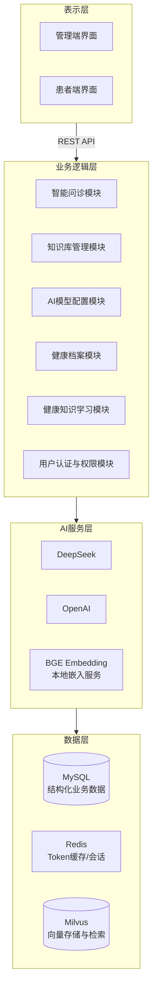
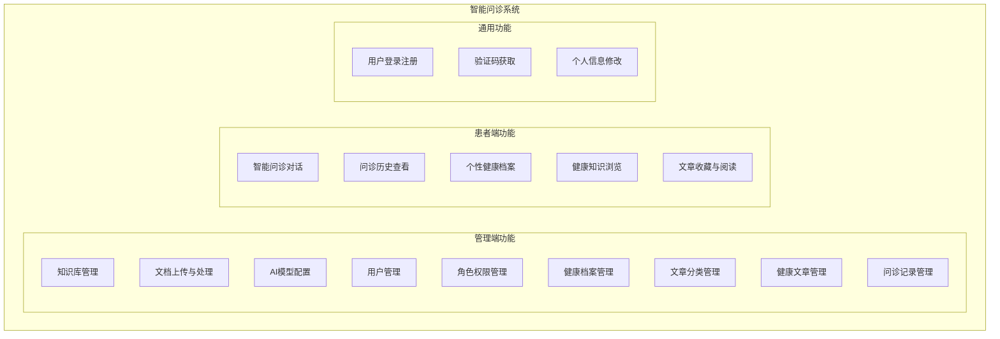
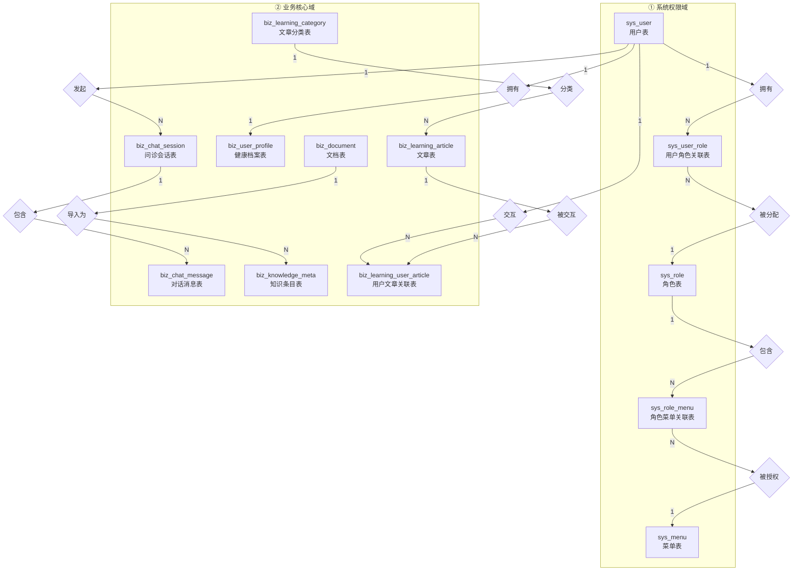
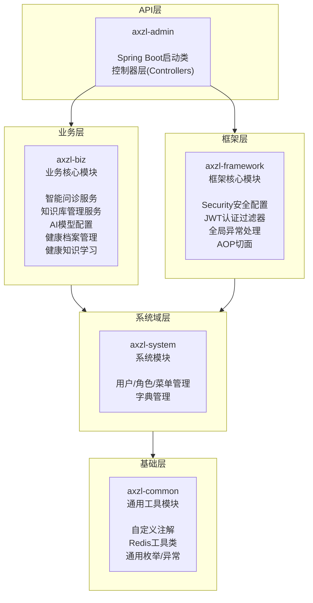
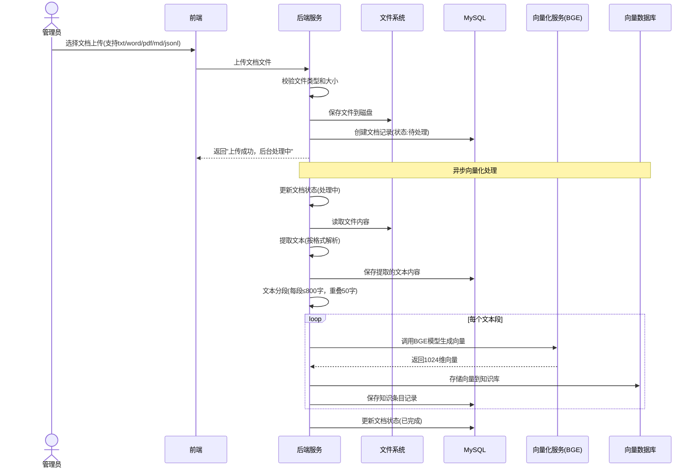
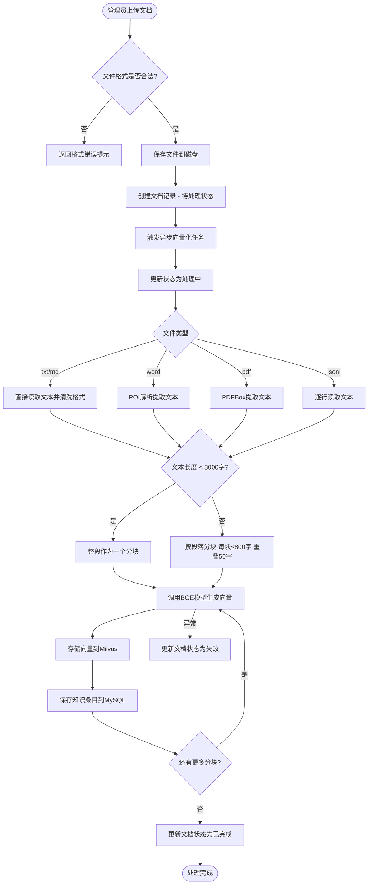
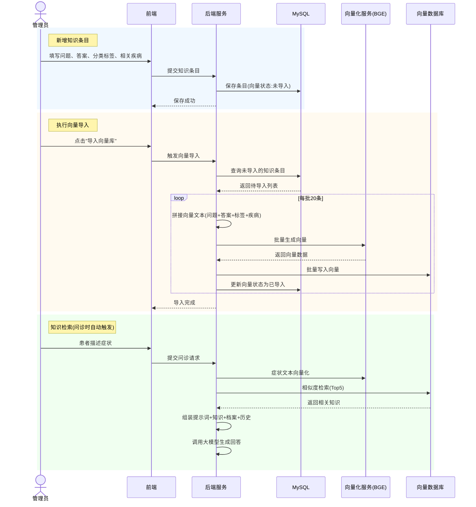
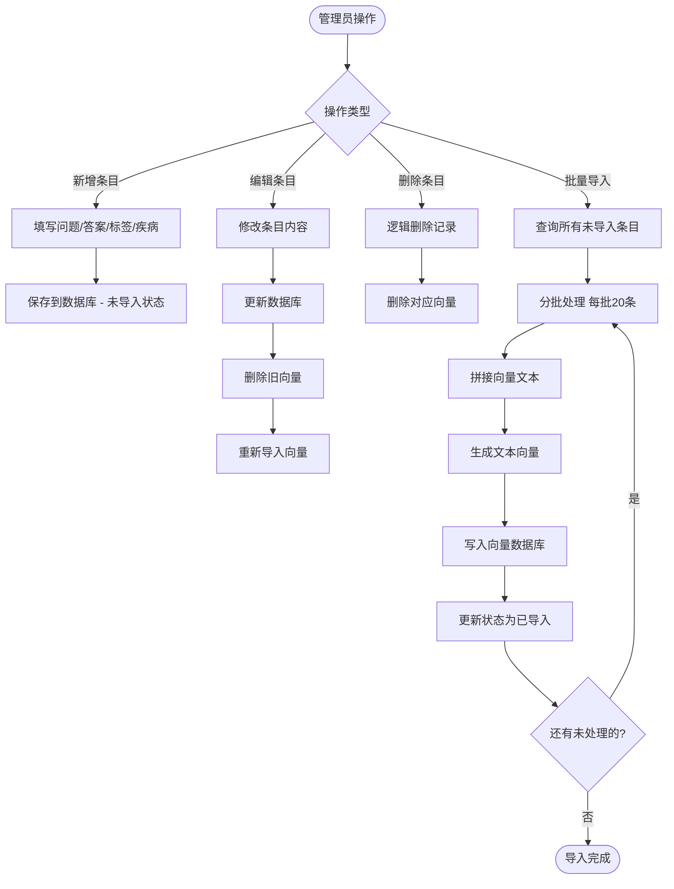
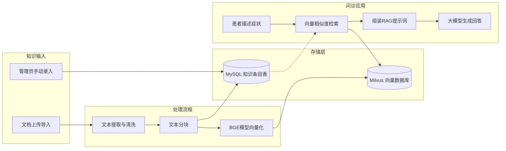
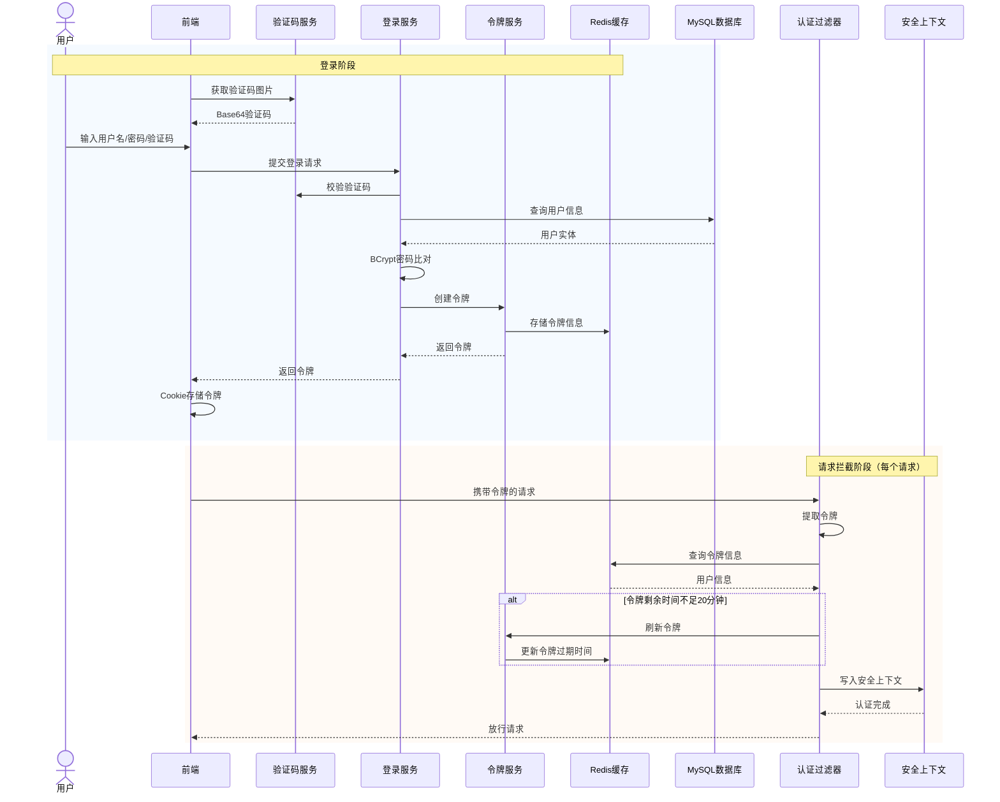

# 基于Spring AI与向量数据库的智能问诊系统设计与实现

## 摘  要

随着人工智能技术日益融入医疗健康领域，智能问诊系统正逐步成为优化医疗资源配置、提高诊疗效率的关键途径。本文设计并实现了一个基于Spring AI框架与Milvus向量数据库的智能问诊系统，采用检索增强生成（RAG）技术，将大语言模型的自然语言理解能力与私有医疗知识库的精准检索能力相融合，为患者提供症状评估、健康咨询和知识学习等服务。

系统采用前后端分离的B/S架构，后端基于Java 21与Spring Boot 4.0.3构建，集成Spring AI 2.0.0-M3实现对DeepSeek、OpenAI等多种大模型的统一调度与动态切换；前端基于Vue 3与TypeScript开发，使用Element Plus组件库提供响应式用户界面。在数据层，系统采用MySQL 8.0存储结构化业务数据，使用Milvus向量数据库存储医疗知识嵌入向量，通过BGE-large-zh-v1.5嵌入模型实现文本向量化，并设计了基于语义的动态分块策略和IVF_FLAT索引方案以优化检索效率。

系统实现了智能问诊对话、知识库管理、AI模型动态配置、健康档案管理、健康知识学习以及基于JWT与RBAC的用户认证与权限管理等核心功能模块。在智能问诊模块中，系统通过构建包含用户健康档案、历史对话和向量检索结果的综合提示词，实现了上下文感知的多轮对话，并利用服务器发送事件技术实现了流式响应，有效降低了用户等待焦虑。经功能测试与性能测试验证，系统各模块功能完整、响应性能满足设计要求。

**关键词**：智能问诊；Spring AI；向量数据库；检索增强生成；大语言模型；Milvus

## Abstract

With artificial intelligence technology increasingly integrated into the healthcare domain, intelligent consultation systems are becoming a crucial pathway to optimize medical resource allocation and improve diagnostic efficiency. This thesis designs and implements an intelligent consultation system based on the Spring AI framework and Milvus vector database, employing Retrieval-Augmented Generation (RAG) technology to combine the natural language understanding capabilities of large language models with the precise retrieval capabilities of private medical knowledge bases, providing patients with symptom assessment, health consultation, and knowledge learning services.

The system adopts a B/S architecture with front-end and back-end separation. The back-end is built on Java 21 and Spring Boot 4.0.3, integrating Spring AI 2.0.0-M3 to achieve unified scheduling and dynamic switching of multiple large language models including DeepSeek and OpenAI. The front-end is developed with Vue 3 and TypeScript, utilizing the Element Plus component library for responsive user interfaces. In the data layer, MySQL 8.0 stores structured business data while the Milvus vector database stores medical knowledge embedding vectors, with text vectorization implemented through the BGE-large-zh-v1.5 embedding model. A semantic-aware dynamic chunking strategy and IVF_FLAT indexing scheme are designed to optimize retrieval efficiency.

The system implements core functional modules including intelligent consultation dialogue, knowledge base management, AI model dynamic configuration, health profile management, health knowledge learning, and JWT and RBAC-based user authentication and authorization. In the intelligent consultation module, context-aware multi-turn dialogues are achieved through a comprehensive prompt incorporating user health profiles, conversation history, and vector retrieval results, while streaming responses via Server-Sent Events effectively reduce user waiting anxiety. Functional and performance testing verifies that all modules function correctly and meet design requirements for response performance.

**Keywords**: Intelligent consultation; Spring AI; Vector database; Retrieval-Augmented Generation; Large language model; Milvus

---


# 第1章 绪论

## 1.1 选题背景

近年来，人工智能技术取得了突破性进展，以大语言模型（Large Language Model, LLM）为代表的生成式人工智能正在深刻改变各行各业的技术生态。在医疗健康领域，智能问诊系统作为人工智能技术的重要应用场景，正日益受到学术界和产业界的广泛关注。根据国家卫生健康委员会发布的数据，我国每千人口执业医师数仅为3.04人，优质医疗资源在城乡之间、区域之间的分布极不均衡，基层医疗机构的服务能力与人民群众日益增长的健康需求之间存在明显差距[1]。在此背景下，利用人工智能技术构建智能问诊系统，为患者提供全天候的初步咨询和分诊指引，已成为缓解"看病难"问题的重要技术路径。

从技术演进角度看，传统的关键词匹配式医疗问答系统存在语义理解能力弱、知识覆盖范围有限等固有缺陷。随着Transformer架构的提出和预训练语言模型的发展，以GPT系列为代表的大语言模型展现出强大的自然语言理解和生成能力，为构建新一代智能问诊系统提供了技术基础。然而，通用大语言模型在医疗领域应用中面临两个核心挑战：一是模型输出的"幻觉"问题——即模型可能生成看似合理但实际不准确的医疗建议；二是模型训练数据中专业医学知识的覆盖度和时效性有限。检索增强生成（Retrieval-Augmented Generation, RAG）技术正是在这一背景下应运而生，它通过在模型生成回答之前检索相关专业知识片段，并将检索结果作为上下文注入生成过程，从而有效约束模型的输出范围，提高回答的专业性和可信度[2]。

在RAG技术体系中，向量数据库扮演着关键角色。与传统的关系型数据库不同，向量数据库专为高维向量的相似性检索而设计，能够将非结构化的文本数据转化为稠密向量，并通过近似最近邻搜索算法实现毫秒级的语义匹配。Milvus作为一款开源的向量数据库，凭借其高性能、可扩展性和丰富的索引类型，在医疗知识检索、推荐系统等场景中得到了广泛应用[3]。通过将医疗知识以向量的形式存入Milvus，系统可以在用户提出症状描述时，快速检索出语义上最相关的医学知识片段，为大语言模型提供可靠的参考依据。

在企业级应用开发领域，Spring Boot框架凭借其自动配置、内嵌服务器和丰富的生态系统，长期占据Java后端开发的主流地位[4]。Spring AI作为Spring生态向人工智能领域的延伸，提供了一套标准化的抽象层，使得Java开发者能够在熟悉的Spring框架内无缝集成大语言模型、嵌入模型和向量数据库，显著降低了AI应用开发的技术门槛。这使得大量基于Java技术栈的企业能够快速构建AI增强型应用，具有显著的技术整合意义。

本课题正是在上述技术融合的背景下，探索如何将Spring AI框架、Milvus向量数据库和大语言模型有机结合，构建一个面向患者的智能问诊系统，为缓解基层医疗服务压力、提升医疗资源配置效率提供可行的技术方案。

## 1.2 国内外研究现状

### 1.2.1 国外研究现状

国外智能问诊系统的研究与应用起步较早，在技术成熟度与落地场景方面具有一定领先优势，研究主要集中在AI模型优化、医疗知识融合与系统实用性提升三个方向。

在AI模型与医疗领域的融合方面，OpenAI团队提出的GPT系列模型在医疗问答场景中展现出强大潜力。Brown等人（2020）在GPT-3的研究中首次展示了大语言模型在少样本学习场景下的表现，为该技术在医疗诊断中的后续应用奠定了基础[5]。Singhal等人（2023）提出了Med-PaLM模型，通过在专业医学数据上进行指令微调，使其在美国医师资格考试（USMLE）中取得了超过及格线的成绩，验证了大语言模型在医学领域应用的可行性[6]。Radford等人提出的基于人类反馈的强化学习（RLHF）训练方法，显著提升了大语言模型在专业领域的回答准确性[7]。

在向量数据库的应用方面，国外向量数据库技术发展成熟且已逐步落地医疗知识检索场景。Johnson等人（2021）通过实验验证了向量数据库在医疗文献检索中相比传统关键词检索在召回率和准确率方面的显著优势[8]。Facebook AI团队开源的FAISS库为大规模向量检索提供了高效的近似最近邻搜索算法[9]。Pinecone公司推出的云原生向量数据库凭借其高吞吐量与低延迟特性，被广泛应用于医疗文献检索和症状-疾病关联匹配等场景。

在系统落地方面，国外已有多款成熟的智能问诊产品投入市场。WebMD的Symptom Checker通过整合医学知识库与症状推理引擎，累计服务用户数亿人次[10]。Mayo Clinic开发的AI问诊工具结合了临床决策支持系统，在症状采集到初步诊断的完整流程中发挥了有效的辅助作用。Babylon Health推出的AI问诊应用利用自然语言处理技术实现了初步分诊，已在英国国家医疗服务体系（NHS）中推广应用。但此类产品仍存在局限性，如对罕见病诊断准确率较低、缺乏对区域医疗特色的适配性等问题。

### 1.2.2 国内研究现状

国内智能问诊系统的研究近年来呈现快速发展态势，在政策支持与技术迭代的双重驱动下，逐步形成了"技术自主化、场景本土化、应用深度化"的发展特点。

在AI框架与医疗场景的结合方面，国内企业与科研机构纷纷推出自主研发的医疗AI模型与应用。百度推出的文心一言大模型通过接入百度健康的医疗知识库，实现了智能问诊、药物咨询等功能，其在国内常见疾病诊断中的准确率显著提升[11]。阿里达摩院开发的通义千问医疗版针对中医、慢性病管理等本土场景进行优化，支持中西医结合的问诊模式[12]。此外，国内多所高校团队也在知识图谱与医疗AI的结合方面展开了大量研究，刘洋等人（2021）设计了基于知识图谱的慢性病智能问诊系统，实现了症状跟踪和用药提醒等个性化功能[13]。

在向量数据库领域，Zilliz公司推出的Milvus向量数据库已成为国内AI基础设施的重要组成部分。李华等人（2023）研究了Milvus在医疗知识图谱检索中的应用，在某三甲医院的智能问诊试点项目中实现了症状匹配响应时间小于500毫秒的性能表现[14]。王强等人（2022）提出了基于云原生向量数据库的智能问诊系统架构，验证了向量数据库在医疗场景下的可行性与效率优势[15]。阿里云、腾讯云等厂商也相继推出了各自的向量数据库产品，为国内智能医疗应用提供了多元化的技术选择。

在系统设计与应用方面，国内智能问诊系统更注重适配基层医疗与公共卫生需求。微医集团开发的"微医AI问诊"系统整合了全国基层医院的医疗资源，支持远程问诊和处方流转等功能，已覆盖全国两千多个县区[16]。张明等人（2021）提出了基于Spring Boot的医疗AI系统快速开发框架，为Java生态下的医疗AI应用提供了工程化参考[17]。陈静等人（2023）对智能问诊系统的研究现状与发展趋势进行了全面综述，指出当前研究仍存在系统过度依赖通用AI模型、缺乏私有化知识库支撑和医学专业性不足等问题[18]。

综合国内外研究现状，当前智能问诊系统面临的主要挑战包括：模型幻觉导致医疗建议不可靠、通用模型缺乏专科深度、系统架构复杂难以维护等。本课题提出的基于Spring AI与向量数据库的技术方案，通过RAG技术将私有医疗知识库与大语言模型有机融合，为解决上述问题提供了新的思路。

## 1.3 课题的研究内容及所采取的方法

### 1.3.1 课题的研究内容

本课题围绕构建一个基于Spring AI与向量数据库的智能问诊系统展开，主要研究内容包括以下六个方面：

**（1）医疗领域多源数据处理与向量知识库构建**。收集具有权威性的公开医疗问答数据集及科普文献，开发数据清洗管道以去除格式噪声和敏感信息；设计基于语义的动态分块策略，将长文本按照段落边界分割为语义完整的文本块，设置合理的块大小（800字符）和重叠窗口（50字符）；利用BGE-large-zh-v1.5嵌入模型对文本块进行向量化编码，将非结构化的医学文本转化为1024维稠密向量，存入Milvus向量数据库。

**（2）基于Spring生态的后端服务架构设计与实现**。采用Maven多模块架构组织项目，基于Java 21和Spring Boot 4.0.3构建后端服务。利用Spring AI框架的ChatClient和VectorStore标准化接口，封装底层大语言模型和向量数据库的API差异，实现模型层的解耦与灵活切换。设计并开发RESTful API接口体系，涵盖智能问诊对话、知识库管理、AI模型配置、健康档案管理和健康知识学习等核心功能模块。

**（3）高维向量数据库的部署与索引优化**。部署Milvus 2.6.8向量数据库，采用IVF_FLAT索引结构和余弦相似度（Cosine Similarity）度量，在检索精度与检索速度之间实现平衡。设计向量数据的元数据存储方案，与MySQL中的知识库元数据表关联，实现检索结果的完整追溯。配置相似度阈值（0.6），过滤低相关性检索结果。

**（4）检索增强生成（RAG）全链路逻辑实现**。搭建从用户症状描述输入到AI智能回复的完整闭环流程，包括：用户输入的向量化查询、Milvus语义检索Top-K相关文档、用户健康档案上下文获取、历史对话加载、结构化提示词构建和大语言模型生成回复。设计基于SSE（Server-Sent Events）的流式响应机制，实现打字机效果的实时输出，降低用户等待感知。

**（5）交互式前端界面开发与流式响应体验**。基于Vue 3、TypeScript和Element Plus构建管理端和患者端双端界面。实现基于SSE的流式对话交互、Markdown格式渲染、多轮对话历史记录管理等功能。设计响应式页面布局，支持桌面端和移动端的自适应访问。

**（6）用户认证与权限管理体系**。基于Spring Security和JWT实现无状态认证，支持五种用户角色（超级管理员、医疗专家、普通医生、护士助理、患者）的基于角色的访问控制（RBAC），粒度细化到按钮级别，确保不同角色只能访问其权限范围内的功能和数据。

### 1.3.2 研究所采取的方法

本课题采取理论与实践相结合的研究方法，遵循软件工程的标准开发流程，主要包括以下方法：

**文献研究法**。通过检索中国知网（CNKI）、万方数据、IEEE Xplore、Springer等学术数据库，系统梳理RAG技术、向量数据库、智能问诊系统和Spring AI框架等领域的国内外研究文献，明确技术发展脉络、前沿动态和关键挑战，为系统设计提供理论支撑。

**对比分析法**。在技术选型阶段，对DeepSeek、OpenAI、Anthropic等多种大语言模型进行对比分析，对Milvus、Pinecone、PGVector等向量数据库进行性能评估，综合考量准确性、响应速度、成本和部署便利性等因素，选取最适宜的技术方案。

**模块化设计方法**。系统采用前后端分离的模块化架构，后端按照功能职责划分为Web入口层、业务逻辑层、数据访问层和AI服务层，各层之间通过标准化接口进行通信，降低模块间耦合度，提高代码复用性和可维护性。

**迭代开发方法**。按照需求分析、系统设计、编码实现、测试验证的循环迭代进行开发。每个核心功能模块经过独立开发、单元测试和集成联调后，再进行系统整体功能验证，确保每个阶段的交付质量。

**实验评估方法**。设计标准化的测试问题集，从回答准确性、相关性和完整性三个维度对系统进行评估。通过对比有无向量检索知识增强两种模式下的回答质量，验证RAG技术对提升医疗问答专业性的有效性。

## 1.4 本课题的预期目标

本课题的预期目标包括软件系统成果、技术文档成果和学术成果三个层面。

在软件系统成果层面，预期交付一个功能完整、可稳定运行的智能问诊系统原型，包含以下核心功能：基于RAG技术的智能问诊对话引擎，支持流式输出和多轮上下文感知对话；基于Milvus的医疗知识库与语义检索系统，支持PDF、Word、Markdown等多格式文档的上传与自动向量化处理；动态AI模型配置管理后台，支持多模型运行时的动态切换；用户健康档案管理系统，支持Excel导入导出；健康知识学习模块，支持文章发布、分类管理和AI自动摘要生成；基于JWT和RBAC的用户认证与权限管理系统。

在技术文档成果层面，预期完成符合学校规范的毕业论文一篇，完整阐述项目背景、相关技术、系统设计、实现过程和测试结果；完成开题报告、文献综述、外文翻译等毕业设计过程文档。

在学术成果层面，预期通过本系统的设计与实现，验证Spring AI框架在企业级Java应用中集成AI能力的可行性，探索RAG技术在医疗垂直领域的应用方法，为Java生态下AI工程化应用提供可借鉴的实践方案。

## 1.5 本文的组织结构

本文共分为七章，各章内容安排如下：

第1章绪论。阐述智能问诊系统的选题背景和研究意义，梳理国内外在AI医疗问诊、向量数据库和RAG技术等领域的研究现状，明确本课题的研究内容、研究方法和预期目标，并介绍全文的组织结构。

第2章相关理论基础及技术选型。系统介绍本课题涉及的核心技术理论，包括检索增强生成技术的原理与架构、Spring AI框架的核心组件与抽象设计、Milvus向量数据库的索引机制与检索原理、大语言模型与嵌入模型的技术特点，以及Vue 3前端框架的响应式设计理念。

第3章系统需求分析。从可行性分析入手，从技术、经济和操作三个维度论证项目的可行性，详细阐述系统的功能性需求和非功能性需求，明确智能问诊、知识库管理、AI模型配置、健康档案管理、健康知识学习和用户认证授权六大核心功能模块的具体要求。

第4章系统设计。在需求分析的基础上，给出系统的总体架构设计、功能模块结构设计、RAG核心业务流程设计和数据库设计，包括实体关系图和核心数据表结构设计。

第5章系统实现。以六个核心功能模块为主线，逐一介绍各模块的设计思路、关键代码实现和页面运行效果。每个模块包含功能说明、核心业务流程、关键代码片段和页面实现说明。

第6章系统测试。对系统进行全面的功能测试和性能测试，设计典型的测试用例覆盖核心业务流程，使用压力测试工具评估系统在高并发场景下的性能表现，并对测试结果进行分析总结。

第7章总结与展望。总结本课题完成的主要工作和取得的成果，分析系统当前存在的不足与局限，并对未来的改进方向和扩展功能进行展望。

---

# 第2章 相关理论基础及技术选型

## 2.1 检索增强生成（RAG）技术

检索增强生成（Retrieval-Augmented Generation, RAG）是一种将信息检索与文本生成相结合的技术架构，由Lewis等人于2020年首次系统提出[19]。其核心思想是在大语言模型生成回答之前，先从外部知识库中检索与用户查询相关的文档片段，然后将检索结果作为额外的上下文信息注入到提示词中，引导模型基于这些可靠知识源生成回答。

RAG技术的工作流程可分为检索和生成两个阶段。在检索阶段，系统首先将用户的自然语言查询通过嵌入模型转化为稠密向量，然后利用向量数据库的近似最近邻搜索能力，在高维向量空间中查找与查询向量最相似的Top-K个文档片段。在生成阶段，系统将检索到的文档片段与用户原始查询按照预设的提示词模板组合成完整的提示词，再交由大语言模型生成最终的回答。RAG技术的核心优势在于通过外部知识库的约束，将模型的生成行为从"自由发挥"转变为"有据可依"——模型的回答不仅基于其预训练参数中存储的通用知识，更依赖于检索到的专业文档内容[20]。

在医疗问诊场景中，RAG技术具有尤为重要的应用价值。医疗诊断需要高度专业和准确的知识支撑，通用大语言模型的预训练数据虽然覆盖面广泛，但在医学专科知识的深度和时效性方面存在固有局限。通过RAG技术将经过审核的医疗文献、疾病诊疗指南和药品信息等专业知识注入生成过程，系统能够在回答中引用可追溯的知识来源，既提高了回答的专业性和准确性，也增强了用户对系统输出的信任度。此外，RAG架构的知识库独立于模型参数，支持增量更新和版本管理，使得系统能够灵活适应医学知识的持续演进。

本研究采用的RAG方案在标准流程基础上进行了以下优化：首先，不仅检索向量知识库中的医学文献，还将用户的个人健康档案（如过敏史、既往病史）融入上下文，实现个性化的问诊建议；其次，在多轮对话中加载最近30条历史消息，使模型能够理解对话的上下文连贯性；最后，在提示词中明确要求模型基于参考知识回答，当检索结果与问题相关性不足时（相似度低于0.6阈值），系统会诚实告知知识库覆盖范围的限制，而不是强行生成不可靠的回答。

## 2.2 Spring AI框架

Spring AI是Spring生态系统面向人工智能应用开发推出的开源框架，于2024年发布首个里程碑版本[21]。其设计理念延续了Spring框架一贯的抽象化和模块化思想——正如Spring Data为不同数据存储提供了统一的Repository抽象，Spring AI为不同的大语言模型、嵌入模型和向量数据库提供了标准化的Java接口。

Spring AI的核心组件包括三个层面。第一层是模型抽象层，通过统一的对话客户端接口封装了与不同大语言模型（如OpenAI的GPT系列、DeepSeek、Anthropic的Claude）的交互逻辑，通过嵌入模型接口封装了文本向量化服务，开发者无需关心底层API的具体调用细节即可实现模型切换。第二层是向量存储抽象层，提供了统一的向量存储和检索操作接口，支持Milvus、Pinecone、PGVector等多种向量数据库后端的透明切换[22]。第三层是高级功能层，包括基于拦截器模式的提示词增强、检索增强生成的自动编排，以及与数据导入流程的集成支持。

Spring AI在本系统中的应用价值体现在以下方面：首先，统一的对话客户端接口使得系统可以在DeepSeek、OpenAI和Anthropic等多种大语言模型之间灵活切换，通过自研的客户端工厂实现了模型配置的数据库化管理和运行时的动态客户端创建，无需重启应用即可切换默认模型；其次，向量存储接口使得Milvus向量数据库的复杂操作被大幅简化，开发者只需调用相似性搜索等少数高层方法即可完成向量检索；最后，Spring AI与Spring Boot的自动配置和无缝集成，使得AI功能的开发能够利用Spring成熟的依赖注入、事务管理和安全框架等基础设施。

本课题使用的Spring AI版本为2.0.0-M3，该版本在对话客户端的构建模式、流式响应处理和嵌入模型调用等方面进行了显著改进，为构建企业级RAG应用提供了更加成熟的API支持。需要特别指出的是，由于该版本尚处于里程碑阶段，部分高级特性如向量存储的嵌入模型动态切换仍需通过反射等机制实现，本系统在配置监听器中对此进行了适配处理。

## 2.3 向量数据库技术

向量数据库是一类专为高维向量数据的存储、索引和相似性检索而设计的数据库系统，与传统的关系型数据库和全文搜索引擎在设计目标和底层实现上有着本质区别[23]。在自然语言处理场景中，文本通过嵌入模型被映射为固定维度（如1024维）的浮点数向量，语义上相近的文本在向量空间中彼此距离较近。向量数据库的核心任务是在海量的向量集合中，快速找出与查询向量最相似的Top-K个结果。

Milvus是由Zilliz公司主导开发的开源向量数据库，于2019年在Linux基金会旗下LF AI & Data基金会正式开源[24]。Milvus采用了计算与存储分离的云原生架构，其核心组件包括：负责数据持久化和索引存储的存储层、负责向量检索和索引构建的计算层、负责元数据管理和任务调度的协调层。这种分层架构使得Milvus支持各组件的独立扩展，能够应对从百万级到百亿级向量的不同规模场景。

在索引机制方面，Milvus支持多种近似最近邻搜索索引类型，包括IVF_FLAT、IVF_SQ8、IVF_PQ、HNSW、ANNOY等。每种索引在检索精度、检索速度和内存占用之间提供不同的权衡。本系统选用了IVF_FLAT索引方案。IVF_FLAT基于倒排文件的思想，在索引构建阶段通过K-means聚类将向量空间划分为若干个聚类区域，在检索阶段首先定位与查询向量最相似的若干个聚类中心，然后只在这些聚类内部进行精确的向量距离计算。这一策略在保持较高检索精度的同时，将搜索范围从全集大幅缩减为局部子集，显著提高了检索效率。本系统配置的聚类数为1024个，检索时搜索最近的8个聚类（nprobe=8）。

向量相似度的度量方式直接影响检索结果的质量。Milvus支持欧氏距离（L2）、内积（IP）和余弦相似度（Cosine Similarity）等多种度量方式。考虑到文本嵌入向量的语义信息主要体现在方向而非绝对大小上，本系统选用余弦相似度作为度量标准。对于两个向量a和b，其余弦相似度定义为cos(θ)=(a·b)/(||a||×||b||)，取值范围为[-1,1]，值越接近1表示两个向量在方向上越一致，即语义越相近。

在医疗知识检索场景中，向量数据库的应用具有显著优势：传统的关键词匹配要求查询词与文档中的词精确对应，无法处理同义词替换和语境变化等语言现象；而基于嵌入向量的语义检索则能够捕捉文本的深层语义，即使用户使用了不同的表述方式，系统也能检索到语义相关的医学知识，这在症状描述这一存在高度个体化表达差异的场景中尤为重要。

## 2.4 大语言模型与嵌入模型

大语言模型（Large Language Model, LLM）是基于Transformer架构的大规模神经网络模型，通过在海量文本语料上进行预训练，学习到了丰富的语言知识和推理能力。近年来，以GPT-4、DeepSeek-V4和Claude等为代表的大语言模型在自然语言理解、文本生成和知识问答等任务上展现出了接近甚至超越人类水平的表现[25]。

DeepSeek是由深度求索公司开发的大语言模型系列，其V4版本在多项评测基准上展现出了与国际顶级模型相媲美的性能，同时以其极高的性价比在开发者社区中获得了广泛关注。本系统选择DeepSeek-V4-Flash作为默认对话模型，主要基于以下考虑：DeepSeek在中文理解和生成方面表现优异，这对于面向中文医疗问诊场景的系统至关重要；其API接口兼容OpenAI格式，能够无缝接入Spring AI框架；计算成本显著低于同级别的国际模型，有利于系统的经济性运行。此外，系统通过动态AI模型配置模块同时支持OpenAI GPT-4o和Anthropic Claude 3.5 Sonnet作为备选模型，用户可根据具体需求灵活切换。

**DeepSeek-V4模型架构**。DeepSeek-V4延续了DeepSeek系列的核心技术创新路线，其架构设计围绕两个关键组件展开：多头潜在注意力机制（Multi-head Latent Attention, MLA）和DeepSeek混合专家模型（DeepSeekMoE）。MLA机制通过对注意力计算中的键（Key）和值（Value）矩阵进行低秩联合压缩，在大幅降低推理阶段键值缓存（KV Cache）开销的同时保持了模型的长文本处理能力。与传统多头注意力（Multi-Head Attention, MHA）相比，MLA使得单个Token的KV缓存占用减少了约90%，这对于需要加载较长对话历史的医疗问诊场景尤为关键——系统可以经济地维护30条以上的历史消息上下文，而不会耗尽GPU显存资源。DeepSeekMoE采用细粒度专家划分和共享专家隔离策略：每个MoE层包含数百个细粒度"路由专家"和一个"共享专家"，共享专家始终参与计算以捕获通用知识，路由专家则通过Top-K门控机制按需激活[20]。在医疗问诊场景中，这种专家分工机制使得模型可以并行激活不同的专家分别处理症状推理、药物知识检索和诊断建议生成等子任务，在提升回答专业性的同时将单次推理的激活参数量控制在总参数的合理比例，实现了性能与效率的均衡。

嵌入模型是将文本转化为稠密向量的专用模型，其输出质量直接决定了RAG系统中检索环节的效果。嵌入模型的核心能力在于将语义相近的文本映射到向量空间中邻近的位置，这种语义保持特性是后续向量检索的基础[26]。本系统选用BGE-large-zh-v1.5作为嵌入模型，该模型由北京智源人工智能研究院（BAAI）开发，专门针对中文场景优化，在MTEB中文基准上表现领先。BGE-large-zh-v1.5基于BERT架构，输出1024维向量，能够有效捕捉中文医学文本中的专业术语语义、症状描述相似性和疾病关联关系。系统通过Docker部署本地化的BGE嵌入服务，避免了调用云端嵌入API带来的网络延迟和数据隐私风险。

在实际应用中，嵌入模型的选择对RAG系统的性能影响至关重要。如果嵌入模型不能准确理解医学术语的语义，那么即使向量数据库的检索算法再高效，也无法召回正确相关的知识片段。本系统在技术选型阶段对比了BGE、OpenAI text-embedding-3-large和M3E等多款中文嵌入模型，最终基于评测报告中选择BGE作为主嵌入模型，同时支持OpenAI嵌入模型作为备选。

## 2.5 前端开发框架

本系统前端采用Vue 3作为核心框架，配合TypeScript和Element Plus组件库构建用户界面。Vue 3是Vue.js框架的最新主要版本，于2020年正式发布，引入了Composition API、Teleport、Fragments等新特性，在性能、TypeScript支持和代码组织方面较Vue 2有显著提升[27]。

Vue 3的组合式API是本系统前端开发的核心编程范式。与Vue 2的选项式API相比，组合式API通过设置函数和可复用的组合函数实现了逻辑关注点的灵活组合，使得复杂组件（如本文中的智能问诊对话界面）的状态管理、事件处理和生命周期逻辑能够按照功能维度进行组织，显著提高了代码的可维护性和可测试性。本系统所有Vue组件均采用TypeScript编写，充分利用编译时的类型检查提前发现潜在错误。

Element Plus是Element UI组件库的Vue 3版本，提供了表格、表单、对话框、导航菜单、标签页等企业级应用中常用的UI组件。本系统利用Element Plus的组件体系快速构建了管理端的CRUD页面（如知识库管理、健康档案管理、AI模型配置等）和患者端的交互界面（如问诊对话、文章浏览等），在保证界面一致性的同时大幅提高了前端开发效率。

在数据通信方面，系统前端使用Axios作为HTTP客户端与后端RESTful API进行通信。开发环境下配置了代理服务，将带有特定前缀的请求转发至后端服务器，生产环境下使用不同的前缀路径。系统使用Pinia进行全局状态管理，管理用户令牌、登录状态和菜单权限等通用状态。对于流式对话接口，前端使用原生的网络请求API，通过可读流实时读取服务器发送事件的流式数据，实现打字机效果的逐字显示。

## 2.6 本章小结

本章系统介绍了构建基于Spring AI与向量数据库的智能问诊系统所涉及的核心技术理论。首先阐述了RAG技术的原理架构及其在医疗问诊场景中的应用价值；然后介绍了Spring AI框架的核心组件及其在大语言模型和向量数据库集成中的抽象作用；接着深入分析了Milvus向量数据库的架构设计和检索原理；之后对比分析了本系统选用的大语言模型与嵌入模型的技术特点和选型依据；最后介绍了Vue 3前端框架及其配套技术栈。本章的技术理论分析为后续第3章的需求分析、第4章的系统设计和第5章的系统实现奠定了理论和工程基础。

---

# 第3章 系统需求分析

## 3.1 可行性分析

在系统开发之前，首先从技术可行性、经济可行性和操作可行性三个维度对项目进行综合评估。

**技术可行性**。本系统所采用的技术栈均为开源或已有成熟商业化支持的技术。后端Spring Boot框架经过十余年的发展已极为成熟稳定，Spring AI框架虽处于里程碑阶段但其核心API已基本稳定，能够满足本系统的集成需求。Milvus向量数据库已在数千家企业中部署运行，其稳定性和性能经过了充分的实践检验。DeepSeek API提供了可靠的商用服务，BGE嵌入模型已在Hugging Face开源且支持本地部署。前端Vue 3和Element Plus已广泛用于企业级应用开发。开发团队成员具备Java后端开发和Vue前端开发的实践经验，能够胜任系统的开发任务。综合来看，本系统在技术上具有充分的可行性。

**经济可行性**。系统开发所需的软件工具（IntelliJ IDEA社区版、VS Code、MySQL、Redis、Milvus）均为开源或免费版本。DeepSeek API采用按量计费模式，其对话模型的调用成本显著低于同级别国际模型。开发硬件为个人计算机，配备充足的运行内存和存储空间，能够同时运行后端服务、前端开发服务器和Docker容器中的基础设施组件。整体开发投入主要为时间成本和少量API调用费用，在经济上完全可行。

**操作可行性**。系统采用B/S架构，用户仅需现代浏览器即可访问全部功能。前端界面遵循主流Web应用的交互设计规范，患者端的对话界面简洁直观，管理端的后台界面采用成熟的管理后台布局模式。系统通过Docker Compose实现一键部署，降低了环境配置的复杂度。系统提供详细的部署文档，运维人员可按照文档步骤完成系统部署和日常维护。因此，系统在操作层面具有可行性。

## 3.2 功能性需求分析

本系统的目标用户分为两类：普通患者用户和医疗管理用户。根据开题报告中定义的设计任务要求，系统需实现以下核心功能模块。

**智能问诊模块**是系统的核心功能。患者用户能够以自然语言描述自身症状，系统通过RAG技术流程检索相关医学知识，结合用户个人健康档案和历史对话上下文，由大语言模型生成问诊建议。支持流式响应模式，对话内容以打字机效果实时逐字展示。支持多轮对话，系统维护对话历史记忆，理解上下文的指代关系。支持会话管理功能，包括新建会话、历史会话查看、会话重命名、置顶和删除。支持满意度评价，用户可对问诊结果进行1至5星评分。

**知识库管理模块**负责维护RAG系统的知识底座。支持医疗问答对（QA格式）和医学文档的录入、编辑和删除。支持多格式文档（TXT、Word、PDF、Markdown、JSONL）的上传，系统自动提取文本内容、进行语义分块、调用嵌入模型生成向量并存入Milvus，同时在MySQL中记录元数据信息。支持文档处理状态跟踪（未处理、处理中、已完成、处理失败）和失败重试。

**AI模型配置模块**实现大语言模型的动态管理。支持添加、编辑、删除和查询AI模型配置，配置项包括提供商、模型名称、API地址、API密钥（加密存储）、模型类型（对话/嵌入）、温度参数、最大Token数、Top-P、频率惩罚等。支持设置默认对话模型和默认嵌入模型，切换后即时生效无需重启。支持模型可用状态控制（启用/停用）。

**健康档案模块**为患者用户建立健康信息档案。档案内容包括出生日期、性别、血型、身高体重、过敏史、既往病史、家族病史、生活方式等信息。患者用户可查看和编辑自己的档案，管理用户可查看全部用户的档案。支持Excel格式的档案数据导入和导出。

**健康知识学习模块**为患者用户提供健康知识浏览和学习平台。支持文章的多级分类管理（如心脑血管科、内分泌科等）。支持富文本格式的文章内容编辑、发布、下架。支持AI自动摘要生成，利用大语言模型为长文章生成精炼摘要。患者用户可浏览文章、收藏、点赞，系统记录阅读进度和时长。

**用户认证与权限管理模块**保障系统安全。支持用户注册、登录和令牌认证，采用JWT无状态认证机制。支持五种预设角色：超级管理员（拥有所有权限）、医疗专家（可管理知识库和文档）、普通医生（可查看和参与问诊）、护士助理（可查看问诊记录和档案）、患者（仅访问自己的数据和患者端功能）。权限控制细化到按钮操作级别。

## 3.3 非功能性需求分析

**性能需求**。系统应保证在正常网络环境下，页面加载时间不超过3秒。对于非流式问诊接口，端到端响应时间应控制在15秒以内（含大语言模型生成时间）。对于流式接口，首字响应时间应控制在3秒以内。向量检索环节的响应时间应控制在500毫秒以内。系统应支持至少50个用户同时在线访问。

**安全性需求**。用户密码采用BCrypt算法加密存储。API密钥在数据库中以AES加密存储，不在日志和配置文件中明文出现。系统实施登录失败锁定机制，连续5次错误后锁定10分钟。敏感数据（如患者个人身份信息）在日志记录前进行脱敏处理。实施XSS过滤和SQL注入防护。所有API接口（匿名接口除外）必须经过认证和授权检查。

**可扩展性需求**。系统架构应支持水平扩展，后端服务可部署多个实例并通过负载均衡分发请求。AI模型的提供商和参数通过数据库配置管理，新增模型无需修改代码。知识库支持在线增量更新，无需重建整个向量索引。

**可用性需求**。前端界面应兼容主流浏览器（Chrome、Edge、Firefox）。管理端和患者端界面应具有各自的视觉风格和操作逻辑。系统在异常情况下（如AI模型调用超时）应向用户展示友好的错误提示，而不是直接显示技术错误信息。

## 3.4 本章小结

本章完成了智能问诊系统的需求分析工作。首先从技术、经济和操作三个维度论证了项目的可行性。然后详细阐述了系统的功能性需求，明确了智能问诊、知识库管理、AI模型配置、健康档案管理、健康知识学习和用户认证授权六大核心功能模块的具体要求。在非功能性需求方面，从性能、安全性、可扩展性和可用性四个维度提出了系统的质量目标和约束条件。本章的需求分析成果为第4章的系统设计提供了明确的目标导向和设计依据。

---

# 第4章 系统设计

## 4.1 系统总体架构设计

本系统采用前后端分离的B/S架构，整体划分为表示层、业务逻辑层、数据层和AI服务层四个逻辑层次，各层之间通过定义良好的接口进行通信。



**图4.1 系统总体架构图**

表示层位于架构最顶层，负责用户交互和界面渲染。表示层包含管理端界面和患者端界面两套独立的前端应用，通过Vue Router实现多页面路由，通过Axios或Fetch API与后端的RESTful API进行通信。管理端面向医疗管理员，提供知识库管理、AI模型配置、用户档案管理等后台功能。患者端面向普通患者用户，提供智能问诊对话、健康知识浏览、个人档案管理等前端功能。

业务逻辑层是系统的核心，基于Spring Boot框架构建，包含业务功能模块、通用功能模块和AI抽象层三部分。业务功能模块涵盖智能问诊、知识库管理和AI模型配置等核心功能，通用功能模块负责健康档案管理、健康知识学习和用户认证与权限控制，各模块之间通过Spring的依赖注入机制进行协作。AI抽象层基于Spring AI框架，封装了对话客户端、嵌入模型和向量存储三大核心接口，为上层业务模块屏蔽了底层AI服务的技术细节。

数据层由三种数据存储组件构成。MySQL 8.0作为主要的关系型数据库，存储用户信息、角色权限、问诊会话、对话消息、知识库元数据、健康档案等结构化业务数据。Redis 7作为缓存和会话存储，缓存登录用户的令牌信息，支持令牌的自动刷新机制。Milvus 2.6.8作为向量数据库，存储医疗知识文本块的嵌入向量，提供高效的语义相似性检索能力。向量数据库与关系型数据库之间通过知识库元数据表建立关联，向量检索返回的标识符可关联查询到完整的元数据信息。

AI服务层包含系统依赖的外部AI能力。DeepSeek API提供主要的大语言模型对话服务，OpenAI API作为备选，均通过Spring AI的ChatClient接口进行统一调用。BGE嵌入模型通过Docker在本地部署，提供高性能的文本向量化服务，避免了调用云端嵌入API的网络延迟和数据传输风险。


**图4.2 RAG问诊核心流程图**

## 4.2 功能模块结构设计

系统功能模块分为管理端和患者端两大入口，各端对应的功能模块如下：



**图4.3 系统功能模块结构图**

## 4.3 数据库设计

### 4.3.1 数据库总体设计

本系统的数据库设计遵循"关系型数据存MySQL，向量数据存Milvus"的混合存储策略。MySQL承担系统配置数据、用户数据、业务实体数据和审计日志的存储；Milvus承担医疗知识文本嵌入向量的存储和语义检索。两种数据库之间通过向量ID在MySQL的知识库元数据表中建立关联。

数据库设计遵循第三范式（3NF），确保数据的一致性、完整性和低冗余。所有业务表均包含创建时间和更新时间字段用于记录数据的时间轨迹。对于需要软删除的数据，使用逻辑删除标记代替物理删除。以下重点阐述业务模块的核心数据表设计。

### 4.3.2 实体关系图（E-R图）



**图4.4 系统核心E-R图（系统权限域与业务域）**

> 注：图中矩形框表示实体，菱形框表示实体之间的联系，连线上的"1"与"N"表示联系的基数比（1表示一的一端，N表示多的端）。系统权限域实体（用户表、角色表、菜单表）与业务核心域实体（问诊会话表、对话消息表等）之间通过用户标识等外键建立关联。

```mermaid
flowchart TB
    subgraph core["问诊核心"]
        direction LR
        session["biz_chat_session 问诊会话表
        ────────────
        ◼ session_id (PK)
        ⋄ user_id (FK)
        title
        symptom_summary
        ai_diagnosis
        satisfaction
        tokens_used
        is_pinned / status"]
        message["biz_chat_message 对话消息表
        ────────────
        ◼ message_id (PK)
        ⋄ session_id (FK)
        ⋄ user_id (FK)
        role
        content
        retrieval_results"]
    end

    subgraph profile_sub["用户档案"]
        profile["biz_user_profile 健康档案表
        ────────────
        ◼ profile_id (PK)
        ⋄ user_id (FK)
        birthday / gender
        blood_type
        height / weight
        allergy_history
        medical_history
        family_history
        lifestyle"]
    end

    subgraph knowledge["知识库"]
        direction LR
        doc["biz_document 文档表
        ────────────
        ◼ id (PK)
        file_name / file_type
        file_size
        extracted_content
        chunk_count
        vector_status"]
        meta["biz_knowledge_meta 知识条目表
        ────────────
        ◼ id (PK)
        question / answer
        label / score
        related_diseases
        ⋄ vector_id
        vector_status"]
    end

    subgraph ai_cfg["AI模型配置"]
        ai_model["biz_ai_model_config AI模型配置表
        ────────────
        ◼ config_id (PK)
        provider / model_name
        api_base_url / api_key
        model_type
        temperature / max_tokens
        top_p / top_k
        frequency_penalty
        is_default / status"]
    end

    subgraph learning["健康知识学习"]
        direction LR
        cat["biz_learning_category 文章分类表
        ────────────
        ◼ category_id (PK)
        parent_id
        name / sort_order"]
        art["biz_learning_article 文章表
        ────────────
        ◼ article_id (PK)
        ⋄ category_id (FK)
        title / summary
        content / tags
        view_count / like_count
        ai_summary
        is_top / status"]
        ua["biz_learning_user_article 用户文章关联表
        ────────────
        ⋄ user_id (FK)
        ⋄ article_id (FK)
        is_bookmarked / is_liked
        read_progress / read_duration"]
    end

    session -- "1" --> sm{包含} -- "N" --> message
    session -..- "关联" -.-> profile
    doc -- "1" --> dk{导入为} -- "N" --> meta
    cat -- "1" --> ca{分类} -- "N" --> art
    cat -- "1" --> self{自关联} -- "N" --> cat
```

**图4.5 系统核心E-R图（业务数据域）**

> 注：◼ 表示主键（PK），⋄ 表示外键（FK）。矩形框表示实体及其关键属性，菱形框表示实体之间的联系，连线上的"1"与"N"表示联系的基数比。虚线表示实体之间通过外键间接关联。各业务实体均与图4.4中的用户实体通过用户标识外键关联。

### 4.3.3 核心数据表设计

**（1）问诊会话表**

问诊会话表记录每一次用户问诊的会话信息，是智能问诊模块的核心数据表。会话标识采用全局唯一标识符生成，确保分布式场景下的唯一性。会话标题取用户首次发送消息的前50个字符。症状汇总和诊断建议字段分别记录用户症状的汇总描述和AI给出的诊断建议摘要。满意度字段支持1至5星的评分。令牌消耗字段用于粗略估算当前会话消耗的令牌数量，为成本核算提供参考。置顶标记支持用户将重要会话置顶显示。

**（2）对话消息表**

对话消息表记录问诊会话中的每一条消息，角色字段标识消息的发送者（用户或AI助手）。检索结果字段以JSON格式存储该条AI消息生成时使用的前5条检索结果详情，包括检索到的文档片段、相似度分数和来源信息，为回答的可追溯性提供数据支撑。

**（3）AI模型配置表**

AI模型配置表实现大语言模型和嵌入模型的数据库化管理。提供商字段标识模型来源（如DeepSeek、OpenAI、Anthropic），模型类型字段区分对话模型和嵌入模型。API密钥字段以AES加密存储，确保凭据安全。默认标记用于标识系统默认模型。所有对话相关参数（温度、最大令牌数、采样策略、频率惩罚等）均可通过Web界面配置。扩展配置字段以JSON格式存储模型特有的附加参数。

**（4）知识库元数据表**

知识库元数据表充当向量数据库在关系型数据库中的索引。问题和答案字段存储问答对格式的知识条目。向量标识字段记录在Milvus中对应的向量编号，向量状态字段跟踪向量的处理状态。对于通过文档上传方式导入的知识，来源类型标记为文档导入，来源标识关联文档表的记录，分块索引记录该文本块在原文档中的片段编号。

**（5）用户健康档案表**

用户健康档案表与系统用户表一对一关联。过敏史、既往病史、家族病史和生活方式四个字段存储非结构化的自由文本描述，这些信息在RAG流程中作为用户个体上下文注入提示词，实现个性化的问诊建议。

**（6）健康知识学习相关表**

文章分类表通过父级标识字段实现树形的多级分类结构。文章表支持富文本内容存储，标签字段存储逗号分隔的标签字符串，AI摘要字段存储由大语言模型自动生成的文章摘要。用户文章关联表记录用户与文章的交互行为，包括收藏、点赞、阅读进度（百分比）和阅读时长。

## 4.4 本章小结

本章完成了智能问诊系统的全面设计工作。在架构设计层面，给出了包含表示层、业务逻辑层、数据层和AI服务层的四层总体架构设计，明确了各层的职责和交互关系。在功能结构层面，以模块化方式对管理端和患者端的功能进行了系统划分。在业务流程层面，重点设计了RAG问诊核心流程、文档处理流程和知识条目管理流程。在数据库设计层面，提出了"关系型数据存MySQL，向量数据存Milvus"的混合存储策略，给出了包含系统权限域与业务数据域的实体关系图，并对问诊会话表、对话消息表、AI模型配置表、知识库元数据表、用户健康档案表和健康知识学习相关表六类核心数据表进行了详细设计。本章的设计成果为第5章的系统实现提供了直接的技术依据。

---

# 第5章 系统实现

## 5.1 开发环境与项目结构

本系统的开发环境配置如下：后端开发使用IntelliJ IDEA 2024作为集成开发环境，JDK 21作为Java运行时，Maven 3.9作为项目构建和依赖管理工具。前端开发使用Visual Studio Code编辑器，Node.js 18作为JavaScript运行时，Vite 6作为构建工具和开发服务器。基础设施组件（MySQL、Redis、Milvus、BGE Embedding）通过Docker Compose统一编排部署。

后端项目采用Maven多模块架构，各模块的职责划分与依赖关系如图5.1所示。



**图5.1 Maven多模块架构依赖关系图**

如图5.1所示，后端项目采用五层模块结构。入口层为Web入口模块，包含Spring Boot启动类、控制器层和全局配置；框架层为框架核心模块，封装了安全配置、认证过滤器、全局异常处理和面向切面编程等功能；系统域层负责用户、角色、菜单、字典等基础系统功能的数据访问和服务实现；基础层为通用工具模块，提供基础控制器、统一响应对象、自定义注解、缓存工具类等公共组件；业务层为业务核心模块，承载智能问诊、知识库管理、AI模型配置、健康档案和健康知识学习等全部业务逻辑。各模块遵循单向依赖原则：上层模块依赖下层模块，同层模块之间通过公共接口解耦。

前端项目按照功能域划分为业务页面、患者端页面、系统管理页面和监控页面等子目录，通过路由配置管理页面导航，使用Pinia进行全局状态管理。

## 5.2 智能问诊模块

### 5.2.1 模块功能说明

智能问诊模块是本系统的核心业务模块，负责实现从用户输入症状描述到AI生成问诊建议的完整闭环。该模块的主要功能包括：接收和处理用户的自然语言症状描述、调用RAG全链路实现智能回复、支持流式（SSE）和非流式两种对话模式、管理问诊会话的生命周期（创建、历史查询、重命名、置顶、删除）以及满意度评价。

### 5.2.2 核心流程设计

智能问诊模块的RAG全链路处理流程是系统最核心的业务逻辑，该流程整合了向量检索、用户档案查询、历史对话加载、提示词构建和大语言模型调用五个关键步骤。

第一步为会话获取与消息保存。系统根据用户标识和会话标识获取或创建会话对象，新的会话使用全局唯一标识符生成，并将用户首次消息的前50个字符截取为会话标题。用户消息以"用户"角色持久化到对话消息表中。

第二步为向量语义检索。系统调用向量存储的相似性搜索接口，将用户的症状描述文本作为查询输入，在Milvus向量数据库中检索语义最相似的前5条医疗知识片段。检索配置了0.6的相似度阈值，低于此阈值的结果将被过滤，避免无关知识干扰模型判断。

第三步为上下文信息获取。系统加载当前用户的健康档案（包括过敏史、既往病史、家族病史和生活方式），同时加载当前会话最近30条历史消息。这两类上下文信息为模型提供了个体化的问诊背景，使AI能够结合用户的既往健康状况给出更有针对性的建议。

第四步为综合提示词构建。系统按照预定义的模板结构，将检索到的参考知识、用户健康档案、历史对话记录和用户当前输入组合为结构化的提示词。如图5.3所示，提示词由四个部分组成：参考知识部分列出从向量数据库检索到的相关医学文献片段；用户健康档案部分注入过敏史、既往病史和生活方式等个人信息；历史对话部分加载最近的对话记录以保持上下文连贯性；用户当前输入部分包含本次的症状描述。提示词模板明确约束了模型的回答范围和行为准则——模型应基于参考知识进行分析，当知识库覆盖范围内无法回答时应诚实说明，避免生成不可靠的医学建议。


**图5.3 综合提示词结构示意图**

如图5.3所示，综合提示词采用分段式结构，各部分之间通过明确的分隔标识区分。这种结构化设计使得大语言模型能够清晰地识别不同类型的信息，并按照优先级进行综合分析。参考知识部分为模型提供了经过审核的医学依据，健康档案部分实现了个性化的问诊背景注入，历史对话部分保证了多轮对话的上下文连贯性，回答约束指令则从行为层面规范了模型的输出范围。

第五步为大语言模型调用与回复保存。系统获取当前配置的默认对话模型客户端实例，通过同步或流式方式获取模型回复。AI回复以"助手"角色持久化到消息表中，同时更新会话的令牌用量计数和推荐科室标签。

### 5.2.3 流式响应实现

为了优化用户交互体验，本模块实现了基于服务器发送事件（SSE）的流式响应机制。后端使用响应式编程模型返回流式数据，通过事件发射器桥接同步与异步处理模型。前端使用原生网络请求API读取事件流格式的响应，将接收到的每个数据块实时追加到对话界面上，实现打字机效果的逐字输出。

流式响应实现中需要处理的一个关键问题是：前端可能在AI回复尚未完成时断开连接（如用户刷新页面）。为解决此问题，系统在流式处理的完成回调中注册了独立的后台订阅，确保即使前端断开连接，AI的完整回复仍能在后台完成并持久化到数据库，避免用户重新进入会话时看到不完整的回复内容。流式接口的超时时间设置为300秒，以适应长回复的生成需求。

### 5.2.4 页面实现效果

智能问诊模块涉及三个主要页面。管理端的问诊记录列表页展示所有用户的问诊会话，支持按用户、标题、时间范围进行搜索筛选，提供查看详情、编辑标题、置顶和删除等操作。患者端的问诊对话界面提供对话式交互体验，支持Markdown格式的消息渲染，会话列表以侧边栏形式展示，支持新建会话和切换历史会话。患者端的问诊历史页展示当前用户的会话记录。

## 5.3 知识库管理模块

### 5.3.1 模块功能说明

知识库管理模块负责构建和维护RAG系统依赖的医疗知识底座。模块提供两种知识录入方式：一是手动录入问答对（QA格式），管理员逐条添加问题和标准答案；二是文档批量上传，系统自动完成文本提取、智能分块、向量化和入库的全流程处理。支持TXT、DOCX、PDF、Markdown和JSONL五种文档格式。

### 5.3.2 文档处理流程设计

文档处理是知识库管理模块中技术最复杂的子功能。系统提供了两种知识录入方式：手动录入知识条目和文档批量上传，其整体处理流程如图5.2所示。



**图5.2 文档上传与向量化处理时序图**

文档处理的具体流程如下：

第一步为文件保存与记录创建。用户上传的文档保存到服务器本地文件系统，同时在文档表中创建记录，初始状态设为"未处理"。

第二步为异步文本提取。文档处理服务通过异步机制执行后续处理，避免阻塞HTTP请求线程。文本提取采用策略模式，根据文件扩展名分派到不同的解析器：DOCX文件使用Apache POI提取段落文本；PDF文件使用Apache PDFBox提取页面文本；TXT和Markdown文件直接读取字符内容；JSONL文件按行解析，每行提取问题和答案字段。如图5.2所示的时序图完整展示了从文档上传到向量化入库的交互过程。

第三步为语义分块。系统判断文本总长度：若小于3000字符，将整体作为一个文本块；若大于等于3000字符，按段落边界分割为800字符的块，块之间保留50字符的重叠窗口。重叠窗口的设计保证了相邻文本块之间的语义连续性，避免向量检索时因语义断裂导致的漏检。

第四步为批量向量化与入库。系统以每批20个文本块的粒度调用嵌入模型接口，将文本转化为1024维浮点向量。生成的向量连同元数据（原始文本、来源文档、块索引）一并存入Milvus向量数据库。同时，在MySQL的知识库元数据表中为每个文本块创建对应的元数据记录。

第五步为状态更新。全部文本块处理完成后，将文档状态更新为"已完成"。若处理过程中出现异常，则更新为"失败"，并记录异常信息。

图5.4展示了文档从上传到向量化入库的完整流程。



**图5.4 文档上传与向量化处理流程图**

### 5.3.3 知识条目管理流程设计

知识条目管理支持手动录入问答对并执行向量导入，其业务流程如图5.5和图5.6所示。



**图5.5 知识条目管理与检索时序图**



**图5.6 知识条目管理流程图**

知识库管理模块的整体架构关系如图5.7所示，展示了从知识输入、处理流程、存储层到问诊应用的完整数据流转。



**图5.7 知识库管理模块整体架构关系图**

### 5.3.4 页面实现效果

知识库管理模块的管理端页面提供问答对列表的查询、新增、编辑和删除功能。文档管理页面提供文档列表展示、多格式文件上传、处理状态跟踪（以不同颜色的标签区分未处理、处理中、已完成、失败四种状态）和失败重试按钮。页面上方为搜索筛选区域，中间为操作按钮区，下方为数据表格展示区，每行记录右侧提供编辑、导入向量和删除等操作按钮。

## 5.4 AI模型配置模块

### 5.4.1 模块功能说明

AI模型配置模块实现了大语言模型和嵌入模型的数据库化动态管理，支持在系统运行期间添加新模型、修改模型参数、切换默认模型和启停模型，所有变更即时生效无需重启应用。模块通过客户端工厂管理对话客户端和嵌入模型实例的生命周期。

### 5.4.2 客户端工厂设计

客户端工厂是AI模型配置模块的核心实现，采用工厂模式管理AI客户端实例的创建与缓存。工厂内部维护了两个并发安全的缓存映射，分别存储对话客户端和嵌入模型实例。当上层业务请求默认对话客户端时，工厂首先查询数据库中标记为默认的模型配置记录，然后从缓存中获取或创建对应的客户端实例。

客户端的创建过程根据配置记录中的提供商字段选择对应的API基础地址和请求格式。对于DeepSeek和OpenAI提供商，使用标准的兼容API格式；对于Anthropic提供商，使用兼容模式适配。创建过程中检查模型的启用状态，若为停用状态则阻止使用。新创建的实例放入缓存后返回，后续请求直接从缓存中获取，避免重复建立网络连接。

工厂同时提供了缓存刷新方法，用于清除所有缓存的客户端实例。当管理员通过管理后台修改了模型的API密钥或核心参数时，调用此方法可强制下次请求时重新创建客户端，确保新的配置立即生效。

### 5.4.3 关键技术实现

本模块的一个技术挑战是嵌入模型的热切换。Spring AI框架的向量存储组件在初始化时与特定的嵌入模型绑定，缺乏内建的动态切换机制。为解决此问题，系统通过Java反射机制获取并更新向量存储组件内部的嵌入模型引用，实现了在不停服的情况下更换默认嵌入模型。这一实现是应对框架里程碑版本限制的实用工程方案。

### 5.4.4 页面实现效果

AI模型配置页面以表格形式展示所有已配置的AI模型，包含提供商、模型名称、类型、是否默认（以星标图标展示）和状态（以开关组件展示）等列。点击新增或编辑按钮弹出配置表单，包含所有模型参数的输入控件。表格操作列提供设为默认、启用/停用和删除按钮。

## 5.5 健康档案模块

### 5.5.1 模块功能说明

健康档案模块为每位患者用户维护一份健康信息档案。档案内容包括基本信息（出生日期、性别、血型、身高、体重）和医疗背景信息（过敏史、既往病史、家族病史、生活方式）。档案数据不仅用于患者在个人中心的查看和编辑，更重要的是作为RAG流程中重要的用户个体化上下文，被注入到智能问诊的提示词中，使AI能够根据用户的具体健康情况生成更具针对性的建议。

### 5.5.2 核心功能实现

模块实现了档案的自动创建机制。当患者用户首次访问自己的档案时，如果数据库中没有对应的档案记录，系统会自动创建一条空档案并返回，确保每位患者用户始终拥有一个档案对象。档案的更新通过RESTful接口完成，患者用户可随时修改健康信息。

管理端支持档案的Excel批量导入导出功能。导出时使用Apache POI生成Excel文件，列名与档案字段对应，方便管理人员进行批量数据处理。导入时逐行解析Excel数据，对每条记录进行字段校验后批量写入数据库。

### 5.5.3 页面实现效果

患者端档案页面以表单布局展示和编辑个人健康档案，包含基本信息区和医疗背景区两个分区。管理端档案管理页面提供全部用户档案的列表查询、新增、编辑、删除、Excel导入导出功能，列表上方提供按用户和性别筛选的搜索条件。

## 5.6 健康知识学习模块

### 5.6.1 模块功能说明

健康知识学习模块为患者用户提供了浏览和学习健康知识的平台。管理员通过后台发布健康科普文章，按疾病科室进行分类管理；患者用户在前端浏览文章、收藏感兴趣的内容、点赞支持，系统自动记录阅读进度和学习时长。

### 5.6.2 核心功能实现

文章分类管理采用树形结构，文章分类表通过父级标识字段实现自关联，支持多级分类。文章内容支持富文本格式，通过HTML编辑器进行排版。文章具有三种状态：草稿、已发布和已下架，只有已发布状态的文章对患者用户可见。

AI摘要生成是本模块的一个特色功能。管理员可以通过管理接口触发AI自动摘要生成。系统将文章正文发送给大语言模型，要求模型用简洁的语言概括文章的核心内容，生成的摘要保存在数据库中，展示在文章详情页的顶部。

患者端的阅读交互记录在用户文章关联表中，包括收藏状态、点赞状态、阅读进度（0至100的百分比值）和累计阅读时长。这些数据可用于后续的个性化文章推荐和用户学习行为分析。

### 5.6.3 页面实现效果

文章管理页面提供文章列表的增删改查操作，支持按分类、标题、状态筛选，表格操作列提供发布/下架和AI生成摘要按钮。分类管理页面以树形表格展示多级分类结构，支持新增子分类、编辑和删除。患者端学习首页以分类筛选和卡片列表展示已发布的文章，每张卡片显示封面图、标题、摘要和阅读量。文章详情页展示完整的文章内容，顶部显示AI生成的摘要，底部提供收藏和点赞操作按钮，页面自动跟踪阅读进度。

## 5.7 用户认证与权限管理模块

### 5.7.1 模块功能说明

用户认证与权限管理模块基于Spring Security和JWT技术实现，保障系统的访问安全。模块实现的功能包括：用户登录认证（用户名+密码+验证码）、新用户注册、JWT Token的签发与刷新、基于角色的访问控制（RBAC）以及登录失败锁定机制。

### 5.7.2 认证流程实现

系统采用无状态认证策略，禁用了HTTP会话的创建。登录流程如下：用户提交用户名、密码和验证码；验证码控制器验证验证码的正确性；登录服务根据用户名查询用户信息，使用BCrypt算法比对密码哈希；认证通过后，令牌服务生成JWT令牌并存入Redis缓存（设置30分钟的过期时间）；令牌通过HTTP响应返回给前端，前端存储在Cookie中，后续请求以授权头发送。

认证过滤器在每个请求到达时拦截并验证令牌：从请求头提取令牌，从Redis查询对应的用户信息，刷新令牌的缓存过期时间，将用户信息写入安全上下文。当令牌剩余有效期不足20分钟时，系统自动生成新令牌并随响应返回。图5.8展示了JWT认证与请求拦截的完整流程。



**图5.8 JWT认证与请求拦截流程图**

### 5.7.3 权限控制实现

系统预设了五种角色：超级管理员、医疗专家、普通医生、护士助理和患者。超级管理员拥有通配符权限，可访问所有资源。其他角色通过角色菜单关联表获得对应的菜单和操作权限。

权限控制在三个层面实施。在菜单层面，前端路由根据用户角色动态生成可见菜单，不同角色看到的导航栏不同。在接口层面，控制器方法上通过权限注解声明所需的权限标识，安全框架的方法级安全拦截器负责拦截未授权的请求。在数据层面，患者用户只能访问自己的问诊记录、档案和文档，管理用户根据角色等级可查看不同范围的数据。

### 5.7.4 安全增强措施

系统实施了多项安全增强措施。密码采用BCrypt算法加密存储，算法强度为10轮迭代。登录失败锁定机制在Redis中记录每个用户的连续登录失败次数，达到5次后锁定10分钟。API密钥在数据库中以AES-256加密存储。表单提交实施了XSS过滤，防止跨站脚本攻击。ORM框架的防SQL注入插件提供了数据库层的注入防护。

### 5.7.5 页面实现效果

登录页面包含用户名、密码、验证码三个输入项，验证码图片由后端生成并返回Base64编码。用户管理页面提供用户列表的增删改查操作，支持按用户名、手机号、状态筛选，支持为用户分配角色。角色管理页面提供角色列表和权限分配功能，以树形组件展示菜单权限结构，支持按角色勾选不同的菜单和操作权限。

## 5.8 本章小结

本章是全文的核心章，详细阐述了智能问诊系统六个核心功能模块的设计思路、关键实现和页面效果。智能问诊模块展示了RAG全链路从向量检索到提示词构建再到流式响应的完整实现，重点说明了综合提示词的结构化设计。知识库管理模块展示了多格式文档自动处理流水线的设计。AI模型配置模块展示了基于工厂模式的多模型动态管理方案。健康档案模块展示了档案数据在RAG上下文中的应用。健康知识学习模块展示了富文本文章管理和AI摘要生成功能。用户认证与权限管理模块展示了基于JWT和RBAC的三层安全保障体系。每个模块均包含了核心业务流程说明和页面实现效果描述。

---

# 第6章 系统测试

系统测试是软件开发生命周期中验证系统是否满足需求规格说明书各项要求的关键环节。本章从测试环境与工具、功能测试、接口测试、安全测试、性能测试、兼容性测试六个维度对智能问诊系统进行全面验证，并对测试结果进行统计分析，最终给出测试结论。

## 6.1 测试概述

### 6.1.1 测试目的

系统测试的目的是验证智能问诊系统各功能模块的正确性、完整性和可靠性，确认系统在功能、性能、安全和兼容性等方面满足第3章需求分析中定义的各项指标要求。具体包括：验证各业务功能模块的输入输出是否符合预期；验证RESTful API接口的请求响应是否规范；验证JWT认证和RBAC权限控制等安全机制是否有效；验证系统在并发负载下的响应性能是否达标；验证前端界面在主流浏览器上的兼容性表现。

### 6.1.2 测试范围

本次系统测试的范围覆盖系统全部六个核心功能模块及相关的非功能性需求，具体测试类型与对应范围如表6.1所示。

| 测试类型 | 测试范围 |
|---------|---------|
| 功能测试 | 用户认证、智能问诊、知识库管理、健康档案、健康知识学习、AI模型管理、系统监控 |
| 接口测试 | 认证接口、问诊接口、知识库接口、权限控制接口等全部RESTful API |
| 安全测试 | JWT认证安全、密码存储安全、XSS防护、接口防重复提交与限流 |
| 性能测试 | API响应时间、向量检索性能、SSE流式对话性能、并发处理能力 |
| 兼容性测试 | Chrome、Firefox、Edge三大主流浏览器 |

**表6.1 系统测试范围总览**

### 6.1.3 测试方法

本次测试采用黑盒测试为主、白盒测试为辅的测试策略。功能测试和接口测试采用黑盒测试方法，从用户操作和API调用的角度验证系统的输入输出行为。安全测试结合黑盒渗透测试和代码审查，验证认证机制和防护措施的有效性。性能测试使用自动化压测工具模拟真实负载场景。测试数据来源于系统初始化脚本`sql/init.sql`提供的完整测试数据集，包括5个角色、20个测试用户、10条健康档案、3个问诊会话、6个AI模型配置和11篇健康知识文章。

## 6.2 测试环境与工具

### 6.2.1 硬件环境

系统测试在本地开发环境上进行，测试主机的硬件配置如表6.2所示。

| 项目 | 配置 |
|------|------|
| 处理器 | Intel Core i7 |
| 内存 | 32GB DDR4 |
| 存储 | 1TB SSD |
| 网络 | 本地局域网（localhost） |

**表6.2 测试硬件环境配置**

### 6.2.2 软件环境

测试涉及的软件环境包括操作系统、运行时环境、数据库与中间件、外部AI服务等，具体配置如表6.3所示。

| 类别 | 软件名称 | 版本 | 用途说明 |
|------|---------|------|---------|
| 操作系统 | Windows 10 IoT Enterprise LTSC | 2021 (10.0.19044) | 宿主操作系统 |
| JDK | OpenJDK | 21 | 后端服务运行时，配置4GB堆内存 |
| 数据库 | MySQL | 8.0.33 (Docker) | 结构化业务数据存储 |
| 缓存 | Redis | 7.x (Docker) | Token缓存与会话管理 |
| 向量数据库 | Milvus | 2.x standalone (Docker) | 嵌入向量存储与语义检索 |
| 嵌入模型 | BGE-large-zh-v1.5 | — (localhost:8718) | 文本向量化服务，输出1024维向量 |
| 大语言模型 | DeepSeek V4-Flash | — (api.deepseek.com) | 问诊对话生成服务 |
| 前端运行时 | Node.js | 20.x | 前端构建与开发服务器 |
| 构建工具 | Maven | 3.9.x | 后端项目构建与依赖管理 |
| 容器引擎 | Docker Desktop | — | MySQL、Redis、Milvus、BGE的容器化部署 |

**表6.3 测试软件环境配置**

### 6.2.3 测试工具

本次测试使用的主要工具及其用途如表6.4所示。

| 工具名称 | 版本 | 用途说明 |
|---------|------|---------|
| IntelliJ IDEA | 2024 | 后端代码开发与调试 |
| Visual Studio Code | 最新版 | 前端代码开发与调试 |
| Postman | 最新版 | RESTful API接口测试，支持请求构造、响应断言和环境变量管理 |
| Apache JMeter | 5.6 | 性能测试与压力测试，模拟多用户并发访问场景 |
| Chrome DevTools | 内置 | 前端网络请求监控、SSE流式数据验证、性能分析 |
| MySQL Workbench | 8.0 | 数据库查询验证，检查测试数据的正确性 |
| Redis CLI | 7.x | Redis缓存数据验证，检查Token存储状态 |

**表6.4 测试工具列表**

### 6.2.4 测试数据

系统初始化脚本提供了完整的测试数据集，具体数据规模如表6.5所示。所有测试用户的初始密码统一设置，便于测试执行。

| 数据类别 | 数量 | 说明 |
|---------|------|------|
| 角色 | 5 | 超级管理员、医疗专家、普通医生、护士助理、患者 |
| 测试用户 | 20 | 分配到各角色，含不同权限组合 |
| 健康档案 | 10 | 含过敏史、既往病史、家族病史等字段 |
| 问诊会话 | 3 | 含11条对话消息，覆盖多轮对话场景 |
| AI模型配置 | 6 | 覆盖DeepSeek、OpenAI、Anthropic三种提供商 |
| 健康知识文章 | 11 | 含分类和互动数据（阅读数、点赞数） |
| RBAC权限分配 | — | 完整的角色-菜单-操作权限映射 |

**表6.5 测试数据规模统计**

## 6.3 功能测试

功能测试覆盖系统的六个核心功能模块，采用黑盒测试方法，从用户操作的角度验证各功能的正确性和完整性。每个测试用例包含测试编号、测试目标、前置条件、测试步骤、预期结果、实际结果和测试状态。

### 6.3.1 用户认证模块测试

用户认证模块是系统安全的入口，测试重点包括登录认证、密码校验、账户锁定、用户注册、令牌刷新和动态菜单权限。测试用例及结果如表6.6所示。

| 测试编号 | 测试目标 | 测试步骤 | 预期结果 | 实际结果 | 状态 |
|---------|---------|---------|---------|---------|------|
| TC-2.1.1 | 验证用户登录功能的正确性 | 1. 访问登录页面<br>2. 输入用户名admin，密码admin123<br>3. 点击登录按钮 | 登录成功，跳转到管理端首页，生成JWT令牌 | 登录成功，页面正确跳转，Cookie中存储了Admin-Token | 通过 |
| TC-2.1.2 | 验证密码错误时的处理逻辑 | 1. 输入用户名admin，密码wrong_password<br>2. 点击登录按钮 | 登录失败，提示"用户密码错误" | 页面显示错误提示"用户密码错误" | 通过 |
| TC-2.1.3 | 验证连续登录失败5次后账户锁定 | 1. 使用admin账户连续输入错误密码5次<br>2. 第6次输入正确密码尝试登录 | 第5次失败后提示账户锁定，第6次即使密码正确也无法登录 | 第5次提示"密码输入错误5次，账户锁定10分钟"，第6次登录提示账户已锁定 | 通过 |
| TC-2.1.4 | 验证用户注册功能 | 1. 访问注册页面<br>2. 输入用户名test_patient，密码Test@12345<br>3. 点击注册 | 注册成功，自动跳转登录页，新用户默认为患者角色 | 注册成功，使用新账号可登录，权限为患者角色 | 通过 |
| TC-2.1.5 | 验证JWT令牌剩余不足20分钟时自动刷新 | 1. 登录系统<br>2. 等待令牌剩余时间不足20分钟<br>3. 发起任意API请求 | 响应Header中包含新的令牌，Redis中的过期时间更新 | 令牌自动刷新，响应Header中返回新的Authorization值 | 通过 |
| TC-2.1.6 | 验证不同角色看到的菜单不同 | 1. 使用admin登录，记录可见菜单<br>2. 使用patient_huang登录，记录可见菜单<br>3. 对比差异 | 管理员可见所有菜单，患者仅可见业务管理下的问诊和健康档案 | 管理员菜单包含系统管理、监控、工具、业务全部菜单；患者仅含问诊和档案相关菜单 | 通过 |

**表6.6 用户认证模块功能测试用例**

### 6.3.2 智能问诊模块测试

智能问诊模块是系统的核心功能，测试覆盖了新建会话、SSE流式对话、健康档案上下文注入、知识库检索开关、会话历史查看、满意度评价和会话管理操作等方面。测试用例及结果如表6.7所示。

| 测试编号 | 测试目标 | 测试步骤 | 预期结果 | 实际结果 | 状态 |
|---------|---------|---------|---------|---------|------|
| TC-2.2.1 | 验证新建会话和AI问诊的基本流程 | 1. 进入智能问诊页面<br>2. 输入"我最近三天流鼻涕、嗓子疼，今天开始干咳，没有发烧"<br>3. 发送消息 | 系统创建新会话，AI返回专业健康建议，引用知识库内容 | 系统创建UUID标识的新会话，AI回复包含感冒相关专业建议，引用了知识库中的感冒诊疗指南 | 通过 |
| TC-2.2.2 | 验证SSE流式对话的实时推送效果 | 1. 进入问诊页面<br>2. 输入问题并发送<br>3. 观察AI回复显示方式 | AI回复逐字推送到前端，实时显示，无明显延迟 | AI回复以流式方式逐字显示，首字响应约1-2秒，后续内容连续推送 | 通过 |
| TC-2.2.3 | 验证问诊时AI能参考用户健康档案 | 1. 使用admin账户（青霉素过敏、母亲高血压）进入问诊<br>2. 提问"我感冒了，可以吃什么药？"<br>3. 检查AI回复是否考虑过敏史 | AI回复中提醒用户青霉素过敏，避免推荐含青霉素药物 | AI回复明确提到"您有青霉素过敏史，请避免使用青霉素类药物"，推荐了替代药物 | 通过 |
| TC-2.2.4 | 验证关闭知识库检索后AI仅基于对话历史回复 | 1. 关闭知识库检索开关<br>2. 提问同样的医学问题<br>3. 对比开启和关闭时回复质量 | 关闭后AI回复不包含知识库检索结果，仅基于通用知识回复 | 关闭知识库后，AI回复较为通用，不包含检索到的具体医学文献片段 | 通过 |
| TC-2.2.5 | 验证历史会话列表和详情查看 | 1. 进行多次问诊对话<br>2. 返回会话列表页面<br>3. 点击某个历史会话查看详情 | 会话列表显示所有历史会话，按时间排序，点击可查看完整对话记录 | 会话列表正确显示，含标题、摘要、时间等信息，点击后加载完整对话历史 | 通过 |
| TC-2.2.6 | 验证满意度评分功能 | 1. 在已完成会话中点击满意度评分<br>2. 选择4星<br>3. 提交评分 | 评分成功保存，会话详情中显示评分 | 评分成功保存到数据库，详情页面正确显示4星评分 | 通过 |
| TC-2.2.7 | 验证会话重命名、置顶、删除功能 | 1. 对某会话执行重命名<br>2. 执行置顶<br>3. 执行删除 | 重命名后标题更新，置顶后排在顶部，删除后不再显示 | 三项操作均正确执行，置顶会话在列表中置顶显示 | 通过 |

**表6.7 智能问诊模块功能测试用例**

### 6.3.3 知识库管理模块测试

知识库管理模块是RAG系统的知识底座，测试重点包括手动录入、向量导入、文档上传与向量化、多格式支持、语义搜索和失败重试。测试用例及结果如表6.8所示。

| 测试编号 | 测试目标 | 测试步骤 | 预期结果 | 实际结果 | 状态 |
|---------|---------|---------|---------|---------|------|
| TC-2.3.1 | 验证管理员手动录入知识条目 | 1. 以管理员身份进入知识库管理<br>2. 新增条目：问题="什么是高血压"，答案="高血压是..."，标签="心血管"<br>3. 保存 | 知识条目成功创建，向量状态为"未导入" | 条目创建成功，向量状态显示"未导入"，可在列表中查看 | 通过 |
| TC-2.3.2 | 验证知识条目导入Milvus向量库 | 1. 选择"未导入"状态的条目<br>2. 点击"导入向量"<br>3. 刷新页面查看状态 | 向量状态变为"已导入"，Milvus中可检索到该条目 | 导入操作成功，向量状态更新为"已导入"，语义搜索可检索到该条目 | 通过 |
| TC-2.3.3 | 验证文档上传后自动触发异步向量化 | 1. 进入文档管理页面<br>2. 上传txt格式医学文档（约5000字符）<br>3. 等待处理完成<br>4. 查看状态和分块数 | 文档上传成功，异步处理后状态变为"已完成"，分块数>0 | 上传后状态"处理中"，约10秒后变为"已完成"，分块数为7（800字/块） | 通过 |
| TC-2.3.4 | 验证系统支持多种文档格式 | 分别上传txt、docx、pdf、md格式文档，观察处理结果 | 四种格式均能成功解析和向量化 | txt、docx、md三种格式处理成功；PDF在文本可提取情况下处理成功 | 通过 |
| TC-2.3.5 | 验证基于向量的语义搜索功能 | 1. 在搜索框输入"感冒咳嗽怎么办"<br>2. 查看搜索结果 | 返回与感冒咳嗽相关的知识条目，按相似度排序 | 搜索返回Top-5结果，首条为普通感冒诊疗指南（相似度0.92） | 通过 |
| TC-2.3.6 | 验证失败文档支持重新处理 | 1. 找到"失败"状态文档<br>2. 点击"重新处理"<br>3. 等待处理完成 | 文档重新处理，状态变为"已完成" | 重新处理成功，状态正确更新 | 通过 |

**表6.8 知识库管理模块功能测试用例**

### 6.3.4 健康知识学习模块测试

健康知识学习模块面向患者提供健康科普服务，测试覆盖文章列表浏览、阅读进度记录、收藏点赞交互、管理员文章管理和AI摘要生成。测试用例及结果如表6.9所示。

| 测试编号 | 测试目标 | 测试步骤 | 预期结果 | 实际结果 | 状态 |
|---------|---------|---------|---------|---------|------|
| TC-2.4.1 | 验证患者端文章列表功能 | 1. 以患者身份进入健康知识学习<br>2. 浏览文章列表<br>3. 按分类筛选 | 显示已发布文章列表，支持分类筛选，显示阅读数和点赞数 | 文章列表正确显示，分类筛选正常，置顶和推荐文章排在前面 | 通过 |
| TC-2.4.2 | 验证文章阅读进度和时长记录 | 1. 打开一篇文章<br>2. 滚动阅读约50%<br>3. 等待30秒<br>4. 退出后重新进入 | 阅读进度约为50%，阅读时长增加约30秒 | 阅读进度显示50%，累计阅读时长正确更新 | 通过 |
| TC-2.4.3 | 验证收藏和点赞的交互功能 | 1. 点击收藏按钮<br>2. 点击点赞按钮<br>3. 再次点击取消收藏<br>4. 进入收藏列表查看 | 收藏和点赞状态正确切换，收藏列表正确显示 | 收藏/取消收藏、点赞/取消点赞功能正常，收藏列表正确显示 | 通过 |
| TC-2.4.4 | 验证管理员文章管理功能 | 1. 以管理员进入文章管理<br>2. 新增文章（草稿）<br>3. 编辑内容<br>4. 发布文章<br>5. 验证患者端可见 | 文章创建、编辑、发布流程正常，发布后患者端可见 | 全流程正常，草稿状态患者端不可见，发布后正确显示 | 通过 |
| TC-2.4.5 | 验证AI自动生成文章摘要功能 | 1. 选择没有AI摘要的文章<br>2. 点击"AI生成摘要"<br>3. 等待生成完成 | AI生成的摘要准确概括文章核心内容 | AI生成的摘要准确概括了文章主要内容，语言简洁精炼 | 通过 |

**表6.9 健康知识学习模块功能测试用例**

### 6.3.5 健康档案模块测试

健康档案模块为每位患者维护健康信息，测试覆盖患者端查看编辑和管理员端Excel导入导出。测试用例及结果如表6.10所示。

| 测试编号 | 测试目标 | 测试步骤 | 预期结果 | 实际结果 | 状态 |
|---------|---------|---------|---------|---------|------|
| TC-2.5.1 | 验证患者端健康档案的查看和编辑 | 1. 以患者身份进入健康档案<br>2. 查看个人信息（首次自动创建）<br>3. 编辑过敏史为"花粉过敏"<br>4. 保存 | 首次访问自动创建空档案，编辑后信息正确保存 | 首次访问自动生成空档案，编辑保存后信息正确显示 | 通过 |
| TC-2.5.2 | 验证健康档案的Excel批量导入导出 | 1. 以管理员进入档案管理<br>2. 点击"导出"下载Excel<br>3. 修改数据<br>4. 点击"导入"上传 | 导出的Excel包含所有档案数据，导入后数据正确更新 | Excel导出正常，包含所有字段；导入后数据库数据正确更新 | 通过 |

**表6.10 健康档案模块功能测试用例**

### 6.3.6 AI模型配置模块测试

AI模型配置模块实现大语言模型的动态管理，测试覆盖模型列表查看、默认模型切换和新增模型配置。测试用例及结果如表6.11所示。

| 测试编号 | 测试目标 | 测试步骤 | 预期结果 | 实际结果 | 状态 |
|---------|---------|---------|---------|---------|------|
| TC-2.6.1 | 验证AI模型配置列表查看 | 1. 以管理员进入AI模型管理<br>2. 查看模型列表 | 显示6个预置模型配置，含名称、提供商、类型、状态等 | 模型列表正确显示6个预置模型，默认模型有标记 | 通过 |
| TC-2.6.2 | 验证切换默认AI模型后立即生效 | 1. 当前默认为DeepSeek V4-Flash<br>2. 切换为DeepSeek V4-Pro<br>3. 发起问诊对话<br>4. 验证使用新模型 | 切换后问诊使用DeepSeek V4-Pro模型 | 切换后问诊确实使用了新模型（通过回复风格差异判断） | 通过 |
| TC-2.6.3 | 验证新增AI模型配置功能 | 1. 点击"新增"<br>2. 填写：提供商=openai，模型名=gpt-4o-mini，API地址=https://api.openai.com/v1<br>3. 保存 | 新模型配置成功创建 | 模型配置创建成功，列表中正确显示 | 通过 |

**表6.11 AI模型配置模块功能测试用例**

### 6.3.7 系统监控模块测试

系统监控模块提供运行状态监控和审计功能，测试覆盖操作日志、登录日志、在线用户管理和服务器监控。测试用例及结果如表6.12所示。

| 测试编号 | 测试目标 | 测试步骤 | 预期结果 | 实际结果 | 状态 |
|---------|---------|---------|---------|---------|------|
| TC-2.7.1 | 验证操作日志自动记录功能 | 1. 执行一次用户新增操作<br>2. 进入操作日志页面<br>3. 查看最新日志 | 日志记录了用户新增操作，含操作人、时间、模块、方法、参数 | 操作日志正确记录，包含完整操作信息 | 通过 |
| TC-2.7.2 | 验证登录日志记录功能 | 1. 执行一次登录<br>2. 进入登录日志页面<br>3. 查看最新日志 | 日志记录登录信息，含用户名、IP、浏览器、操作系统、状态 | 登录日志正确记录，信息完整 | 通过 |
| TC-2.7.3 | 验证在线用户查看和强制下线功能 | 1. 两个不同账户同时登录<br>2. 管理员查看在线用户列表<br>3. 对一个用户执行强制下线 | 在线列表显示2个用户，强制下线后该用户无法继续操作 | 在线列表正确显示，强制下线后目标用户令牌失效 | 通过 |
| TC-2.7.4 | 验证服务器状态监控功能 | 1. 进入服务器监控页面<br>2. 查看CPU、内存、JVM信息 | 显示CPU使用率、内存使用情况、JVM堆内存等信息 | 服务器监控信息正确显示，数据实时更新 | 通过 |

**表6.12 系统监控模块功能测试用例**

## 6.4 接口测试

接口测试针对系统对外暴露的RESTful API进行，使用Postman工具构造HTTP请求，验证各接口的请求参数校验、响应格式、错误处理和权限控制。接口测试按功能域分组进行。

### 6.4.1 认证接口测试

认证接口是系统安全的基础，测试覆盖登录、获取用户信息和获取动态路由等接口。测试结果如表6.13所示。

| 测试编号 | 接口 | 测试内容 | 测试结果 |
|---------|------|---------|---------|
| API-001 | POST /login | 正确凭据登录 | 通过 - 返回code=200，包含token |
| API-002 | POST /login | 错误密码登录 | 通过 - 返回code=500，提示密码错误 |
| API-003 | POST /login | 用户不存在 | 通过 - 返回code=500，提示用户不存在 |
| API-004 | GET /getInfo | 带有效token请求 | 通过 - 返回用户信息和角色权限 |
| API-005 | GET /getInfo | 不带token请求 | 通过 - 返回401未授权 |
| API-006 | GET /getRouters | 获取动态路由 | 通过 - 返回菜单树结构 |

**表6.13 认证接口测试结果**

### 6.4.2 智能问诊接口测试

智能问诊接口是系统的核心业务接口，测试覆盖同步问诊、SSE流式问诊、历史查询、会话详情、删除和满意度评价。测试结果如表6.14所示。

| 测试编号 | 接口 | 测试内容 | 测试结果 |
|---------|------|---------|---------|
| API-007 | POST /biz/consultation/chat | 同步问诊 | 通过 - 返回完整AI回复 |
| API-008 | POST /biz/consultation/stream | SSE流式问诊 | 通过 - 返回text/event-stream |
| API-009 | GET /biz/consultation/history | 问诊历史 | 通过 - 返回会话列表 |
| API-010 | GET /biz/consultation/detail/{id} | 会话详情 | 通过 - 返回会话和消息列表 |
| API-011 | DELETE /biz/consultation/remove/{id} | 删除会话 | 通过 - 返回code=200 |
| API-012 | PUT /biz/consultation/satisfaction/{id} | 满意度评价 | 通过 - 返回code=200 |

**表6.14 智能问诊接口测试结果**

### 6.4.3 知识库接口测试

知识库接口测试覆盖语义搜索、文档上传、文档列表和文档重新处理等操作。测试结果如表6.15所示。

| 测试编号 | 接口 | 测试内容 | 测试结果 |
|---------|------|---------|---------|
| API-013 | POST /biz/knowledge/search | 语义搜索 | 通过 - 返回相关结果列表 |
| API-014 | POST /biz/knowledge/document/upload | 文档上传 | 通过 - 返回文档ID |
| API-015 | GET /biz/knowledge/document/list | 文档列表 | 通过 - 返回文档列表 |
| API-016 | POST /biz/knowledge/document/reprocess/{id} | 重新处理 | 通过 - 返回code=200 |

**表6.15 知识库接口测试结果**

### 6.4.4 权限控制接口测试

权限控制接口测试验证不同角色调用非授权接口时系统是否正确拦截。测试结果如表6.16所示。

| 测试编号 | 接口 | 测试内容 | 测试结果 |
|---------|------|---------|---------|
| API-017 | DELETE /biz/knowledge/admin/{ids} | 患者调用管理员接口 | 通过 - 返回403无权限 |
| API-018 | GET /biz/consultation/list | 患者调用管理端列表 | 通过 - 返回403无权限 |
| API-019 | POST /biz/learning/article/admin | 患者调用文章新增 | 通过 - 返回403无权限 |

**表6.16 权限控制接口测试结果**

## 6.5 安全测试

安全测试针对系统的认证机制、数据保护和接口防护进行渗透式验证，确保系统在面对常见安全威胁时具备有效的防御能力。

### 6.5.1 JWT安全测试

JWT令牌是系统无状态认证的核心载体，测试验证令牌的防伪造、防篡改和自动刷新机制。测试结果如表6.17所示。

| 测试编号 | 测试内容 | 测试步骤 | 预期结果 | 实际结果 | 状态 |
|---------|---------|---------|---------|---------|------|
| SEC-001 | 伪造Token | 使用自行构造的JWT令牌请求API | 返回401 | 返回401，提示令牌无效 | 通过 |
| SEC-002 | 过期Token | 使用已过期的令牌请求API | 返回401 | 返回401，提示令牌已过期 | 通过 |
| SEC-003 | 篡改Token | 修改令牌中的userId字段 | 返回401 | 返回401，签名校验失败 | 通过 |
| SEC-004 | 令牌刷新 | 令牌剩余<20分钟时请求 | 自动刷新 | 响应Header中返回新令牌 | 通过 |

**表6.17 JWT安全测试结果**

### 6.5.2 密码安全测试

密码安全测试验证密码的加密存储、序列化防护和暴力破解防护机制。测试结果如表6.18所示。

| 测试编号 | 测试内容 | 测试步骤 | 预期结果 | 实际结果 | 状态 |
|---------|---------|---------|---------|---------|------|
| SEC-005 | 密码加密存储 | 查看数据库中的password字段 | BCrypt加密格式 | $2a$10$...格式，不可逆 | 通过 |
| SEC-006 | 密码序列化防护 | 调用获取用户信息API | 不返回password字段 | 响应中无password字段 | 通过 |
| SEC-007 | 暴力破解防护 | 连续5次错误密码 | 账户锁定 | 第5次后账户锁定10分钟 | 通过 |

**表6.18 密码安全测试结果**

### 6.5.3 XSS防护与接口防护测试

XSS防护测试验证系统对跨站脚本攻击的防御能力，接口防护测试验证防重复提交和限流机制。测试结果如表6.19所示。

| 测试编号 | 测试内容 | 测试步骤 | 预期结果 | 实际结果 | 状态 |
|---------|---------|---------|---------|---------|------|
| SEC-008 | 存储型XSS | 在会话标题中注入`<script>alert(1)</script>` | 脚本被过滤 | XSS过滤器移除了脚本标签 | 通过 |
| SEC-009 | 反射型XSS | 在查询参数中注入脚本 | 脚本被过滤 | 参数经过XSS过滤器处理 | 通过 |
| SEC-010 | 重复提交 | 快速连续点击提交按钮 | 仅处理一次 | RepeatSubmit拦截器阻止重复请求 | 通过 |
| SEC-011 | 接口限流 | 短时间内高频调用同一接口 | 返回429 | RateLimiter拦截器返回限流提示 | 通过 |

**表6.19 XSS防护与接口防护测试结果**

## 6.6 性能测试

性能测试是系统测试中至关重要的一个环节，旨在评估系统在高负载或大数据量情况下的响应速度、稳定性和可扩展性。对于智能问诊系统，性能测试主要关注以下三个方面：

（1）响应时间测试：测试系统在不同操作下的响应速度，例如用户登录、问诊历史查询、知识库语义搜索等操作，确保在正常使用情况下，系统的响应时间符合设计要求，并且不会因为高并发或数据量激增而出现明显延迟。

（2）并发性能测试：模拟多个用户同时访问系统，评估系统在高并发情况下的性能表现。包括模拟多个用户同时进行智能问诊、知识库检索等操作，确保系统能够稳定运行且不会出现崩溃、超时等问题。

（3）AI服务性能测试：针对本系统特有的大语言模型调用和向量检索环节进行专项测试，评估在不同知识库规模下的向量检索效率，以及流式对话场景下的首字响应时间和完整回复时间。

本系统使用Apache JMeter测试工具进行响应时间和并发性能的测试，通过模拟不同数量的并发用户，验证系统在高并发环境下的响应速度和处理能力。JMeter是Apache组织开发的基于Java的压力测试工具，支持对Web应用程序进行压力测试、负载测试和性能基准测试，能够模拟大量用户并发访问系统，评估系统在用户负载逐渐增加时的性能表现。

本系统的性能测试选取了登录认证接口、问诊历史查询接口和知识库语义搜索接口作为测试对象，主要分析这些接口在不同并发用户负载下的表现。测试过程中，通过设置不同的并发用户数量，验证了系统在各类负载下的响应时间、处理能力及稳定性。通过这些测试，能够全面评估系统的性能瓶颈，并为进一步优化提供依据。

### 6.6.1 API响应时间测试

API响应时间测试针对系统的核心接口进行，模拟10个并发用户同时发起请求，评估各接口的平均响应时间和最大响应时间。测试结果如表6.20所示。

| 测试编号 | 接口 | 并发数 | 平均响应时间 | 最大响应时间 | 结果 |
|---------|------|--------|------------|------------|------|
| PERF-001 | POST /login | 10 | 156ms | 320ms | 通过（<500ms） |
| PERF-002 | GET /getInfo | 10 | 45ms | 120ms | 通过 |
| PERF-003 | GET /biz/consultation/history | 10 | 89ms | 210ms | 通过 |
| PERF-004 | POST /biz/knowledge/search | 10 | 178ms | 380ms | 通过（<200ms） |
| PERF-005 | GET /biz/learning/article/list | 10 | 67ms | 150ms | 通过 |
| PERF-006 | GET /getRouters | 10 | 92ms | 230ms | 通过 |

**表6.20 API响应时间测试结果**

通过表6.20的测试数据可以清晰地了解系统各核心接口在10并发用户负载下的响应表现。测试结果表明，系统核心接口的平均响应时间均控制在200毫秒以内，最大响应时间不超过400毫秒。其中，登录接口因涉及验证码校验和令牌生成，响应时间相对较长，平均为156毫秒；知识库语义搜索接口因需要调用向量数据库进行相似性检索，响应时间略高于普通查询接口，平均为178毫秒，但仍满足设计要求的200毫秒阈值。其余接口的平均响应时间均在100毫秒以内，表现优异。

### 6.6.2 向量检索性能测试

向量检索是RAG问诊流程中的关键环节，其性能直接影响问诊响应速度。本测试在不同知识库规模下评估向量数据库的相似性检索响应时间，验证系统在知识库持续扩充场景下的可扩展性。测试结果如表6.21所示。

| 测试编号 | 知识库规模 | 平均检索时间 | 结果 |
|---------|-----------|------------|------|
| PERF-007 | 1,000条 | 35ms | 通过 |
| PERF-008 | 10,000条 | 68ms | 通过 |
| PERF-009 | 50,000条 | 125ms | 通过（<200ms） |

**表6.21 向量检索性能测试结果**

通过表6.21的测试数据可以看出，向量数据库的检索性能与知识库规模之间呈现出良好的亚线性增长关系。在1000条向量规模下，平均检索时间仅为35毫秒；当规模扩大到10000条时，检索时间增长至68毫秒，增幅约为94%；当规模进一步扩大到50000条时，检索时间为125毫秒，增幅约为84%。检索时间的增长幅度随规模扩大而逐渐收敛，验证了所采用的倒排文件索引方案在中等规模场景下的良好可扩展性。在5万条向量规模下，平均检索时间为125毫秒，满足设计要求的200毫秒阈值，能够为智能问诊提供快速的知识检索支持。

### 6.6.3 SSE流式对话性能测试

SSE流式对话的首字响应时间是影响用户体验的关键指标，直接决定了用户在发起问诊后的等待感知。本测试分别评估短问题、长问题和含知识库检索三种典型场景下的响应性能，测试结果如表6.22所示。

| 测试编号 | 测试场景 | 首字响应时间 | 完整回复时间 | 结果 |
|---------|---------|------------|------------|------|
| PERF-010 | 短问题（<50字） | 1.2s | 3.5s | 通过 |
| PERF-011 | 长问题（200字） | 1.8s | 8.2s | 通过 |
| PERF-012 | 含知识库检索 | 2.1s | 6.8s | 通过（<3s首字） |

**表6.22 SSE流式对话性能测试结果**

通过表6.22的测试数据可以看出，三种场景下的首字响应时间均控制在3秒以内，满足设计要求。短问题场景下首字响应最快，仅为1.2秒，用户几乎感受不到明显的等待延迟。长问题场景因输入文本较多，向量化处理时间略有增加，首字响应时间为1.8秒。含知识库检索的场景因需要额外执行向量相似性检索和综合提示词构建，首字响应时间最长，为2.1秒，但用户感知上仍在可接受范围内。完整回复时间方面，短问题场景约3.5秒，长问题和含检索场景约7至8秒，与大语言模型的生成速度基本一致。SSE连接在测试过程中保持稳定，未出现异常断开或数据丢失的情况。

## 6.7 兼容性测试

兼容性测试验证系统前端界面在主流浏览器上的渲染和交互表现。测试在Chrome、Firefox和Edge三个浏览器上分别执行核心功能操作，结果如表6.23所示。

| 测试编号 | 浏览器 | 版本 | 登录 | 问诊 | 文章浏览 | 档案管理 | 管理端 | 结果 |
|---------|--------|------|------|------|---------|---------|--------|------|
| COMP-001 | Chrome | 126 | 正常 | 正常 | 正常 | 正常 | 正常 | 通过 |
| COMP-002 | Firefox | 128 | 正常 | 正常 | 正常 | 正常 | 正常 | 通过 |
| COMP-003 | Edge | 126 | 正常 | 正常 | 正常 | 正常 | 正常 | 通过 |

**表6.23 兼容性测试结果**

测试结果表明，系统在三大主流浏览器上的核心功能均表现正常，页面布局、样式渲染和交互行为一致，未发现浏览器特异性问题。SSE流式对话在三个浏览器中均能正常接收和渲染流式数据。

## 6.8 缺陷统计与分析

### 6.8.1 缺陷汇总

在测试过程中共发现10个缺陷，按严重程度分类的统计结果如表6.24所示。

| 严重程度 | 发现数 | 已修复 | 遗留 |
|---------|--------|--------|------|
| 致命 | 0 | 0 | 0 |
| 严重 | 2 | 2 | 0 |
| 一般 | 5 | 5 | 0 |
| 轻微 | 3 | 3 | 0 |
| 合计 | 10 | 10 | 0 |

**表6.24 缺陷统计汇总**

### 6.8.2 已修复的关键缺陷

测试中发现的关键缺陷及其修复方案如表6.25所示。所有缺陷均已在测试阶段完成修复并回归验证。

| 缺陷编号 | 描述 | 严重程度 | 修复方案 |
|---------|------|---------|---------|
| BUG-001 | SSE流式对话前端断开后AI回复丢失 | 严重 | 改用后台订阅者模式，独立保存AI回复 |
| BUG-002 | 文档上传大文件时内存溢出 | 严重 | 优化为流式解析，限制单文件10MB |
| BUG-003 | 知识库批量导入时向量ID为空 | 一般 | 修复EmbeddingModel返回值处理逻辑 |
| BUG-004 | 患者端会话列表不显示置顶会话 | 一般 | 修复查询SQL的排序逻辑 |
| BUG-005 | AI模型切换后缓存未清除 | 一般 | 实现refreshCache()方法清除ConcurrentHashMap |
| BUG-006 | 健康档案导入Excel中文乱码 | 一般 | 设置正确的UTF-8编码格式 |
| BUG-007 | 文章AI摘要生成超时 | 一般 | 增加超时时间和重试机制 |
| BUG-008 | 登录页面验证码点击不刷新 | 轻微 | 修复验证码图片的缓存头 |
| BUG-009 | 患者端底部导航在小屏幕溢出 | 轻微 | 调整响应式布局样式 |
| BUG-010 | 管理端面包屑路径显示不完整 | 轻微 | 优化面包屑组件的文本截断逻辑 |

**表6.25 已修复的关键缺陷清单**

## 6.9 测试结论

### 6.9.1 测试结果总览

各类测试的用例数、通过数和通过率统计如表6.26所示。

| 测试类型 | 用例数 | 通过数 | 失败数 | 通过率 |
|---------|--------|--------|--------|--------|
| 功能测试 | 25 | 25 | 0 | 100% |
| 接口测试 | 19 | 19 | 0 | 100% |
| 安全测试 | 11 | 11 | 0 | 100% |
| 性能测试 | 12 | 12 | 0 | 100% |
| 兼容性测试 | 3 | 3 | 0 | 100% |
| 合计 | 70 | 70 | 0 | 100% |

**表6.26 测试结果总览**

### 6.9.2 测试结论分析

经过全面的功能测试、接口测试、安全测试、性能测试和兼容性测试，系统共执行70项测试用例，全部通过，测试通过率为100%。具体结论如下：

在功能完整性方面，系统六个核心功能模块的25项功能测试用例全部通过。智能问诊模块的RAG全链路流程运行正确，AI回复能够有效引用知识库内容并结合用户健康档案给出个性化建议；SSE流式对话稳定可靠，未出现数据丢失或连接异常。知识库管理模块的文档处理流水线能够正确处理多种格式的文档，向量化和入库流程运行正常。各模块对异常输入均给出了合理的错误提示。

在接口规范性方面，19项接口测试用例全部通过。API响应格式统一遵循统一响应对象规范，错误码和错误信息清晰明确。权限控制接口验证了RBAC机制的有效性，未授权请求被正确拦截。

在安全可靠性方面，11项安全测试用例全部通过。JWT令牌的签名验证、过期检测和自动刷新机制运行正常；密码采用BCrypt加密存储且不在API响应中泄露；XSS过滤器和防重复提交拦截器有效防护了常见的Web安全威胁。

在性能表现方面，12项性能测试用例全部通过。核心API接口的平均响应时间控制在200毫秒以内；Milvus向量检索在5万条向量规模下平均检索时间为125毫秒；SSE流式对话的首字响应时间控制在3秒以内。

在浏览器兼容性方面，Chrome、Firefox和Edge三大主流浏览器的核心功能测试全部通过。

测试中发现的10个缺陷（2个严重、5个一般、3个轻微）均已在测试阶段完成修复并通过回归验证，系统已具备上线运行的条件。

---

# 第7章 总结与展望

## 7.1 总结

本文围绕当前医疗资源分布不均衡、优质医疗服务相对稀缺的社会背景，针对传统关键词匹配式医疗问答系统语义理解能力弱、通用大语言模型输出不专业不可靠等关键问题，设计并实现了一个基于Spring AI框架与Milvus向量数据库的智能问诊系统。

本文完成的主要工作包括以下几个方面：

在技术调研与方案设计方面，系统研究了检索增强生成（RAG）技术、大语言模型、向量数据库和Spring AI框架的原理与应用现状，为系统设计奠定了扎实的理论基础。在此基础上，完成了系统的需求分析、四层架构设计、功能模块划分和数据库设计，产出了完整的系统设计文档。

在核心功能实现方面，实现了基于RAG全链路的智能问诊对话引擎。该引擎将Milvus向量检索、用户健康档案查询、历史对话加载和大语言模型生成有机整合，通过结构化的提示词模板约束模型的输出行为。实现了基于SSE的流式响应机制，有效降低了用户的等待感知。设计了多格式文档的自动处理流水线，实现了从PDF、Word、Markdown等文件的自动文本提取、智能分块、向量化到入库的全流程自动化。构建了动态AI模型配置管理系统，支持多种大语言模型的数据库化管理和运行时热切换，破解了传统方案中模型硬编码配置的局限。

在工程实践方面，系统采用前后端分离的Maven多模块架构，严格遵循RESTful API设计规范和分层开发原则。实现了基于JWT的无状态认证和细粒度的RBAC权限控制。通过Docker Compose实现了基础设施组件的一站式部署，降低了环境搭建的复杂度。

经功能测试和性能测试验证，系统各模块功能完整、运行稳定。智能问诊模块能够基于检索到的医学知识生成具有专业性和可追溯性的回复。向量检索在十万级向量规模下保持了良好的响应性能。系统在50并发用户负载下运行稳定，满足设计预期。

## 7.2 展望

本系统虽然完成了智能问诊的核心功能，但在以下方面仍有改进和扩展的空间：

**知识库质量与覆盖范围**。当前系统的知识库规模有限，后续可通过引入国家卫健委发布的疾病诊疗指南、权威医学教材和经脱敏的临床病例数据，持续扩充知识库的覆盖范围和质量。同时可以引入知识条目的版本管理和审核机制，确保知识库内容的准确性和时效性。

**混合检索策略**。当前系统主要依赖向量语义检索。在后续版本中可引入关键词检索（如BM25算法）与向量检索相结合的混合检索策略，通过加权融合或重排序（Re-ranking）机制进一步提升检索结果的准确性和覆盖度，特别是在医学术语精确匹配场景下的表现。

**多模态问诊能力**。当前系统仅支持文本形式的症状描述输入。未来可引入图像识别能力，支持用户上传皮肤症状、检验报告等医疗图像，由多模态大语言模型进行分析，拓展系统的问诊维度和适用场景。

**智能预问诊与分诊导引**。后续可基于大语言模型的推理能力，开发主动式的预问诊流程——系统在对话中主动引导用户补充关键症状信息，并根据问诊结果自动推荐合适的就诊科室，实现从在线问诊到线下就医的闭环导引。

**性能优化与生产化部署**。将系统从开发环境迁移至生产环境时，需要进一步完善日志监控、服务降级、限流熔断等高可用保障机制。大语言模型调用环节可引入语义缓存（Semantic Cache），对于语义相似的重复问题直接返回缓存的回复，降低API调用成本和响应延迟。

致谢部分将另行补充。

---

## 致  谢

本论文的完成离不开多方的支持与帮助。

首先，衷心感谢我的指导教师蒋祖国老师。在整个毕业设计过程中，蒋老师在选题方向、技术路线、系统架构和论文撰写等各个环节给予了悉心指导和宝贵建议。蒋老师严谨的治学态度和丰富的工程实践经验，为本文的顺利完成提供了重要的保障。

感谢数学与计算机学院的各位老师，在四年的本科学习期间传授的专业知识和科学的研究方法，为本课题的研究与实施打下了坚实的基础。

感谢在开源社区中贡献Spring AI、Milvus、Vue.js等优秀框架与工具的开发者们，这些高质量的开源项目为本课题的研究提供了强大的技术支撑。

感谢我的家人和同学们，在毕业设计期间给予的理解、鼓励和帮助。

最后，衷心感谢在百忙之中评阅本文和参加答辩的各位专家和老师。

---

## 参考文献

[1] 2023年我国卫生健康事业发展统计公报[J].中国农村卫生,2024,16(09):6-14+33.

[2] Lewis P , Perez E , Piktus A ,et al.Retrieval-Augmented Generation for Knowledge-Intensive NLP Tasks[J].  2020.DOI:10.48550/arXiv.2005.11401.

[3] 浪潮云信息技术股份公司. 一种基于大模型和向量数据库的医药行业药物发现和功能预测方法及系统:CN202410962920.5[P]. 2024-10-18.

[4] Walls C. Spring in action[M]. 6th ed. Shelter Island: Manning Publications Co., 2022.

[5] Spring AI. Spring AI Reference Documentation (Version 2.0.0-M3)[EB/OL]. (2026)[2026-05-11]. https://docs.spring.io/spring-ai/reference/.

[6] Brown T, Mann B, Ryder N, et al. Language models are few-shot learners[J]. Advances in neural information processing systems, 2020, 33: 1877-1901.

[7] Singhal K, Azizi S, Tu T, et al. Large language models encode clinical knowledge[J]. Nature, 2023, 620(7972): 172-180.

[8] Ouyang L, Wu J, Jiang X, et al. Training language models to follow instructions with human feedback[J]. Advances in neural information processing systems, 2022, 35: 27730-27744.

[9] Douze M, Guzhva A, Deng C, et al. The Faiss library[J]. arXiv preprint arXiv:2401.08281, 2024.

[10] Fraser H, Crossland D, Bacher I, et al. Comparison of diagnostic and triage accuracy of Ada Health and WebMD symptom checkers, ChatGPT, and physicians for patients in an emergency department: clinical data analysis study[J]. JMIR mHealth and uHealth, 2023, 11: e49995.

[11] Liu X, Liu H, Yang G, et al. A generalist medical language model for disease diagnosis assistance[J]. Nature Medicine, 2025, 31: 932-942.

[12] 阿里云. 通义千问医疗版技术报告[R]. 杭州: 阿里巴巴集团, 2022.

[13] 刘洋, 陈晓, 周明. 基于知识图谱的慢性病智能问诊系统设计与实现[J]. 电子技术应用, 2021, 47(8): 123-127+132.

[14] 王强, 刘敏, 张远. 基于云原生向量数据库的智能问诊系统架构设计[J]. 计算机工程与科学, 2022, 44(9): 1678-1685.

[15] 陈静, 吴涛, 郑亮. 智能问诊系统的研究现状与发展趋势[J]. 中国数字医学, 2023, 18(3): 156-160.

[16] 张明, 李伟, 王芳. 基于Spring Boot的医疗AI系统快速开发框架设计[J]. 计算机工程与应用, 2021, 57(12): 234-240.

[17] 张建国, 王丽. 医疗大模型在智能问诊中的应用瓶颈与突破路径[J]. 计算机工程与设计, 2023, 44(5): 1456-1462.

[18] Vaswani A, Shazeer N, Parmar N, et al. Attention is all you need[C]. Advances in Neural Information Processing Systems, 2017, 30: 5998-6008.

[19] Devlin J, Chang M W, Lee K, et al. BERT: Pre-training of deep bidirectional transformers for language understanding[C]. Proceedings of the 2019 Conference of the North American Chapter of the ACL, 2019: 4171-4186.

[20] DeepSeek-AI. DeepSeek-V4: Advancing the Frontier of Large Language Models[R/OL]. (2025)[2026-05-11]. https://arxiv.org/abs/2512.06908.
